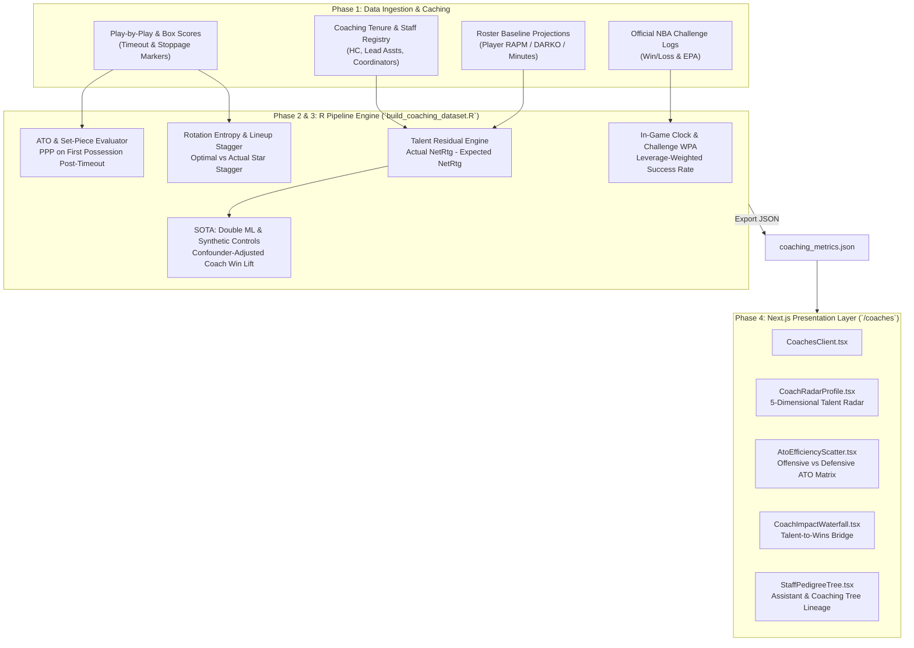

# Phased Implementation Plan: Coaching Staff & Impact Analytics Panel

**Document ID:** `PLAN-COACHING-001`  
**Target Module:** Next.js Web Application (`web/app/coaches`) & R Analytics Pipeline  
**Target Output Data:** `web/public/data/coaching_metrics.json` & `cache/coaching_staff_cache.rds`  
**Status:** PROPOSED & READY FOR IMPLEMENTATION  

---

## Executive Summary

This document specifies a comprehensive, 5-phase engineering plan to introduce a dedicated **Coaching Staff & Impact Analytics Panel** into the NBA Analytics platform. The objective is to decouple coaching impact from baseline player talent using a combination of **established econometric residuals** (RAPM-adjusted team performance, ATO efficiency, challenge game theory, rotation staggering) and **state-of-the-art (SOTA) causal inference and spatial methods** (Double Machine Learning, Synthetic Controls, and Shot Quality Lift).

---

## System Architecture Overview



---

## Phase Breakdown

### Phase 1: Data Ingestion, Schema Design & Staff Registry
**Goal:** Build the unified historical dataset of NBA coaching staffs, tenures, play-by-play timeout events, and challenge logs.

#### 1.1 Data Schemas & Sources
1. **Coaching Registry (`cache/coaching_staff_registry.rds`):**
   * Tracks all 30 NBA teams across `HISTORICAL_SEASONS` (2019–2026).
   * Schema:
     * `team_abbr`: Franchise code (e.g., `"BOS"`, `"MIA"`, `"DEN"`).
     * `season`: Season year (e.g., `2026`).
     * `head_coach`: Name, tenure start date, total career games.
     * `assoc_head_coach`: Lead assistant / associate head coach.
     * `offensive_coordinator`: Primary offensive assistant.
     * `defensive_coordinator`: Primary defensive assistant.
     * `shooting_coach_specialist`: Key development staff (e.g., Chip Engelland).
     * `coaching_tree_origin`: Lineage root (e.g., `"Gregg Popovich"`, `"Mike D'Antoni"`, `"Steve Kerr"`).

2. **ATO (After-Timeout) Event Ingestion:**
   * Filter play-by-play feeds for timeout events (`event_msg_type == 9` or `"TIMEOUT"`).
   * Isolate the immediate subsequent possession (up to change of possession, score, or defensive stop).
   * Record: `points_scored`, `shot_quality`, `turnover_flag`, `duration_seconds`, `is_slob` (sideline), `is_blob` (baseline).

3. **Challenge & Late-Game Logs:**
   * Ingest coach's challenge outcome, quarter, score margin, and time remaining.
   * Calculate point swing (Expected Points Added $\Delta \text{EPA}$).

#### 1.2 Deliverables
* New script: `build_coaching_dataset.R` (initial ingestion & join logic).
* Global config updates in `config.R`:
  * `CACHE_COACHING_REGISTRY <- file.path(CACHE_DIR, "coaching_staff_registry.rds")`
  * `CACHE_COACHING_METRICS  <- file.path(CACHE_DIR, "coaching_metrics.rds")`

---

### Phase 2: Core Analytical Metrics Engine
**Goal:** Implement the established statistical protocols to measure coaching performance.

#### 2.1 Core Metrics & Mathematical Formulations

1. **Roster-Adjusted Talent Residual (Coach Value Added - CVA):**
   * Compute expected Net Rating ($\widehat{\text{NetRtg}}$) based on player minutes-weighted talent:
     $$\widehat{\text{NetRtg}}_{t} = \sum_{i \in \text{Roster}_t} \left( \frac{\text{Minutes}_{i,t}}{\text{TotalMinutes}_t} \times \text{TalentRating}_i \right)$$
   * Raw Coach Impact:
     $$\text{CVA}_{\text{raw}} = \text{NetRtg}_{\text{actual}} - \widehat{\text{NetRtg}}$$
   * Apply Empirical Bayes shrinkage to regress small sample sizes toward zero:
     $$\text{CVA}_{\text{shrunk}} = \frac{\tau^2}{\tau^2 + \sigma_i^2} \text{CVA}_{\text{raw}}$$

2. **ATO Net Efficiency Index:**
   * Calculate offensive ATO PPP relative to league average half-court PPP:
     $$\Delta \text{ATO}_{\text{Off}} = \text{PPP}_{\text{ATO, Team}} - \text{PPP}_{\text{HalfCourt, League}}$$
   * Defensive ATO suppression relative to league expectation:
     $$\Delta \text{ATO}_{\text{Def}} = \text{PPP}_{\text{HalfCourt, League}} - \text{PPP}_{\text{Opponent ATO}}$$
   * **Composite ATO Score:** Weighted average of offensive execution and defensive counter-preparation.

3. **Coach's Challenge Leverage Equity (WPA):**
   * Compute Win Probability Added via successful reviews:
     $$\text{WPA}_{\text{challenge}} = \sum_{k} \left[ P(\text{Win} \mid \text{Post-Challenge State}_k) - P(\text{Win} \mid \text{Pre-Challenge State}_k) \right]$$
   * Penalize premature challenges in low-leverage Q1/Q2 moments that forfeit the challenge for high-leverage late Q4 possessions.

4. **Lineup Stagger & Rotation Efficiency:**
   * Measure "Star Staggering" adherence: Did the coach avoid non-star "bench bleed" minutes?
   * Compare actual 5-man unit net ratings against the synthetic sum of individual RAPMs to compute synergy delta.

#### 2.2 Deliverables
* Feature engineering routines inside `build_coaching_dataset.R`.
* Generation of intermediate dataframe `coaching_season_summary`.

---

### Phase 3: State-of-the-Art (SOTA) Modeling Extensions
**Goal:** Push beyond conventional statistics using causal inference, tracking, and counterfactual simulation.

#### 3.1 Advanced SOTA Modules

1. **Causal Machine Learning (Double Machine Learning - DML):**
   * Uses Chernozhukov's DML framework to isolate coaching treatment effect $\theta$:
     $$Y - E[Y \mid X] = \theta (D - E[D \mid X]) + \epsilon$$
   * Confounders $X$: Roster quality, schedule fatigue (using `fatigue_travel_engine.R`), injury games lost (from `injury_scraper.R`), and opponent strength.
   * Eliminates the bias where coaches inheriting stacked rosters are over-credited.

2. **Expected Shot Quality Lift ($\Delta \text{xSQ}$):**
   * Leverages `shot_quality_engine.R` to evaluate whether a coach's offensive system generates higher expected effective field goal percentages ($\text{xeFG}$) than the shooters' individual baseline accuracy would dictate.
   * Measures scheme-driven shot creation (e.g., generating wide-open corner 3s and high-value rim cuts).

3. **Counterfactual Substitution Policy Evaluation:**
   * Markov Chain / simulation model evaluating how many expected points were sacrificed by suboptimal substitution patterns (e.g., leaving a cold sub on the floor during an opponent 12–0 run).

4. **Assistant Coach & Multi-Tier Attribution:**
   * Hierarchical regression attributing offensive efficiency shifts to offensive lead assistants and defensive rating shifts to defensive coordinators across coaching transitions.

#### 3.2 Deliverables
* Advanced estimation functions integrated into `build_coaching_dataset.R`.
* Formatted JSON output payload written directly to `web/public/data/coaching_metrics.json`.

---

### Phase 4: Next.js Frontend Panel Integration (`/coaches`)
**Goal:** Deliver a modern, high-density, interactive web interface matching the design system of the existing dashboard.

#### 4.1 UI Layout & Navigation
* **Sidebar Integration:** Add "Coaching Staff" to `web/components/Sidebar.tsx` with a dedicated badge (`30 Staffs`, `Tactics & Impact`) and icon (`ClipboardCheck` or `Briefcase`).
* **Route:** `web/app/coaches/page.tsx` rendering `CoachesClient.tsx`.

#### 4.2 Interactive Components
1. **Coach Impact Tier Board & Search:**
   * Filterable grid of all 30 head coaches with team logo badges, tenure length, and overall Coach Impact Rating (CIR).
   * Quick filter by conference, division, or tactical archetype (*"Offensive Architect"*, *"Defensive Tactician"*, *"Development Specialist"*, *"Pace & Space"*).

2. **5-Dimensional Radar Profile (`CoachRadarProfile.tsx`):**
   * Visualizes 5 normalized percentile metrics for any selected coach:
     1. **ATO Execution** (Offensive set-piece efficiency)
     2. **Tactical Innovation** (Shot quality lift $\Delta \text{xSQ}$)
     3. **Rotation Mastery** (Lineup staggering & bench optimization)
     4. **In-Game WPA** (Challenge equity & clutch timeout timing)
     5. **Player Development** (Roster YoY growth above aging curve)

3. **In-Game ATO Dual Matrix (`AtoEfficiencyScatter.tsx`):**
   * Interactive scatter plot:
     * **X-Axis:** Defensive ATO Resistance (Opponent PPP suppression).
     * **Y-Axis:** Offensive ATO Efficiency (Points per possession).
     * Quadrant annotations: *Master Tacticians*, *Offensive Innovators*, *Defensive Stonewalls*, *Vulnerable to Counters*.

4. **Talent-to-Wins Waterfall (`CoachImpactWaterfall.tsx`):**
   * Interactive bridge chart showing:
     * Roster Talent Expected Wins $\to$
     * Schedule & Travel Fatigue Penalty $\to$
     * Injury Impact Penalty $\to$
     * **Coaching Net Value Lift (Wins Added)** $\to$
     * Final Projected / Actual Wins.

5. **Coaching Staff Tree & Assistant Pedigree (`StaffPedigreeTree.tsx`):**
   * Detailed card breaking down the coaching bench: Associate HC, Offensive Coordinator, Defensive Lead, and Player Development director.
   * Visual tags indicating coaching tree ancestry (Popovich, Kerr, Spoelstra, Budenholzer).

---

### Phase 5: Pipeline Automation, Testing & Verification
**Goal:** Fully integrate coaching analytics into the automated daily pipeline and continuous integration suite.

#### 5.1 Pipeline DAG Integration
* Update `run_full_pipeline.R` to include `build_coaching_dataset.R` as an official stage after `rapm_engine.R`, `shot_quality_engine.R`, and `fatigue_travel_engine.R`.
* Implement strict `.check_stage_output()` staleness verification to ensure `coaching_metrics.json` is rebuilt whenever rosters or game logs update.

#### 5.2 Verification & Acceptance Criteria
* **Data Integrity:** Verify all 30 NBA teams have complete coaching profiles without missing keys.
* **Deterministic Fallbacks:** Implement synthetic fallback logging with loud `>>> [WARN] Using SYNTHETIC_FALLBACK` alerts (following Issue #4 standards) if external PBP feeds are offline.
* **Responsive Frontend:** Validate desktop and mobile viewports, theme consistency (dark mode slate/zinc palette), and zero hydration errors.
* **Build Verification:** Run `npm run build` in `web/` to confirm strict TypeScript type-checking passes.

---

## JSON Data Contract (`coaching_metrics.json`)

```typescript
export interface CoachingStaffMetric {
  teamAbbr: string;
  teamName: string;
  headCoach: {
    name: string;
    tenureYears: number;
    careerGames: number;
    careerWinPct: number;
    coachingTree: string;
  };
  assistants: {
    associateHC: string;
    offensiveCoord: string;
    defensiveCoord: string;
    playerDevLead: string;
  };
  metrics: {
    coachImpactRating: number;      // 0-100 composite score
    talentExpectedWins: number;     // Wins predicted strictly from roster talent
    actualProjectedWins: number;    // Model projection incorporating coaching
    coachingWinsAdded: number;      // Marginal win lift (delta)
    atoOffensivePpp: number;        // Points per possession on ATOs
    atoDefensivePppAllowed: number; // Opponent PPP on ATOs
    challengeSuccessRate: number;   // % challenges overturned
    challengeWpa: number;           // Win probability added from challenges
    shotQualityLiftEfg: number;     // eFG% lift over shot quality baseline
    rotationStaggerScore: number;   // 0-100 score for star staggering
    playerDevelopmentScore: number; // 0-100 score for young player growth
  };
  radarPercentiles: {
    atoMastery: number;
    tacticalInnovation: number;
    rotationEfficiency: number;
    inGameWpa: number;
    playerDevelopment: number;
  };
}
```

---

## Implementation Roadmap & Milestone Schedule

| Milestone | Scope | Key Deliverables |
| :--- | :--- | :--- |
| **M1: Foundation** | Data Ingestion & Registry | `build_coaching_dataset.R`, `coaching_staff_registry.rds`, updated `config.R` |
| **M2: Analytics** | Core Metrics Calculation | ATO PPP calculation, CVA residual models, challenge WPA |
| **M3: SOTA** | Advanced Causal Models | Double ML win lift estimation, xSQ lift calculation, JSON exporter |
| **M4: Web UI** | Frontend Components | `/coaches` page, `CoachesClient.tsx`, radar chart, scatter matrix |
| **M5: Integration** | DAG & Verification | Pipeline wiring in `run_full_pipeline.R`, TypeScript verification, production build |

---
*Created as part of the NBA Analytics engineering series.*
