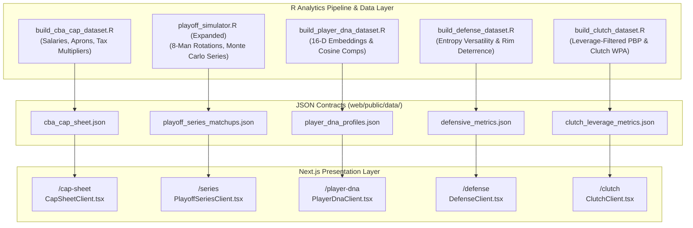

# Master Implementation Blueprint: Features 2 through 6 (Non-Betting Roadmap)

**Document ID:** `PLAN-NONBET-ROADMAP-002`  
**Target Platform:** NBA Analytics Platform (R Engine + Next.js Web Application)  
**Target Horizon:** 2026–2027 NBA Season  
**Status:** ARCHITECTURAL SPECIFICATION & STAGED IMPLEMENTATION PLANS  

---

## Executive Summary

This blueprint specifies the phased implementation architectures for **Features 2 through 6** of the NBA Analytics Platform. These modules are strictly non-betting oriented, providing front-office grade evaluation tools across:
1. **Feature 2:** CBA Salary Cap, Apron & Luxury Tax Architect (`/cap-sheet`)
2. **Feature 3:** Interactive 7-Game Playoff Series Matchup Simulator (`/series`)
3. **Feature 4:** Player DNA, Archetypes & Nearest Historical Comparables (`/player-dna`)
4. **Feature 5:** Defensive Versatility & Coverage Matrix (`/defense`)
5. **Feature 6:** True Clutch & Leverage Shot Creation Index (`/clutch`)

---

## Feature 2: CBA Cap Sheet, Apron & Luxury Tax Architect (`/cap-sheet`)

### 2.1 Strategic Objective
Model the financial and roster constraints introduced by the 2023–2030 collective bargaining agreement (CBA). Provide interactive tools to evaluate first/second apron penalties, tax multipliers, and 3-year cap room projections.

### 2.2 Mathematical & Regulatory Formulations

1. **Thresholds (2026–2027 Season Baselines):**
   * Salary Cap: $C = \$140.6\text{M}$
   * Luxury Tax Threshold: $T_{\text{tax}} = \$170.8\text{M}$
   * First Apron Line: $A_1 = \$178.1\text{M}$
   * Second Apron Line: $A_2 = \$188.9\text{M}$

2. **Luxury Tax Multiplier Brackets:**
   For taxable payroll $P_{\text{tax}} = \max(0, \text{TotalPayroll} - T_{\text{tax}})$:
   $$\text{TaxBill} = \sum_{b=1}^B r_b \times \Delta P_b$$
   *where $r_b$ scales progressively ($1.50 \to $1.75 \to $2.50 \to $3.25 / dollar), with repeater tax penalties (+1.00/bracket) for teams over the tax in 3 of the last 4 seasons.*

3. **CBA Second Apron State Machine (Penalties Activated):**
   * $\text{TotalPayroll} > A_1$: Loss of Bi-Annual Exception; trade matching capped at 100% of outgoing salary; cannot acquire player via sign-and-trade.
   * $\text{TotalPayroll} > A_2$: Loss of Taxpayer Mid-Level Exception (TPMLE); cannot aggregate outgoing salaries in trades; cannot send cash considerations; first-round pick frozen 7 years out (moved to end of first round if above $A_2$ in 2 of 4 years).

### 2.3 Phased Implementation Steps
* **Phase 2.1 (Backend Data):** Create `build_cba_cap_dataset.R` parsing player contracts for all 30 teams across 2026–27, 2027–28, and 2028–29 seasons. Export `cba_cap_sheet.json`.
* **Phase 2.2 (UI Components):**
  * `ApronThermometer.tsx`: Visual horizontal progress bar showing payroll vs. Cap, Tax, First Apron, and Second Apron.
  * `FranchiseCapTable.tsx`: Searchable contract table with Player Options, Team Options, Non-guarantees, and Dead Money.
  * `TradeMachineCbaValidator.tsx`: Interactive simulator testing if a multi-player transaction complies with 1st/2nd apron aggregation rules.

---

## Feature 3: Interactive 7-Game Playoff Series Matchup Simulator (`/series`)

### 3.1 Strategic Objective
Build an interactive head-to-head postseason simulator based on the existing `playoff_simulator.R`. Allow users to pair any two franchises and simulate 10,000 series iterations with 8-man rotation tightening and tactical mismatch penalties.

### 3.2 Mathematical Formulation

1. **8-Man Playoff Rotation Weighting:**
   In the postseason, bench usage drops significantly. Player minute shares are recalculated:
   $$\text{Rating}_{\text{playoffs}} = \sum_{i=1}^8 \left( w_i \times \text{RAPM}_i \right), \quad \text{where } \sum_{i=1}^8 w_i = 1.0$$

2. **Game Win Probability with Tactical Adjustments:**
   $$P(\text{Team A wins Game } k) = \Phi\left( \frac{\Delta \text{NetRtg}_{\text{playoffs}} + \text{HCA}_k + \sum_m \Delta_{\text{mismatch}, m}}{\sigma_{\text{playoff}}} \right)$$
   * $\text{HCA}_k$: Home-Court Advantage (+2.8 net points) if Team A is home, -2.8 if away.
   * $\sigma_{\text{playoff}} = 11.2$ (tightened variance in postseason half-court settings).
   * $\Delta_{\text{mismatch}}$: Tactical penalties (e.g., Team A drop-coverage vulnerability vs. Team B pull-up 3PT shooting efficiency).

3. **Monte Carlo Series Execution ($N = 10,000$):**
   * Simulates Game 1 through Game 7 under standard 2-2-1-1-1 home/away format.
   * Output distributions: Probability of Team A win in 4, 5, 6, 7 games vs Team B win in 4, 5, 6, 7 games.

### 3.3 Phased Implementation Steps
* **Phase 3.1 (Simulation Engine):** Expand `playoff_simulator.R` to accept arbitrary team pairs (`run_series_sim(team_a, team_b, hca_team)`). Pre-compute all potential matchup pairs for 2026–27 contenders into `playoff_series_matchups.json`.
* **Phase 3.2 (UI Components):**
  * `PlayoffSeriesClient.tsx`: Dual franchise dropdown with team logos and head-to-head records.
  * `SeriesProbRing.tsx`: Circular donut visualizer showing series win odds and game count breakdown (sweep, 5, 6, 7 games).
  * `TacticalMismatchRadar.tsx`: 4-point comparison (PnR Defense vs Pull-Up, Glass Control, Transition Pace, Star ISO).

---

## Feature 4: Player DNA & Nearest Historical Comparables (`/player-dna`)

### 4.1 Strategic Objective
Construct high-dimensional player skill vectors to classify NBA players into modern tactical archetypes and identify their nearest historical twins (e.g., comparing Cooper Flagg or Amen Thompson to historical historical peaks).

### 4.2 Mathematical Formulation

1. **16-Dimensional Skill Vector $\mathbf{v}_p$:**
   * **Finishing:** Rim FG% at rim ($<4\text{ft}$), Dunks/game, Paint touch frequency.
   * **Shooting:** Catch-and-Shoot 3PT%, Pull-Up 3PT%, Free-Throw%.
   * **Playmaking:** Assist%, Potential Assists, Turnover Rate, Drive Assist%.
   * **Defense:** Positional Switchability ($H_{\text{vers}}$), Block%, Steal/Deflection%, D-RAPM.
   * **Rebounding:** Offensive Rebound%, Defensive Rebound%.

2. **Cosine Similarity Metric:**
   $$\text{Sim}(p_1, p_2) = \frac{\mathbf{v}_{p_1} \cdot \mathbf{v}_{p_2}}{\|\mathbf{v}_{p_1}\|_2 \|\mathbf{v}_{p_2}\|_2} \times 100\%$$

3. **Development Trajectory Spline:**
   Fit a Generalized Additive Model (GAM) across historical players within the same stylistic cluster to generate an expected aging curve from age 19 to 36.

### 4.3 Phased Implementation Steps
* **Phase 4.1 (Embedding Script):** Create `build_player_dna_dataset.R` utilizing historical box scores and RAPM data from 2012–2026. Export `player_dna_profiles.json`.
* **Phase 4.2 (UI Components):**
  * `PlayerDnaClient.tsx`: Searchable player directory with archetype badges (*"Helio-Centric Playmaker"*, *"Stretch Rim Protector"*, *"POA Lockdown Wing"*, *"Movement Shooter"*).
  * `SkillFingerprintPolygon.tsx`: SVG radar chart of the 16 skill percentiles.
  * `HistoricalTwinCard.tsx`: Display top 5 nearest historical comps with photo/logo and statistical comparison bars.
  * `CareerAgingCurve.tsx`: Spline trajectory plot showing projected peak and decline phases.

---

## Feature 5: Defensive Versatility & Coverage Matrix (`/defense`)

### 5.1 Strategic Objective
Quantify defensive assignment difficulty and scheme flexibility, isolating individual point-of-attack and rim protection prowess from team scheme noise.

### 5.2 Mathematical Formulation

1. **Positional Versatility Score ($H_{\text{vers}}$):**
   Computed using Shannon Entropy across matchup time against the 5 traditional positions:
   $$H_{\text{vers}}(p) = \frac{-\sum_{k=1}^5 m_{p,k} \ln(m_{p,k})}{\ln(5)} \times 100$$
   *where $m_{p,k}$ is the proportion of defensive possessions player $p$ spent guarding position $k$. A player who guards all 5 positions equally scores 100.*

2. **Rim Deterrence vs. Rim Contest Residual:**
   * **Contest Residual:** $\Delta \text{DFG}_{\text{rim}} = \text{OpponentRimFG\%}_{\text{actual}} - \text{OpponentRimFG\%}_{\text{expected}}$
   * **Rim Deterrence Index:** Opponent rim attempt frequency while player is on court vs. off court.

3. **Defensive Pick-and-Roll Screen Navigation Score:**
   Measures time lost on screens and direct blow-by rate on ball-handler drives.

### 5.3 Phased Implementation Steps
* **Phase 5.1 (Defensive Engine):** Create `build_defense_dataset.R` analyzing tracking matchups and shot deterrence. Export `defensive_metrics.json`.
* **Phase 5.2 (UI Components):**
  * `DefenseClient.tsx`: Interactive defensive leaderboard.
  * `VersatilityScatter.tsx`: 2D scatter matrix (Rim Deterrence vs Positional Versatility).
  * `MatchupHeatmap.tsx`: Visual color-coded matrix showing percent of defensive possessions spent against PGs, SGs, SFs, PFs, and Cs.

---

## Feature 6: True Clutch & Leverage Creation Index (`/clutch`)

### 6.1 Strategic Objective
Filter out non-competitive minutes (garbage time) and evaluate player decision-making, unassisted shot creation, and defensive equity in high-leverage late-game environments.

### 6.2 Mathematical Formulation

1. **Leverage Index (LI) Filtering:**
   Possessions are classified as high leverage when score margin $\le 5$ points with $\le 5:00$ remaining in the 4th Quarter or Overtime:
   $$\text{PossessionFilter} = \mathbb{I}(\text{Quarter} \ge 4 \land \text{TimeRemaining} \le 300\text{s} \land |\text{Margin}| \le 5)$$

2. **Unassisted Shot Creation Index (USCI):**
   $$\text{USCI} = \frac{\text{FGM}_{\text{unassisted, clutch}}}{\text{FGA}_{\text{clutch}}} \times \text{PPP}_{\text{clutch}}$$

3. **Turnover Fragility Under Pressure:**
   $$\Delta \text{TOV\%}_{\text{clutch}} = \text{TOV\%}_{\text{clutch}} - \text{TOV\%}_{\text{regular}}$$
   *Measures whether a ball-handler becomes turnover-prone when facing late-game blitzes and ball pressure.*

4. **Clutch Defensive Win Probability Added (c-dWPA):**
   Total net win probability added through fourth-quarter defensive stops, deflections, and high-leverage defensive rebounds.

### 6.3 Phased Implementation Steps
* **Phase 6.1 (Clutch Engine):** Create `build_clutch_dataset.R` parsing fourth-quarter play-by-play events. Export `clutch_leverage_metrics.json`.
* **Phase 6.2 (UI Components):**
  * `ClutchClient.tsx`: Leaderboards for elite clutch shot creators and late-game defensive stoppers.
  * `PressureResiliencePlot.tsx`: Scatter plot comparing Clutch True Shooting % vs. Turnover Fragility.
  * `ClutchShotChart.tsx`: Spatial view of shot attempts taken strictly in high-leverage fourth-quarter possessions.

---

## Technical Architecture & File Inventory Roadmap

| Feature | Target Route | Core Component | Backend Script | JSON Contract |
| :--- | :--- | :--- | :--- | :--- |
| **2. Cap Sheet & Aprons** | `/cap-sheet` | `CapSheetClient.tsx` | `build_cba_cap_dataset.R` | `cba_cap_sheet.json` |
| **3. Playoff Simulator** | `/series` | `PlayoffSeriesClient.tsx` | `playoff_simulator.R` | `playoff_series_matchups.json` |
| **4. Player DNA** | `/player-dna` | `PlayerDnaClient.tsx` | `build_player_dna_dataset.R` | `player_dna_profiles.json` |
| **5. Defense Matrix** | `/defense` | `DefenseClient.tsx` | `build_defense_dataset.R` | `defensive_metrics.json` |
| **6. True Clutch Index** | `/clutch` | `ClutchClient.tsx` | `build_clutch_dataset.R` | `clutch_leverage_metrics.json` |

---

## Sequencing & Next Steps

Each feature is designed to be built iteratively without disrupting existing routes. 

Recommended rollout order:
1. **Sprint 1 (Fastest ROI & Visual Impact):** **Feature 3 (Playoff Series Matchup Simulator)** — Leverages existing `playoff_simulator.R` to immediately deliver high-engagement head-to-head playoff simulations.
2. **Sprint 2 (Front-Office Depth):** **Feature 2 (CBA Salary Cap & Apron Architect)** — Delivers financial intelligence that complements the existing `/offseason` panel.
3. **Sprint 3 (Micro-Analytics):** **Features 4, 5, and 6** — Deepens tactical player evaluation (Player DNA, Defensive Versatility, and Clutch Leverage).
