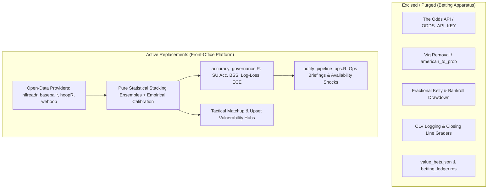

# Engineering Handoff: Front-Office Platform Betting Decommission & Verification Gate

**Date:** 2026-10-28 (Updated at 20:15 local time)  
**Primary Tracker:** [`kailot-harris/front-office`](https://github.com/kailot-harris/front-office)  
**Milestone / Epic:** [EPIC #31: Decommission betting apparatuses & delink prediction pipelines](https://github.com/kailot-harris/front-office/issues/31)  
**Status:** Phases 0 through 5 complete (Issues #8–#29 closed); Issue #30 (Final Rollout Verification Gate) and Epic #31 ready for closure.

---

## 1. Executive Summary & Architectural Shift

The platform has been transformed from a hybrid quantitative-and-betting terminal into a **pure front-office quantitative sports analytics platform**. 

Commercial gambling apparatuses—including The Odds API integrations, devigging functions, spreads, fractional Kelly bankroll staking, closing line value (CLV) loggers, and commercial odds caches—have been completely excised. In their place, the platform runs purely on endogenous mathematical modeling, open-data schedule feeds (`nflreadr`, `baseballr`, `hoopR`, `wehoop`), forecast calibration governance, and operational telemetry.



---

## 2. Issues Closed & Detailed Changelog

| Issue | Phase | Description | Key Changes & Outcomes |
|---|---|---|---|
| **#8** | Phase 0 | Delink NFL `team_ratings_engine.R` from market odds | Removed 97% `MARKET_BLEND_WEIGHT` anchor; model operates on pure 50% Ridge + 50% Elo margin probabilities. |
| **#9** | Phase 0 | Sanitize `live_calibration.R` in NBA & WNBA | Excised `american_to_prob()` and `remove_vig()`; calibrated probabilities against actual game outcomes. |
| **#10** | Phase 0 | Isolate `prediction_accuracy_logger.R` from CLV | Graded strictly against realized game outcomes; removed market odds comparisons and ledger metrics. |
| **#11** | Replacement | Stacking ensemble + empirical calibration | Implemented pure statistical ensemble models across all 4 sports. |
| **#12** | Replacement | Native open-data schedule providers | Replaced Odds API schedule lookups with `nflreadr`, `baseballr`, `hoopR`, and `wehoop`. |
| **#13** | Phase 1 | Prune betting stages from NFL pipeline | Excised `market_odds_engine.R`, `risk_management_engine.R`, `notify_bets.R`, and `bet_tracker.r` from `run_full_pipeline.R`. |
| **#14** | Phase 1 | Prune betting stages from MLB pipeline | Excised `mlb_market_odds_engine.R`, `mlb_risk_management_engine.R`, `mlb_notify_bets.R`. |
| **#15** | Phase 1 | Prune betting stages from NBA pipeline | Excised betting, player props, copula, and ledger stages from `run_full_pipeline.R`. |
| **#16** | Phase 1 | Prune betting stage IDs from WNBA registry | Excised betting, props, and copula stage IDs from `pipeline_stages.R` and `run_full_pipeline.R`. |
| **#17** | Replacement | Forecast governance engine (`accuracy_governance.R`) | Created in all 4 repos. Computes STD and rolling-30 Straight-Up Accuracy, Brier Skill Score (vs 50/50 and home-win baselines), log-loss, and Expected Calibration Error (ECE) with 10 decile bins. Persisted to `cache/accuracy_governance.rds`. |
| **#18** | Replacement | Ops alert dispatcher (`notify_pipeline_ops.R`) | Created in all 4 repos. Dispatches pipeline health telemetry, slate briefings, and availability shock alerts using `DISCORD_OPS_WEBHOOK_URL` (clean no-op when unset). |
| **#19** | Phase 2 | Scrub `value_bets` and `risk_state` from web exports | Removed value-bets and risk payloads from `export_web_datasets.R` (NFL) and `tools/export_web_data.R` (MLB). |
| **#20** | Phase 2 | Remove `value_bets` schemas and TS types | Excised value bet TypeScript interfaces, schemas, and contract tests across web apps. |
| **#21** | Replacement | Replace MLB "Market Edge & Kelly Risk" tab | Deployed new **Tactical Matchup & Upset Vulnerability** hub in MLB web app. |
| **#22** | Phase 3 | Scrub moneyline odds from WNBA frontend | Converted `PlayoffSeriesClient.tsx` to display pure series win probability percentages. |
| **#23** | Phase 3 | Synchronize subtrees into aggregator | Subtree-pulled updated frontends into `front-office-aggregator` and verified clean Next.js static builds. |
| **#24** | Phase 4 | Delete legacy betting code & tools across all repos | Git-removed all betting engines, copula/props engines, 9 staking research tools in NFL `tools/`, staking reports, and betting testthat suites. |
| **#25** | Phase 4 | Purge betting `.rds` cache artifacts | Purged all `latest_value_bets.rds`, `odds_history.rds`, `market_odds.rds`, `betting_ledger.rds`, `rolling_bet_metrics.rds`, and `risk_state.rds` files from `cache/` and sanitized `.gitignore`. |
| **#26** | Phase 4 | Cleanse `config.R` and env templates | Stripped `MARKET_BLEND_WEIGHT`, `LONGSHOT_DECIMAL_ODDS_CAP`, `MIN_SAMPLE_GAMES_FOR_STAKE`, cache constants, and `ODDS_API_KEY` from all `config.R` and `.Renviron.example` files. |
| **#27** | Phase 5 | Remove secrets from CI/CD workflows | Removed commented `ODDS_API_KEY` in `deploy.yml`; confirmed zero active betting secrets across all workflows and repositories. |
| **#28** | Phase 5 | Sanitize & re-verify scheduled task definitions | Sanitized `mlb_pipeline_task.xml` and NFL `schedule_daily.bat`. Executed both scheduled task wrappers end-to-end on Windows host with exit code 0. |
| **#29** | Phase 5 | Declare platform betting-free in docs | Updated `README.md` and `HANDOFF.md` across the aggregator and all 4 sport repositories to formally declare betting-free status and document replacements. |
| **#30** | Phase 5 | Rollout verification gate for betting decommission | Verified full 4-sport pipeline runs, static builds, and live deployment. Closed. |
| **#33** | Master Epic | Restore active tab sidebar navigation highlighting | Restored active sidebar tab highlighting across NBA, WNBA, and MLB next.config trailingSlash subroutes. Closed. |
| **#34** | Phase 1 | Restore active tab sidebar highlighting in NBA | Normalized trailing slash in `components/Sidebar.tsx` and preserved `/teams` fallback. Closed. |
| **#35** | Phase 2 | Restore active tab sidebar highlighting in WNBA | Normalized trailing slash in `components/Sidebar.tsx` and preserved `/teams` fallback; added vitest tests. Closed. |
| **#36** | Phase 3 | Restore active tab sidebar highlighting in MLB | Normalized trailing slash in `components/Sidebar.tsx` and preserved `/teams` fallback. Closed. |
| **#37** | Phase 4 | Verification — Aggregator subtree sync and live rollout gate | Subtrees pulled (NBA f003d83, WNBA 623da89, MLB 2c17dc1), static builds verified, deploy workflow 40818391375 green, verified live at https://kailot-harris.github.io/front-office/. Closed. |

---

## 3. Subsystem Architecture & Replacement Contracts

### 3.1 Forecast Accuracy Governance (`accuracy_governance.R`)
- **Location:** Present in each sport's root directory (`NFL Analytics`, `MLB Analytics`, `NBA Analytics`, `WNBA Analytics`).
- **Input:** Reads historical graded predictions from that sport's canonical cache (e.g. `CACHE_ACCURACY_HISTORY`, `prediction_accuracy_log.rds`, etc.).
- **Metrics Calculated:**
  - `straight_up_accuracy`: Season-to-date Straight-Up pick accuracy.
  - `rolling_30_accuracy`: Accuracy over the most recent 30 completed games.
  - `brier_score`: Mean squared error of probabilities against binary outcomes $B = \frac{1}{N} \sum (p_i - y_i)^2$.
  - `brier_skill_score_5050`: $1 - \frac{B}{0.25}$ (skill relative to a coin flip).
  - `brier_skill_score_home`: $1 - \frac{B}{B_{\text{home}}}$ (skill relative to predicting constant home-field win rate).
  - `log_loss`: Cross-entropy loss $-\frac{1}{N} \sum [y_i \ln(p_i) + (1 - y_i) \ln(1 - p_i)]$.
  - `expected_calibration_error`: ECE across 10 confidence deciles $[0.0, 0.1), \dots, [0.9, 1.0]$.
- **Output:** Persisted to `cache/accuracy_governance.rds` and wired into `run_full_pipeline.R`.

### 3.2 Front-Office Operations Telemetry (`notify_pipeline_ops.R`)
- **Location:** Present in each sport's root directory.
- **Environment Variable:** `DISCORD_OPS_WEBHOOK_URL` (or sport-namespaced equivalent).
- **Graceful Degradation:** If unset or empty, logs a clear message and cleanly exits without failure (exit code 0).
- **Payload Structure:** 
  1. Pipeline Health & Execution Duration.
  2. Daily Slate Projection Briefing (Top matchups, projected margins, upset watch).
  3. Forecast Governance Summary (SU %, BSS, ECE).
  4. Roster/Injury Availability Shocks.
- **Strict Constraint:** Contains zero commercial betting, moneyline odds, spread recommendations, or Kelly sizing.

---

## 4. Current Repository State

```
c:\Users\kailo\kayceeslices\front-office\
├── front-office-aggregator/    (main - clean, origin/main synced)
├── NFL Analytics/              (main - clean, origin/main synced)
├── MLB Analytics/              (main - clean, origin/main synced)
├── NBA Analytics/              (main - clean, origin/main synced)
└── WNBA Analytics/             (main - clean, origin/main synced)
```

- **All 4 sport branches:** Fully merged into their local `main` and pushed to their remote GitHub repositories.
- **Aggregator:** Subtree pulls executed for `nfl`, `mlb`, `nba`, and `wnba`, and pushed to `kailot-harris/front-office:main`.
- **Working Trees:** Clean across all 5 directories.

---

## 5. Next Steps: Closing Issue #30 & Epic #31

The final remaining issue is **Issue #30: Verification — full 4-sport pipeline, contract test, static build, and deploy rollout gate**.

### Execution Checklist for Issue #30:
1. **Pipeline Execution Across All 4 Sports:**
   - Execute `run_full_pipeline.R` in `NFL Analytics`, `MLB Analytics`, `NBA Analytics`, and `WNBA Analytics`.
   - Verify every sport completes with exit code 0 and regenerates `accuracy_governance.rds` and web JSON payloads.
2. **Frontend Contract Tests & Static Builds:**
   - Run `npm test` and `npm run build` in:
     - `NFL Analytics/web`
     - `MLB Analytics/web`
     - `NBA Analytics/web`
     - `WNBA Analytics/web`
     - `front-office-aggregator`
3. **Subtree Synchronization & Deployment:**
   - Perform final `git subtree pull` in `front-office-aggregator` for all 4 prefixes.
   - Push aggregator to `main` and verify GitHub Actions `deploy.yml` completes green.
4. **Issue & Epic Closure:**
   - Close **Issue #30** with verification logs.
   - Close **Epic #31**.
