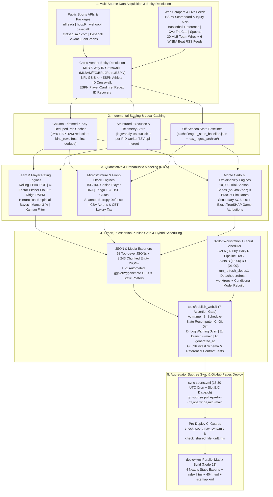

# Front Office — Multi-Sport Probabilistic Analytics & Data Engineering Platform

[](https://kailot-harris.github.io/front-office/)
[](https://kailot-harris.github.io/front-office/)
[](https://kailot-harris.github.io/front-office/)
[](#data-quality--publish-governance)
[](#academic-context--zero-betting-policy)

**Live Production Site:** **https://kailot-harris.github.io/front-office/**

**Front Office** is a unified, multi-sport quantitative analytics, salary-cap economics, and probabilistic forecasting platform spanning **56 interactive modules** across the **NFL, NBA, WNBA, and MLB**. Built as a companion engineering project for a university **Data Acquisition and Management** course, it demonstrates end-to-end automated data acquisition across 15+ heterogeneous sources, cross-vendor entity resolution, memory-bounded incremental caching (`.rds` & DuckDB), regularized regression and Monte Carlo simulation engines in R, a 7-assertion pre-publish verification gate, and static Next.js publishing via GitHub Pages.

### Current League Operational Status (2026–2027 Slate)

| League | Base Route | Operational Mode | Automated Refresh Cadence | Modules | Primary Accent / Pip |
| :--- | :--- | :--- | :--- | :---: | :--- |
| **NFL** | [`/front-office/nfl/`](https://kailot-harris.github.io/front-office/nfl/) | **In-Season (Live Slate)** | Daily 09:00 R DAG (Slot A) + 18:00 & 01:00 Live Score/Model Refresh (Slots B/C) | **13** | Emerald (`#34d399`) |
| **NBA** | [`/front-office/nba/`](https://kailot-harris.github.io/front-office/nba/) | **In-Season (Live Slate)** | Daily 09:00 R DAG (Slot A) + 18:00 & 01:00 Live Score/Model Refresh (Slots B/C) | **14** | Orange (`#fb923c`) |
| **WNBA** | [`/front-office/wnba/`](https://kailot-harris.github.io/front-office/wnba/) | **Off-Season (Weekly Monitor)** | Weekly Monday Transaction Wire Reconciler + Daily Scoreboard Slot Check | **15** | Violet (`#a78bfa`) |
| **MLB** | [`/front-office/mlb/`](https://kailot-harris.github.io/front-office/mlb/) | **Off-Season (Weekly Monitor)** | Weekly Monday Transaction Wire Reconciler + CBT Payroll Sync | **14** | Sky (`#38bdf8`) |

---

## 5-Minute Quick-Start Tour

If you only have 5 minutes to evaluate the platform, visit these five modules in order:

1. **[Portal Hub & Instant Module Filter (`/front-office/`)](https://kailot-harris.github.io/front-office/)**  
   Press `/` on your keyboard and type `clutch`, `dna`, `cap`, or `diagnostics` to filter all 56 modules across four leagues in real time, or toggle the 360° Championship Hardware Showcase (which automatically degrades to static `.webp` posters under `prefers-reduced-motion: reduce`).
2. **[NBA Matchup Slates & TreeSHAP Game Explainability (`/front-office/nba/matchups/`)](https://kailot-harris.github.io/front-office/nba/matchups/)** *(or [NFL Weekly Matchups](https://kailot-harris.github.io/front-office/nfl/matchups/))*  
   Click any game card on an active in-season slate to open its chunked per-game drawer (`data/games/{game_id}.json` and `data/explainability/{game_id}.json`), surfacing pre-game win probabilities, circadian travel/rest fatigue penalties, injury availability impacts, and exact XGBoost TreeSHAP feature attributions.
3. **[NFL Calibration Diagnostics & Accuracy Governance (`/front-office/nfl/diagnostics/`)](https://kailot-harris.github.io/front-office/nfl/diagnostics/)** *(or [MLBModel Variants](https://kailot-harris.github.io/front-office/mlb/variants/))*  
   Inspect out-of-sample Brier score, log-loss, and decile calibration reliability curves. Notice the strict provenance separation between genuine pre-game forecasts logged prior to kickoff (`LOGGED_PREGAME`) and walk-forward historical backtests (`BACKTEST_PREWEEK`).
4. **[MLB Competitive Balance Tax (CBT) & Payroll Architect (`/front-office/mlb/cap-sheet/`)](https://kailot-harris.github.io/front-office/mlb/cap-sheet/)** *(or [NBA Cap & Aprons](https://kailot-harris.github.io/front-office/nba/cap-sheet/))*  
   Explore multi-year guaranteed contract obligations (2026–2028), progressive luxury tax brackets (Base \$244M through Tier 3 \$304M Cohen Tax + repeater surcharges), and an interactive contract Surplus Value Calculator ($\text{WAR} \times \$8.5\text{M} - \text{Salary}$).
5. **[MLB 2026–2027 Off-Season Dynamics Monitor (`/front-office/mlb/offseason-monitor/`)](https://kailot-harris.github.io/front-office/mlb/offseason-monitor/)** *(or [WNBA Off-Season Monitor](https://kailot-harris.github.io/front-office/wnba/offseason-monitor/))*  
   See how out-of-season leagues transition from daily game simulations to weekly state reconciliation ($S_t = S_{\text{last}} \oplus \Delta S_{\text{confirmed}}$), separating official MLB Stats API / WNBA wire transactions from beat-writer RSS rumors with a fail-closed quiet-week health gate.

---

## System Architecture

Front Office uses a **hub-and-subtrees multi-repository architecture**. Each sport (`nfl`, `nba`, `wnba`, `mlb`) is developed and scheduled in its own standalone repository containing its R data-acquisition pipeline, local `.rds`/DuckDB caches, analytical engines, and a Next.js (`output: 'export'`) frontend under `<sport>/web/`. Changes published to a sport repository's `main` branch are pulled into this aggregator repository via `git subtree pull` (preserving full commit history) and compiled into a single unified static site.



### Lifecycle Pipeline Walkthrough

1. **Acquisition & Adapter Fail-Safes:** Ingestion scripts (`daily_ingest.R`, `mlb_ingest.R`, `mlb_stats_sync.R`, `injury_scraper.R`, `tools/offseason/ingest_sources.R`) fetch schedules, play-by-play, box scores, rosters, injuries, and contract data. Every external call is wrapped in `tryCatch` with polite rate-limiting (`RATE_LIMIT_SLEEP_SEC = 1.5`, `MAX_RETRIES = 3`) and falls back either to secondary live endpoints (e.g., direct `statsapi.mlb.com` JSON when `baseballr` fails) or to the last verified cache snapshot with an explicit provenance warning.
2. **Incremental Deduplication & Memory Management:** Raw play-by-play feeds are projected down to required feature columns immediately upon load (e.g., `.PBP_CACHE_COLUMNS` in `nfl/daily_ingest.R` reduces 372 `nflreadr` columns / 3.4 GB RAM to 26 columns / 167 MB). Incremental updates bind newly fetched rows *before* existing cached rows (`bind_rows(new_rows, existing) |> distinct(...)`) and perform key-sorted content equality checks so newly finalized scores overwrite preseason `NA` rows even when row counts do not grow.
3. **Fail-Safe DAG Orchestration (`run_full_pipeline.R`):** Each sport's master orchestrator runs 14–18 stages inside `run_stage()`, which uses non-exiting `withCallingHandlers()` to capture deep call stacks before stack unwinding and an outer `tryCatch()` to log stage errors without crashing downstream stages. After every stage, `.check_stage_output()` (Finding C-2 guard) verifies that all declared output files exist and have `mtime >= stage_start`.
4. **7-Assertion Pre-Publish Gate (`tools/publish_web.R`):** No automated run can commit directly to `main` on a bare exit code. `tools/publish_web.R` runs 7 artifact assertions (mtime freshness, independent schedule-to-slate recomputation, non-empty git diff, stage warning scan, `HEAD == main` branch verification, internal `generated_at` payload timestamp check, and the sport's Vitest contract suite). If any fatal assertion fails, nothing is committed and the live site retains its last valid state.
5. **3-Slot Hybrid Refresh Cadence (`tools/run_refresh_slot.ps1`):** Because GitHub Actions scheduled crons empirically suffer 5+ hour delays under platform load, Windows Task Scheduler drives **Slot A (09:00 local)** full pipeline runs and **Slot B (18:00 local) / Slot C (01:00 local)** score refreshes. Slots B and C run `tools/refresh_live_results.R` in isolated detached git worktrees (`.refresh-worktrees/<sport>`). When new final scores are committed for an active in-season sport (`nfl`, `nba`), the runner automatically executes a local model refresh (`Invoke-ModelRefresh`), re-applies live finals so unboxed night games remain graded, and dispatches `sync-sports.yml` → `deploy.yml`.

---

## Data Provenance & Attribution Table

All data ingested by Front Office originates from publicly accessible sports statistics providers, open-source sports analytics packages, and public news RSS feeds. **Zero commercial betting or sportsbook odds APIs are used.**

| League | Domain | Upstream Source / Provider | Acquisition Method & Script | Refresh Cadence | Storage & Published Format | Attribution & Provenance Notes |
| :--- | :--- | :--- | :--- | :--- | :--- | :--- |
| **NFL** | Play-by-Play & Schedules | **nflverse (`nflreadr`)** | `nflreadr::load_pbp()`, `load_schedules()` (`nfl/daily_ingest.R`) | Daily 09:00 (Slot A) | `cache/pbp_cache.rds` (26-col trim), `schedules_cache.rds` → `team_epa_profiles.json`, `matchups_current_week.json` | nflfastR / nflverse open data (2002–2026 seasons). |
| **NFL** | Live Game Scores | **nflverse / ESPN Scoreboard** | `nfl/tools/refresh_live_results.R` | Daily 18:00 (Slot B) & 01:00 (Slot C) | Patches `web/public/data/matchups_current_week.json` & `model_diagnostics.json` | Triggers full NFL model rebuild when new finals land. |
| **NFL** | Rosters & Player IDs | **nflverse (`nflreadr`)** | `nflreadr::load_rosters()`, `load_ff_playerids()` (`nfl/sync_rosters.R`, `player_id_crosswalk.R`) | Daily 09:00 (Slot A) | `cache/rosters_cache.rds`, `player_id_crosswalk.rds` → `player_qb_profiles.json` | Full 53-man (`ACT`), practice squad (`DEV`), and `RES` ledger. |
| **NFL** | Injury Reports | **nflverse + ESPN Site API** | `nflreadr::load_injuries()` + `site.web.api.espn.com/.../nfl/injuries` (`nfl/injury_scraper.R`) | Daily 09:00 (Slot A) | `cache/injury_data_cache.rds` (`data_source`: `NFLREADR_OFFICIAL` / `ESPN_LIVE`) | Recovers ESPN athlete IDs from Player-Card `href` regex. |
| **NFL** | Salary Cap & Contracts | **Over The Cap (OTC)** via `nflreadr` | `nflreadr::load_contracts()` (`nfl/export_web_datasets.R` §8) | Daily 09:00 (Slot A) | `web/public/data/salary_cap_profiles.json` | Active APY, guaranteed money, and positional spend; dead-money heuristics excluded (Issue #48). |
| **NFL** | Next Gen Stats & Passing Zones | **NFL Next Gen Stats** via `nflreadr` | `nflreadr::load_nextgen_stats()` + PBP air-yards/location (`nfl/build_player_dna_dataset.R`, `build_passing_dataset.R`) | Daily 09:00 (Slot A — Stages 14.1–14.3) | `cache/nfl_ngs_*.rds` → `player_dna_profiles.json`, `passing_index.json`, `data/passing/{id}.json` | 12-zone passing depth/direction grids & skill vectors. |
| **NBA** | Team & Player Box Scores | **sportsdataverse (`hoopR`)** | `hoopR::load_nba_team_box()`, `load_nba_player_box()` (`nba/daily_ingest.R`, `tools/refresh_matchups_team_box.R`) | Daily 09:00 (Slot A) | `box_scores_cache.rds`, `cache/nba_player_box_2026.rds` → `projections_season_*.json` | Historical window 2019–2027 (`hoopR` end-year numbering). |
| **NBA** | Play-by-Play, Stints & Possessions | **sportsdataverse (`hoopR`)** | `hoopR::load_nba_pbp()` (`nba/build_stint_dataset.R`, `rapm_engine.R`, `build_tactical_events_dataset.R`) | Daily 09:00 (Slot A) | `cache/nba_pbp_2026.rds`, `stint_lineups.rds`, `pbp_timeout_cache.rds`, `rapm_ratings.rds` | Drives L2 Ridge ORAPM/DRAPM, empirical ATO PPP, challenge rates, and USCI clutch metrics. |
| **NBA** | Live Scoreboard & Box Verification | **ESPN Site API** | `site.api.espn.com/.../basketball/nba/scoreboard` (`nba/tools/espn_scoreboard.R`, `refresh_live_results.R`) | Daily 18:00 (Slot B) & 01:00 (Slot C) | Patches `web/public/data/matchups_slates.json` (`data/games/{id}.json`) | Cross-checked via `nba/tools/verify_results_vs_espn.R`. |
| **NBA** | CBA Payroll, Cap & Aprons | **Basketball-Reference + NBA PR** | `rvest`/`httr` scraper on `basketball-reference.com/contracts/players.html` (`nba/tools/fetch_bbref_player_contracts.R`, `build_cba_cap_dataset.R`) | Daily 09:00 (Slot A) | `cache/bbref_player_contracts.rds` → `web/public/data/cba_cap_sheet.json` | Active-roster salaries automated from BBRef; 2026–27 cap/apron lines from official NBA PR; Spotrac snapshot fallback. |
| **WNBA** | Box Scores, PBP & Possessions | **sportsdataverse (`wehoop`) + ESPN PBP** | `wehoop::load_wnba_team_box()`, `load_wnba_player_box()`, `load_wnba_pbp()` (`wnba/daily_ingest.R`, `pbp_engine.R`) | Daily In-Season / Frozen Off-Season | `cache/wnba_pbp_cache.rds`, `wnba_espn_pbp_cache.rds`, `wnba_shots_cache.rds` → `web/public/data/*.json` | Covers all 15 franchises (including 2025/2026 expansion franchises GS, POR, TOR); filters exhibition rows. |
| **WNBA** | Off-Season Wire & Beat Sentiment | **WNBA/ESPN Wire + 6 Beat RSS Feeds** | `httr`/`xml2` adapters (`wnba/tools/offseason/ingest_sources.R`, `sentiment_pulse.R`, `build_offseason_monitor.R`) | Weekly Mondays (Off-Season) | `cache/raw_ingest_archive/YYYYMMDD/`, `league_state_baseline.json` → `offseason_monitor.json` | The Next Hoops, Winsidr, Her Hoop Stats, ESPN WNBA, Just Women's Sports, Swish Appeal + deterministic `udpipe` NLP sentiment. |
| **MLB** | Schedules, Box Scores & Live Finals | **MLB Stats API (`statsapi.mlb.com`)** | `baseballr::mlb_schedule()` + direct REST `/api/v1/schedule` & `/game/{pk}/boxscore` (`mlb/mlb_ingest.R`, `tools/refresh_live_results.R`) | Daily In-Season / Slots B & C | `cache/ingest/mlb_schedule_*.rds`, `mlb_boxscores_*.rds` → `matchups_index.json`, `data/matchups/week-*.json` | Public unauthenticated MLBAM REST endpoints. |
| **MLB** | Statcast Spatial & Pitch Tracking | **Baseball Savant / Statcast** | `baseballr::statcast_search()` (`mlb/mlb_ingest.R`, `tools/export_spatial_analytics.R`, `export_player_spatial_maps.R`) | In-Season / Batch Export | `web/public/data/statcast_spatial_analytics.json`, `spatial_index.json`, `data/spatial/{mlbam_id}.json` | 1,279 chunked per-player spatial maps (exit velo, launch angle, spray charts, pitch movement). |
| **MLB** | Sabermetric Leaderboards & Park Factors | **FanGraphs** via `baseballr` | `baseballr::fg_batter_leaders()`, `fg_pitcher_leaders()`, `fg_park()` (`mlb/mlb_stats_sync.R`) | Daily In-Season | `cache/stats_sync/fg_batters.rds`, `fg_pitchers.rds`, `fg_park.rds` | Canonical `fWAR`, `wOBA`, `wRC+`, `FIP`, `xFIP`, and venue park factors. |
| **MLB** | 5-Way Player ID Crosswalk | **Chadwick Bureau Register** | `baseballr::chadwick_player_lu()` + fuzzy fallback (`mlb/mlb_id_crosswalk.R`) | Daily In-Season | `cache/id_crosswalk/mlb_id_crosswalk.rds` | Links `mlbam_id`, `fg_id`, `bref_id`, `retro_id`, and `espn_id`. |
| **MLB** | CBT Payroll & Luxury Tax | **Spotrac / Official CBA Schedule** | Verified multi-year contract tables + 2022–2026 CBA tiered tax engine (`mlb/mlb_cbt_payroll_engine.R`) | Weekly / Pipeline Stage 18 | `web/public/data/cbt_payroll_sheet.json` | Models \$244M base threshold, Tiers 1–4 Cohen Tax surcharges, repeater penalties, and WAR surplus. |
| **MLB** | Off-Season Transaction Wire | **MLB Stats API Transactions + 30 Team Feeds + Beat RSS** | 3 isolated feed adapters (`mlb/tools/offseason/ingest_sources.R`, `build_offseason_monitor.R`) | Weekly Mondays (09:00 Local) | `cache/offseason_wire_items.json` → `web/public/data/offseason_monitor.json` (+ `data/archive/`) | Discriminates `MLB` vs. `MiLB` (`rosterTier`) and enforces fail-closed quiet-week validation. |

---

## 4-League Module Matrix (All 56 Landing-Page Modules)

Every link below resolves to the live static deployment at `https://kailot-harris.github.io/front-office/`. (Note: CI enforces 1:1 parity between `index.html` and each sport's `web/components/Sidebar.tsx` via `tools/check_sport_nav_sync.mjs`.)

| Functional Capability | NFL (13 Modules) | NBA (14 Modules) | WNBA (15 Modules) | MLB (14 Modules) |
| :--- | :--- | :--- | :--- | :--- |
| **1. Season Standings & Projections** | [Season Standings (`nfl/`)](https://kailot-harris.github.io/front-office/nfl/) | [Season Standings (`nba/`)](https://kailot-harris.github.io/front-office/nba/) | [Season Standings (`wnba/`)](https://kailot-harris.github.io/front-office/wnba/) | [Season Standings (`mlb/`)](https://kailot-harris.github.io/front-office/mlb/) |
| **2. Weekly / Daily Matchups & SHAP** | [Weekly Matchups (`nfl/matchups/`)](https://kailot-harris.github.io/front-office/nfl/matchups/) | [Matchup Slates (`nba/matchups/`)](https://kailot-harris.github.io/front-office/nba/matchups/) | [Matchups (`wnba/matchups/`)](https://kailot-harris.github.io/front-office/wnba/matchups/) | [Weekly Matchups (`mlb/matchups/`)](https://kailot-harris.github.io/front-office/mlb/matchups/) |
| **3. Player Projections & Ratings** | [QB & Player Ratings (`nfl/players/`)](https://kailot-harris.github.io/front-office/nfl/players/) | [Player Projections (`nba/players/`)](https://kailot-harris.github.io/front-office/nba/players/) | [Player Projections (`wnba/players/`)](https://kailot-harris.github.io/front-office/wnba/players/) | [Player Projections (`mlb/players/`)](https://kailot-harris.github.io/front-office/mlb/players/) |
| **4. Player DNA & Similarity Twins** | [Player DNA (`nfl/dna/`)](https://kailot-harris.github.io/front-office/nfl/dna/) | [Player DNA & Peer Comps (`nba/player-dna/`)](https://kailot-harris.github.io/front-office/nba/player-dna/) | [Player DNA & Twins (`wnba/player-dna/`)](https://kailot-harris.github.io/front-office/wnba/player-dna/) | [Player DNA & Twins (`mlb/player-dna/`)](https://kailot-harris.github.io/front-office/mlb/player-dna/) |
| **5. True Clutch & Leverage Index** | [True Clutch Index (`nfl/clutch/`)](https://kailot-harris.github.io/front-office/nfl/clutch/) | [True Clutch Index (`nba/clutch/`)](https://kailot-harris.github.io/front-office/nba/clutch/) | [True Clutch Index (`wnba/clutch/`)](https://kailot-harris.github.io/front-office/wnba/clutch/) | [True Clutch Index (`mlb/clutch/`)](https://kailot-harris.github.io/front-office/mlb/clutch/) |
| **6. Spatial / Shot / Passing Charts** | [Passing Charts (`nfl/passing/`)](https://kailot-harris.github.io/front-office/nfl/passing/) | [Shot Charts (`nba/shots/`)](https://kailot-harris.github.io/front-office/nba/shots/) | [Shot Charts (`wnba/shots/`)](https://kailot-harris.github.io/front-office/wnba/shots/) | [Spatial Analytics (`mlb/spatial/`)](https://kailot-harris.github.io/front-office/mlb/spatial/) |
| **7. Salary Cap / CBA / CBT Payroll** | [Salary Cap & OTC (`nfl/salary-cap/`)](https://kailot-harris.github.io/front-office/nfl/salary-cap/) | [Cap & Aprons (`nba/cap-sheet/`)](https://kailot-harris.github.io/front-office/nba/cap-sheet/) | *(Archived — pending live WNBA CBA feed)* | [CBT Payroll Sheet (`mlb/cap-sheet/`)](https://kailot-harris.github.io/front-office/mlb/cap-sheet/) |
| **8. Playoff / Series Simulator** | [Playoff Machine (`nfl/playoffs/`)](https://kailot-harris.github.io/front-office/nfl/playoffs/) | [Playoff Simulator (`nba/series/`)](https://kailot-harris.github.io/front-office/nba/series/) | [Playoff Simulator (`wnba/series/`)](https://kailot-harris.github.io/front-office/wnba/series/) | [Playoff Simulator (`mlb/series/`)](https://kailot-harris.github.io/front-office/mlb/series/) |
| **9. Postseason Bracket / Bullpen Ops** | *(Integrated in `nfl/playoffs/`)* | *(Integrated in `nba/series/`)* | [2026 Bracket (`wnba/bracket-2026/`)](https://kailot-harris.github.io/front-office/wnba/bracket-2026/) | [Postseason & Bullpen (`mlb/postseason/`)](https://kailot-harris.github.io/front-office/mlb/postseason/) |
| **10. Interactive Model Variants** | [Model Variants (`nfl/variants/`)](https://kailot-harris.github.io/front-office/nfl/variants/) | [Model Variants (`nba/variants/`)](https://kailot-harris.github.io/front-office/nba/variants/) | [Model Variants (`wnba/variants/`)](https://kailot-harris.github.io/front-office/wnba/variants/) | [Model Variants (`mlb/variants/`)](https://kailot-harris.github.io/front-office/mlb/variants/) |
| **11. Calibration Diagnostics** | [Diagnostics (`nfl/diagnostics/`)](https://kailot-harris.github.io/front-office/nfl/diagnostics/) | [Diagnostics (`nba/diagnostics/`)](https://kailot-harris.github.io/front-office/nba/diagnostics/) | [Diagnostics (`wnba/diagnostics/`)](https://kailot-harris.github.io/front-office/wnba/diagnostics/) | [Diagnostics (`mlb/diagnostics/`)](https://kailot-harris.github.io/front-office/mlb/diagnostics/) |
| **12. Visual Media & Race Gallery** | [Visual Gallery (`nfl/gallery/`)](https://kailot-harris.github.io/front-office/nfl/gallery/) | [Visual Gallery (`nba/gallery/`)](https://kailot-harris.github.io/front-office/nba/gallery/) | [Visual Gallery (`wnba/gallery/`)](https://kailot-harris.github.io/front-office/wnba/gallery/) | [Visual Media Gallery (`mlb/gallery/`)](https://kailot-harris.github.io/front-office/mlb/gallery/) |
| **13. Coaching Staff & Scheme Impact** | [Coaching Analysis (`nfl/coaching/`)](https://kailot-harris.github.io/front-office/nfl/coaching/) | [Coaching Staffs (`nba/coaches/`)](https://kailot-harris.github.io/front-office/nba/coaches/) | [Coaching Staffs (`wnba/coaches/`)](https://kailot-harris.github.io/front-office/wnba/coaches/) | *(Planned backlog)* |
| **14. Defensive Versatility Matrix** | *(EPA defense in `nfl/teams/`)* | [Defensive Versatility (`nba/defense/`)](https://kailot-harris.github.io/front-office/nba/defense/) | [Defensive Matrix (`wnba/defense/`)](https://kailot-harris.github.io/front-office/wnba/defense/) | *(OAA/Fielding in `mlb/player-dna/`)* |
| **15. Team Efficiency / Retrospective** | [Team Ratings & EPA (`nfl/teams/`)](https://kailot-harris.github.io/front-office/nfl/teams/) | *(Alias `/nba/teams/` redirects to `/?tab=table`)* | [Retrospective (`wnba/retrospective/`)](https://kailot-harris.github.io/front-office/wnba/retrospective/) | [2026 Retrospective (`mlb/retrospective/`)](https://kailot-harris.github.io/front-office/mlb/retrospective/) |
| **16. Off-Season Monitor & Moves** | *(In-Season Active)* | [Offseason Moves (`nba/offseason/`)](https://kailot-harris.github.io/front-office/nba/offseason/) | [2026-2027 Off-Season Monitor (`wnba/offseason-monitor/`)](https://kailot-harris.github.io/front-office/wnba/offseason-monitor/) | [2026-2027 Off-Season Monitor (`mlb/offseason-monitor/`)](https://kailot-harris.github.io/front-office/mlb/offseason-monitor/) |

---

## Modeling & Evaluation Methodology

### 1. Core Rating & Win-Probability Engines
- **NFL Rolling EPA/CPOE + Ridge-Massey & Dynamic Elo Ensemble (`nfl/epa_metrics_engine.R`, `team_ratings_engine.R`):** Computes trailing offensive EPA/play, defensive EPA/play allowed, success rate, CPOE, and situational splits (red zone, money downs, garbage-time excluded). Early-season noisy ratings are shrunk toward prior-season baselines via Empirical Bayes weighting $w = \frac{g}{g + K}$ (`RATING_SHRINKAGE_GAMES_K`), scaled by empirical plays-per-game, and converted to win probabilities via $P(\text{home win}) = \Phi\left(\frac{\Delta\text{Rating} + \text{HCA}}{\sigma_{\text{NFL}}}\right)$ where $\sigma_{\text{NFL}}$ and $\text{HCA}$ are derived from historical `nflreadr` schedules (`tools/derive_nfl_constants.R`).
- **NBA & WNBA Possession-Level L2 Ridge RAPM + Bottom-Up Roster Engine (`rapm_engine.R`, `roster_bottom_up_engine.R`, `shot_quality_engine.R`, `fatigue_travel_engine.R`):** Fits sparse possession design matrices (`glmnet` L2 ridge penalty $\lambda$ cross-validated over possessions) to separate Offensive and Defensive Regularized Adjusted Plus-Minus (ORAPM/DRAPM), combined with 15-game rolling spatial shot quality ($\text{xeFG\%}$ vs. actual shooting luck), circadian travel/rest fatigue penalties, and injury-adjusted minute allocations ($\sigma_{\text{NBA}} = 11.8$, $\sigma_{\text{WNBA}} = 14.0$).
- **MLB 4-Factor Starting Pitcher Elo + Hierarchical Empirical Bayes & Marcel (`mlb/mlb_elo_engine.R`, `mlb_bayes_pooling.R`, `mlb_marcel_baseline.R`, `mlb_pythag_baseline.R`):** Implements FiveThirtyEight-style pregame Elo adjustments incorporating Home-Field Advantage ($+24$ Elo), cubic-root travel distance penalty ($d^{1/3} \cdot c_{\text{travel}}$), rest bonus, and Starting Pitcher Rolling Game Score adjustment $\Delta R_{\text{SP}} = 4.7 \times (\text{rGS}_{\text{pitcher}} - \text{rGS}_{\text{team}})$ using Tangotiger's modified Game Score ($47.4 + K + 1.5\cdot\text{Outs} - 2\cdot\text{BB} - 2\cdot H - 3\cdot R - 4\cdot\text{HR}$) with an automated opener heuristic. Player projections blend Tom Tango's 3-year age-regressed Marcel baseline (5/4/3 weights) with Hierarchical Empirical Bayes partial pooling and Pythagenpat run-environment exponents ($W\% = \frac{R^\gamma}{R^\gamma + RA^\gamma}$, $\gamma = (R_{\text{pg}} + RA_{\text{pg}})^{0.287}$).

### 2. Secondary Machine Learning & Exact TreeSHAP Explainability (`xgboost_shap_engine.R`)
In NFL and NBA, a secondary gradient-boosted decision tree model (`xgboost`) fuses team ratings, rolling efficiency deltas, rest/travel differentials, and injury penalties. For every scheduled matchup, the pipeline extracts exact game-level **TreeSHAP (`predcontrib = TRUE`)** additive feature attributions, exported as per-game JSON (`web/public/data/explainability/{game_id}.json` and `games/{game_id}.json`) to power interactive waterfall explanations in the UI.

### 3. High-Dimensional Player DNA & True Clutch Indexes
- **Cosine Similarity Player DNA (`build_player_dna_dataset.R`, `mlb_player_dna_engine.R`):** Embeds players into 15-dimensional (NBA/WNBA) or 16-dimensional (MLB) empirical percentile skill vectors (e.g., Empirical-Bayes shrunk shooting splits, rim/mid/3PT creation, Statcast EV90/Barrel%/Chase/Sprint Speed/OAA, or NFL NGS separation/air-yards/CPOE). Pairwise similarity is computed via 50-centered cosine similarity over non-null dimensions (never imputing missing tracking data).
- **True Clutch & Leverage Creation (`build_clutch_dataset.R`, `mlb_clutch_leverage_engine.R`):** Filters empirical play-by-play to high-leverage windows (NBA/WNBA: 4Q/OT $\le 5\text{:00}$, margin $\le 5$, minimum 5 clutch FGA; NFL: 4Q/OT margin $\le 8$ or WP $\in [0.10, 0.90]$ in final 5:00, minimum 5 pass attempts; MLB: Tom Tango Leverage Index $\text{LI} \ge 1.5$, WPA, and reliever inherited-runner "Fireman" strand rates) to measure **Unassisted Shot Creation Index ($\text{USCI} = \frac{\text{FGM}_{\text{unassisted}}}{\text{FGA}} \times \text{PPP}$)**, True Shooting Resilience ($\Delta\text{TS\%}$), and Turnover Fragility under pressure.

### 4. Calibration Diagnostics & Forecast Governance (`accuracy_governance.R`, `prediction_accuracy_logger.R`)
Every prediction is evaluated using proper scoring rules:
$$\text{Brier Score} = \frac{1}{N}\sum_{i=1}^{N} (\hat{p}_i - y_i)^2, \qquad \text{Log-Loss} = -\frac{1}{N}\sum_{i=1}^{N} \left[y_i \ln(\hat{p}_i) + (1 - y_i)\ln(1 - \hat{p}_i)\right]$$
compared against the $0.2500$ naive coin-flip Brier baseline and binned into 10-decile reliability curves. Crucially, the prediction log enforces **Owner Decision D1**: genuine prospective forecasts logged before game start (`log_source == "LOGGED_PREGAME"`) are strictly separated in schema and UI from reconstructed walk-forward historical backtests (`log_source == "BACKTEST_PREWEEK"`).

---

## Local Development & Reproducibility Guide

### 1. Verified Prerequisites
- **Node.js:** `v22.x` (verified in CI `.github/workflows/deploy.yml`; note that **npm 11** is recommended when regenerating lockfiles because npm 10.9.x crashes with `Cannot read properties of null (reading 'edgesOut')` on `@vitest/coverage-v8` peer graphs—use `.github/workflows/relock.yml` if a lockfile ever drifts).
- **R:** `R >= 4.5.0` (verified `4.5.2` in `MLB Analytics/renv.lock` and `WNBA Analytics/renv.lock`).
- **Python (Optional, for NBA/WNBA PyTorch Team Embeddings stage):** `Python 3.10+` with `torch`, `pandas`, `numpy`, `duckdb`.
- **GitHub CLI (`gh`):** Required only for running unattended refresh slots (`tools/run_refresh_slot.ps1`).

### 2. Required Environment Variables & Secrets
The platform requires **zero commercial API keys or betting secrets** to build or run. Optional operational environment variables:
- `PAGES_BASE_PATH`: Set to `/front-office` in production CI (`deploy.yml`) so Next.js serves assets under `https://kailot-harris.github.io/front-office/<sport>/`. Leave unset for local dev (`http://localhost:3000/<sport>`).
- `DISCORD_WEBHOOK` / `NFL_DISCORD_WEBHOOK` *(optional, in gitignored `.Renviron`)*: Webhook URL for pipeline operations telemetry (`notify_pipeline_ops.R`). See `nba/.Renviron.example`.
- `SUBTREE_TOKEN` *(GitHub Actions repo secret only)*: Fine-grained PAT with read-only `Contents` access on the four sibling sport repos, used by `.github/workflows/sync-sports.yml`.

### 3. Running a Sport Web App Locally (Next.js)
Each sport's web application under `<sport>/web/` is an independent Next.js static export app:
```bash
cd nba/web
npm ci
npm run dev          # Starts dev server at http://localhost:3000/nba
npm test             # Runs Vitest schema, referential & invariant contract tests
npm run build        # Builds static production export into nba/web/out/
```

### 4. Running the R Ingestion & Modeling Pipeline Locally
> **Important Rule on Subtrees:** Never edit `mlb/`, `nba/`, `nfl/`, or `wnba/` directly inside `front-office-aggregator`—they are read-only `git subtree` mirrors overwritten by `sync-sports.yml`. Always run pipeline updates inside the standalone sibling sport checkouts (`NFL Analytics/`, `NBA Analytics/`, `WNBA Analytics/`, `MLB Analytics/`).

```powershell
# 1. Restore R package environment (for repos with renv.lock: MLB & WNBA)
cd "..\MLB Analytics"
Rscript -e "renv::restore()"

# 2. Run the full staged R pipeline DAG
Rscript run_full_pipeline.R

# 3. Run the Weekly Off-Season Monitor DAG (MLB or WNBA)
Rscript build_offseason_monitor.R --dry-run

# 4. Run the 7-Assertion Publish Gate in safe dry-run mode (commits nothing)
Rscript -e "source('tools/publish_web.R'); publish_web(dry_run = TRUE)"
```

### 5. Running Aggregator Pre-Deploy Verification Guards
From the root of `front-office-aggregator`:
```bash
# Verify index.html's 56-module accordion matches all 4 sports' Sidebar.tsx nav arrays
node tools/check_sport_nav_sync.mjs

# Verify agreed shared utility files (basePath.ts, exportToCsv.ts, exportSvgAsPng.ts) have not drifted
node tools/check_shared_file_drift.mjs
```

### 6. Critical Next.js `basePath` Engineering Contract
Next.js's `basePath`/`assetPrefix` config only prefixes URLs generated by Next itself (`next/link`, `next/image`, JS/CSS chunks). It **never** rewrites literal strings in application code such as `` or `fetch('/data/shots/123.json')`. To prevent production 404s under `/front-office/<sport>/`, every sport app enforces a two-part contract:
1. **Prefix hand-written public asset/fetch paths with `BASE_PATH`** imported from `@/lib/basePath`:
   ```ts
   import { BASE_PATH } from '@/lib/basePath';
   fetch(`${BASE_PATH}/data/shots/${id}.json`);
   ```
2. **Inline `PAGES_BASE_PATH` into the client bundle in `next.config.mjs`**:
   Because `lib/basePath.ts` is imported by `'use client'` components and Next.js only auto-inlines `NEXT_PUBLIC_*` variables on the client, every `<sport>/web/next.config.mjs` must keep:
   ```js
   env: { PAGES_BASE_PATH: repoBase },
   ```

---

## Repository Structure

```text
front-office/                          # Aggregator Repository (kailot-harris/front-office)
├── index.html                         # Portal landing page (56-module accordion, '/' filter, 360° Trophy Showcase)
├── 404.html                           # Custom Teal Current 404 recovery page
├── CLAUDE.md                          # Checkout safety contract (Issue #105 scheduled-checkout guard)
├── assets/
│   ├── social/og-card.png             # OpenGraph / Twitter social preview card (1200x630)
│   └── trophies/                      # H.264 turntable MP4s (130-249 KB) & 512px WebP posters (7-14 KB)
├── .github/workflows/
│   ├── deploy.yml                     # Parallel 4-sport Next.js static export, assembly, sitemap.xml & Pages deploy
│   ├── sync-sports.yml                # Automated git subtree pull from the 4 sibling sport repos + deploy dispatch
│   ├── check-sport-nav-sync.yml       # CI gate: verifies index.html accordion matches each sport's Sidebar.tsx
│   ├── check-shared-file-drift.yml    # CI gate: prevents drift across shared web/lib/*.ts utilities
│   └── relock.yml                     # Manual Linux npm 11 lockfile regenerator (works around npm 10 crash)
├── tools/
│   ├── run_refresh_slot.ps1           # Workstation Slot B/C orchestrator (detached worktrees + model refresh)
│   ├── register_refresh_tasks.ps1     # Idempotent Windows Task Scheduler registration for Slots B (18:00) & C (01:00)
│   ├── check_sport_nav_sync.mjs       # Node.js landing-page vs. Sidebar.tsx nav parity verifier
│   └── check_shared_file_drift.mjs    # Node.js cross-sport shared file drift detector
├── nfl/                               # git subtree mirror of kailot-harris/NFL_analytics
│   ├── config.R                       # Single source of truth for NFL constants, seeds & WEB_DATA_FILES
│   ├── run_full_pipeline.R            # 15-stage fail-safe R DAG orchestrator with C-2 staleness checks
│   ├── daily_ingest.R                 # Column-trimmed (26-col) nflreadr PBP & schedule incremental loader
│   ├── epa_metrics_engine.R           # Rolling EPA/CPOE & situational efficiency splits
│   ├── team_ratings_engine.R          # Empirical-Bayes shrunk EPA ratings, Ridge-Massey & Elo projections
│   ├── xgboost_shap_engine.R          # Secondary XGBoost feature fusion & exact TreeSHAP game attributions
│   ├── playoff_simulator.R            # 14-team NFL bracket Monte Carlo simulator with reseeding
│   ├── export_web_datasets.R          # Terminal DAG stage exporting JSON + 21 race GIFs/heatmaps
│   ├── tools/publish_web.R            # 7-Assertion Pre-Publish Gate (Assertions A-G)
│   └── web/                           # Next.js 14 static export app (13 modules, 30 test files / 233 tests)
├── nba/                               # git subtree mirror of kailot-harris/NBA_analytics
│   ├── config.R & run_full_pipeline.R # 18-stage NBA R DAG with strict projection publish guard
│   ├── rapm_engine.R                  # Possession-level L2 Ridge ORAPM/DRAPM estimator
│   ├── season_simulator.R             # 10,000-trial season & player projection Monte Carlo engine
│   ├── build_cba_cap_dataset.R        # Automated BBRef contract payrolls + 2026-27 First/Second Apron architect
│   ├── build_{clutch,coaching,defense,player_dna,matchups}_dataset.R
│   ├── tools/publish_web.R            # 7-Assertion Pre-Publish Gate
│   └── web/                           # Next.js static export app (14 modules, 36 test files / 120 contract tests)
├── wnba/                              # git subtree mirror of kailot-harris/WNBA_analytics
│   ├── config.R & run_full_pipeline.R # Memory-adaptive parallel R DAG + DuckDB worker log spill merger
│   ├── pipeline_stages.R              # Declarative DAG stage registry with explicit input/output contracts
│   ├── pbp_engine.R & rapm_engine.R   # Empirical wehoop/ESPN PBP feature engine & possession RAPM
│   ├── build_offseason_monitor.R      # Weekly 2026-27 Off-Season Monitor DAG + udpipe Media Sentiment Pulse
│   ├── export_web_json.R              # Unified JSON exporter + format-aware bo3/bo5/bo7 playoff simulator
│   └── web/                           # Next.js static export app (15 modules, 21 test files / 159 contract tests)
└── mlb/                               # git subtree mirror of kailot-harris/MLB-Analytics
    ├── config.R & run_full_pipeline.R # 18-stage MLB R DAG with execution summary telemetry
    ├── mlb_ingest.R & mlb_stats_sync.R# MLB Stats API, Statcast & FanGraphs leaderboard ingestion
    ├── mlb_id_crosswalk.R             # 5-Way Player ID Crosswalk (MLBAM, FanGraphs, BBRef, Retrosheet, ESPN)
    ├── mlb_elo_engine.R               # 4-Factor Starting Pitcher Rolling Game Score Elo engine
    ├── mlb_bayes_pooling.R & mlb_marcel_baseline.R
    ├── mlb_cbt_payroll_engine.R       # 2026-28 Competitive Balance Tax (Tiers 1-4 Cohen Tax) & WAR surplus engine
    ├── build_offseason_monitor.R      # Weekly MLB Off-Season Wire Reconciler with fail-closed quiet-week gate
    └── web/                           # Next.js static export app (14 modules, 13 test files / 84 contract tests)
```

---

## Roadmap & In-Development Status

Front Office is actively maintained. Known open items and planned enhancements include:
- **Resolved pre-release fixes (November 2026):** removed the two archived WNBA tombstone links from `index.html` (`NAV_SYNC_EXCEPTIONS` is now empty); WNBA gallery renders a "Pending upstream PBP" placeholder instead of a broken image for the unrendered Finals chart; `nba/playoff_simulator.R` tactical ratings are now derived deterministically from Player DNA, defensive RAPM/versatility and clutch eFG% (no unseeded `runif()`); `nfl/build_passing_dataset.R`, `build_clutch_dataset.R` and `build_player_dna_dataset.R` are wired into `run_full_pipeline.R` as Stages 14.1–14.3; landing page gained a docs/provenance footer.
- **Pipeline Stage Wiring for NBA Shot Charts (P1):** Wire `nba/build_shot_chart_dataset.R` into the NBA `run_full_pipeline.R` DAG.
- **Cross-Sport Schema & Lockfile Harmonization (P2):** Standardize JSON field casing (`teamAbbr` vs. `team`, `headCoach` vs. `head_coach`) across shared endpoint groups, commit `renv.lock` files in `NBA Analytics` and `NFL Analytics`, and migrate large binary `.rds`/`.udpipe` caches to Git LFS or local-only cache storage.

---

## Academic Context & Zero-Betting Policy

This project was developed as an optional companion engineering system for a university **Data Acquisition and Management** course. In accordance with **Platform Principle #1 (Zero-Betting Constraint)**, all commercial gambling feeds, sportsbook moneylines/spreads, and Kelly-criterion staking apparatuses have been completely eradicated and are guarded by automated CI and publish-time lexical scanners (`validate_zero_betting()`). All probabilities, expected margins, and simulations are presented strictly for sports-science, front-office decision support, and academic model-calibration research.
