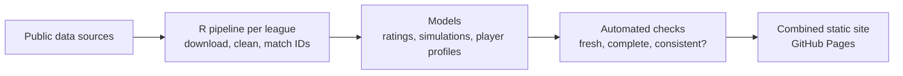

# Front Office

**Explore the NFL, NBA, WNBA and MLB through data: team ratings, game forecasts, player comparisons, salary caps and more.**

**Live site:** https://kailot-harris.github.io/front-office/

Front Office brings four leagues into one site with <span data-count="all">56</span> interactive pages. It's built for fans who want more than the box score: how good a team really is, why a game is forecast the way it is, which players share a style, and how payroll shapes a roster. Every number comes from public sports data and is refreshed automatically.

---

## What you can explore

| League | Season status | How often it updates | Pages |
| :--- | :--- | :--- | :---: |
| [NFL](https://kailot-harris.github.io/front-office/nfl/) | In season | Every morning, plus evening and overnight score updates | 13 |
| [NBA](https://kailot-harris.github.io/front-office/nba/) | In season | Every morning, plus evening and overnight score updates | 14 |
| [WNBA](https://kailot-harris.github.io/front-office/wnba/) | Offseason | Weekly offseason report every Monday | 15 |
| [MLB](https://kailot-harris.github.io/front-office/mlb/) | Offseason | Weekly offseason report every Monday | 14 |

Each league offers roughly the same set of tools, so once you learn one, the others feel familiar:

- **Standings and projections.** Current records alongside simulated end-of-season outcomes and playoff odds.
- **Matchups.** Upcoming games with win probabilities, plus a breakdown of what's driving each forecast (team strength, rest, travel, injuries).
- **Player projections and ratings.**
- **Player DNA.** A skill profile for each player and a list of the players whose style is most similar.
- **Clutch.** How players perform late in close games.
- **Shot, passing and batted-ball charts.** Where on the field or court production actually happens.
- **Salary cap and payroll.** Team spending against each league's cap or luxury-tax rules (NFL, NBA, MLB).
- **Playoff simulator.** Thousands of simulated postseasons.
- **Model variants and accuracy.** Side-by-side model comparisons and an honest scorecard of how past forecasts held up.
- **Offseason monitor** (WNBA, MLB). A weekly digest of confirmed signings and trades, kept separate from rumors.

Not sure where to start? The [Walkthrough](https://kailot-harris.github.io/front-office/guide/) is organized around questions you might bring to the site. [How the Models Work](https://kailot-harris.github.io/front-office/how-it-works/) explains where the numbers come from.

**Tip:** on the home page, press `/` and start typing (`clutch`, `cap`, `dna`) to search all <span data-count="all">56</span> pages at once.

---

## Where the data comes from

Everything is built from free, public sources:

| League | Main sources |
| :--- | :--- |
| NFL | nflverse (play-by-play, schedules, rosters, injuries, Next Gen Stats), Over The Cap contracts, ESPN live scores and injuries |
| NBA | hoopR (box scores, play-by-play), Basketball-Reference contracts, official NBA cap figures, ESPN live scores |
| WNBA | wehoop (box scores, play-by-play), ESPN scores and injuries, league transaction wire and beat-writer news feeds |
| MLB | MLB Stats API, Baseball Savant (Statcast), FanGraphs, Chadwick Bureau player register, Spotrac payroll, team news feeds |

See [How the Models Work](https://kailot-harris.github.io/front-office/how-it-works/#limits-of-the-data) for what these sources can and can't tell you.

---

## How it's built

Each league lives in its own repository with two halves:

1. **A data pipeline in R** that downloads new data, matches players across sources that use different IDs, runs the models and writes the results as JSON files.
2. **A Next.js web app** that reads those files and renders the interactive pages as a static site.

This repository pulls the four leagues together, adds the home page and publishes everything to GitHub Pages.



A few design choices worth noting:

- **Nothing publishes unless it passes checks.** Before new data goes live, automated tests confirm the files are fresh, the schedule matches the games shown and the data is internally consistent. If any check fails, the site keeps its last good version.
- **Graceful fallbacks.** If a source is down, the pipeline tries a backup source or reuses the last verified data and flags it, instead of failing silently.
- **Fast pages without a server.** Large datasets are split into small per-game and per-player files that load only when you open them.

### Repository layout

```text
front-office/
├── index.html          # Home page
├── nfl/  nba/  wnba/  mlb/   # Copies of each league's repository (synced automatically)
├── tools/              # Sync and consistency-check scripts
└── .github/workflows/  # Build and deploy automation
```

The league repositories are private; their published code is mirrored in the `nfl/`, `nba/`, `wnba/` and `mlb/` folders here.

### Running it locally

You'll need **Node.js 22** and **R 4.5 or newer**. No API keys are required.

Run a league's web app:

```bash
cd nba/web
npm ci
npm run dev      # http://localhost:3000/nba
npm test         # data checks
npm run build    # static export to nba/web/out/
```

Run a league's data pipeline (from that league's own repository, not the copies in this one):

```bash
Rscript run_full_pipeline.R
```

> The `nfl/`, `nba/`, `wnba/` and `mlb/` folders here are overwritten on every sync. Make changes in the league repositories instead.
