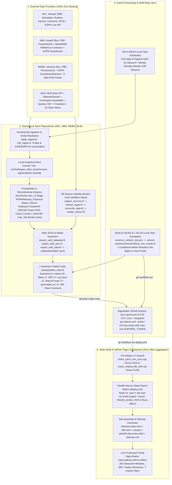

# Front Office — Pre-Release Technical & Academic Executive Summary

**Live Production Portal:** https://kailot-harris.github.io/front-office/  
**Aggregator Repository:** `kailot-harris/front-office` (`front-office-aggregator/`)  
**Sibling Sport Repositories:** `NFL_analytics` (`nfl/`), `NBA_analytics` (`nba/`), `WNBA_analytics` (`wnba/`), `MLB-Analytics` (`mlb/`)  
**Audit Date:** November 19, 2026 | **Context:** University *Data Acquisition & Management* Companion Project

---

## 1. Project Vision & Problem Statement

**Front Office** is an end-to-end, multi-sport quantitative analytics and probabilistic forecasting platform covering the **NFL, NBA, WNBA, and MLB**. Designed around a strict **Zero-Betting Policy (Principle #1)**, the platform replaces commercial odds feeds and gambling framing with pure sports-science, front-office salary cap economics, spatial tracking, and calibrated probability models.

Unifying four major professional leagues under a single automated data engineering and publishing architecture is non-trivial for three structural reasons:
1. **Heterogeneous Upstream Data Ecosystems & Identifiers:** Each sport relies on different public APIs, R packages, and web schemas (`nflreadr`/nflverse, `hoopR`, `wehoop`, `baseballr`, `statsapi.mlb.com`, Baseball Savant/Statcast, FanGraphs, Over The Cap, Basketball-Reference, ESPN Site APIs, and beat RSS feeds) with incompatible player/team ID namespaces (GSIS vs. ESPN vs. MLBAM vs. FanGraphs vs. Retrosheet).
2. **Divergent Domain Physics & Collective Bargaining Agreement (CBA) Regimes:** A 17-game weekly NFL schedule with discrete downs and hard salary caps + void years requires fundamentally different state representations than an 82-game NBA or 44-game WNBA possession model (soft cap with First/Second Apron restrictions vs. hard cap with 11-vs-12 player roster crunch) or a 162-game MLB schedule governed by starting pitcher adjustments and 4-tier Competitive Balance Tax (CBT) surcharges.
3. **Asynchronous Seasonal Lifecycles:** At any point in the calendar year, leagues operate in different operational regimes. In mid-November 2026, **NFL** and **NBA** are **In-Season (Live Slate)** requiring sub-daily score patching and daily Monte Carlo re-simulations, while **WNBA** and **MLB** are in **Off-Season (Weekly Monitor)** requiring deterministic transaction-wire reconciliation ($S_t = S_{\text{last}} \oplus \Delta S_{\text{confirmed}}$) and media sentiment tracking.

---

## 2. By-the-Numbers Snapshot (Verified Repo Evidence)

| Dimension | Verified Count | Repo & File-Level Evidence |
| :--- | :--- | :--- |
| **Leagues & Portal** | **4 Leagues + 1 Hub** | `front-office-aggregator/index.html` + `nfl/`, `nba/`, `wnba/`, `mlb/` `git subtree` mirrors |
| **Live Web Modules** | **56 Linked Modules** (61 Next.js routes) | NFL (13), NBA (14 + `/teams` redirect), WNBA (15 + `/teams` redirect), MLB (14 + `/teams` view) |
| **R Pipeline Codebase** | **428 Active R Scripts** (**123,908 LOC**) | NFL: 97 files (23,955 LOC); NBA: 106 files (29,634 LOC); WNBA: 129 files (41,836 LOC); MLB: 96 files (28,483 LOC) |
| **Next.js / TypeScript UI** | **285 TS/TSX App Files** (**68,304 LOC**) | **149 React components** (`web/components/*.tsx`) + **61 App Router pages** (`web/app/**/page.tsx`) |
| **Automated Test Suites** | **156 Test Files** (**36,202 LOC**) | **100 Web TypeScript test files** (22,659 LOC; **596 passing contract tests**) + **56 R test files** (13,543 LOC) |
| **External Data Sources** | **15+ Distinct Feeds** | `nflreadr`, `hoopR`, `wehoop`, `baseballr`, MLB Stats API, Statcast, FanGraphs, OTC, BBRef, Spotrac, Chadwick, ESPN API, 6+ RSS wires |
| **CI/CD & Orchestration** | **13 GitHub Workflows + 3 Local Slots** | 5 aggregator workflows (`deploy.yml`, `sync-sports.yml`, 2 drift/nav guards, `relock.yml`) + 8 sport workflows (`ci.yml`, `refresh-results.yml` × 4) |
| **Published JSON Endpoints** | **63 Top-Level + 3,243 Chunked JSONs** | 10.22 MB top-level (`13` NFL, `16` NBA, `20` WNBA, `14` MLB) + 3,243 per-game/player/shot/spatial/SHAP chunked payloads (~99 MB) |
| **Model & Analytics Families** | **10 Core Families** | Elo / 4-Factor Pitcher Elo, L2 Ridge RAPM & Ridge-Massey, Empirical Bayes Pooling, Marcel, Kalman State-Space, XGBoost + TreeSHAP, Spatial xeFG%/Statcast/NGS, Cosine Player DNA, Tango LI/USCI Clutch, 10,000-Trial Monte Carlo Simulators |

---

## 3. Major Technical & Academic Accomplishments

Mapped directly to core **Data Acquisition and Management** curriculum themes:

### A. Multi-Source Acquisition & Defensive Adapter Engineering
- **Layered Primary + Fallback Acquisition:** Every league pairs bulk historical packages with low-latency live HTTP endpoints. For example, `NFL Analytics/injury_scraper.R` (lines 11–34) unions authoritative weekly `nflreadr::load_injuries()` reports (`NFLREADR_OFFICIAL`) with same-day ESPN Site API JSON (`ESPN_LIVE`). In `MLB Analytics/mlb_ingest.R` (lines 49–120), when `baseballr::mlb_schedule()` fails or changes column aliases, the pipeline transparently falls back to direct REST requests against `https://statsapi.mlb.com/api/v1/schedule?sportId=1&hydrate=team,probablePitcher,lineups`.
- **Upstream Schema Quirk Remediation:** Live probing revealed that ESPN's NFL/WNBA/MLB injury JSON omits a top-level `athlete$id` field (the entry `id` is an injury-report row ID, not an athlete ID). `NFL Analytics/injury_scraper.R` (lines 35–53, 85–100) and `MLB Analytics/mlb_injury_scraper.R` deterministically recover the true numeric ESPN athlete ID via regex extraction (`/id/([0-9]+)/`) from `athlete$links[[1]]` ("Player Card" `href`) and headshot CDN URLs.
- **Anti-Bot & Rate-Limit Governance:** When Spotrac's anti-bot protections blocked automated NBA payroll scraping, the pipeline was re-architected (`NBA Analytics/tools/fetch_bbref_player_contracts.R`, `build_cba_cap_dataset.R` lines 21–50) to scrape Basketball-Reference's `/contracts/players.html` with polite throttling (`RATE_LIMIT_SLEEP_SEC <- 1.5`, `MAX_RETRIES <- 3` in `NBA Analytics/config.R` lines 96–98) and a documented last-known-good snapshot fallback (`[CBA_BBREF_FALLBACK]`).

### B. Heterogeneous Entity Resolution & Cross-Vendor Schema Harmonization
- **5-Way MLB Player ID Crosswalk:** `MLB Analytics/mlb_id_crosswalk.R` (Stage 4 of `MLB Analytics/run_full_pipeline.R`, lines 228–235) reconciles player identities across **MLBAM (`mlbam_id`), FanGraphs (`fg_id`), Baseball-Reference (`bref_id`), Retrosheet (`retro_id`), and ESPN (`espn_id`)** using the Chadwick Bureau register with fuzzy name/birth-year fallback matching.
- **NFL Cross-Source ID Enrichment Without Destructive Collapsing:** Rather than naively joining `nflreadr` (`gsis_id`) and ESPN (`espn_id`) injury rows by player name—which silently drops records on suffix/punctuation mismatches—`NFL Analytics/player_id_crosswalk.R` enriches each row with its crosswalked counterpart (`espn_athlete_id_crosswalked`, `gsis_id_crosswalked`) via `nflreadr::load_ff_playerids()`, explicitly dropping ambiguous duplicate `gsis_id` mappings discovered in upstream data (`NFL Analytics/injury_scraper.R` lines 19–33).
- **Franchise Abbreviation Canonicalization:** `NBA Analytics/build_cba_cap_dataset.R` (lines 66–81) normalizes Basketball-Reference's non-standard franchise codes (`PHO -> PHX`, `CHO -> CHA`, `BRK -> BKN`), while `NFL Analytics/config.R` (lines 95–130) enforces a single 32-team lookup validated against `nflreadr::load_teams(current = TRUE)`.

### C. Memory-Bounded Incremental ETL, Storage & Static Payload Chunking
- **95% In-Memory PBP Footprint Reduction:** `nflreadr::load_pbp()` returns 372 columns (~3.4 GB in RAM for 1.14M plays), which previously caused OS-level out-of-memory kills during `bind_rows()` incremental updates. `NFL Analytics/daily_ingest.R` (lines 35–77) enforces a 26-column projection whitelist (`.PBP_CACHE_COLUMNS`), shrinking the in-memory footprint by **95% to ~167 MB** and calling `gc(verbose = FALSE)` between DAG stages (`NFL Analytics/run_full_pipeline.R` line 219).
- **Order-Sensitive Incremental Deduplication & Content-Diffing:** Early runs discovered that `bind_rows(existing, new_rows) |> distinct(game_id)` permanently froze games that had `NA` scores at season bootstrap time. `NFL Analytics/daily_ingest.R` (lines 145–176) binds `new_rows` *first* so newly completed scores overwrite `NA` placeholders, and compares key-sorted data frames (`!isTRUE(identical(arrange_keys(combined), arrange_keys(existing)))`) so score-only updates persist even when total row count (`n_new_records == 0`) does not change.
- **Concurrency & Lock-Contention Engineering (R PSOCK + DuckDB):** In `WNBA Analytics/run_full_pipeline.R` (lines 326–384), spawning 8+ `future::multisession` R workers caused 280-second CPU stalls because every child `Rscript.exe` re-ran `renv` sandbox validation concurrently; setting `RENV_CONFIG_SANDBOX_ENABLED = "FALSE"` before cluster creation resolved 20-of-20 worker connections in <40s, paired with a dynamic `Win32_OperatingSystem.FreePhysicalMemory` RAM check (<4,096 MB degrades gracefully to `plan(sequential)`). To prevent DuckDB single-writer lock failures across parallel workers (`logs/analytics.duckdb`), workers spill failed log writes to per-PID TSV files (`logs/logs_pending_<pid>.tsv`), which the parent process atomically merges and unlinks after `plan(sequential)` shutdown (`WNBA Analytics/run_full_pipeline.R` lines 511–570).
- **Client-Side JSON Chunking Architecture:** To keep initial page loads fast on static GitHub Pages without a backend database, large entity catalogs are partitioned into lightweight index files (`passing_index.json`, `shots_index.json`, `spatial_index.json`, `matchups_index.json`) paired with 3,243 on-demand per-entity JSON payloads (`mlb/web/public/data/spatial/{id}.json`, `nba/web/public/data/shots/{id}.json`, `nba/web/public/data/explainability/{id}.json`, `nfl/web/public/data/games/{id}.json`).

### D. Lifecycle-Aware Hybrid Scheduling & Multi-Repo Subtree Publishing
- **Solving GitHub Cron Latency via Hybrid Workstation + Cloud Orchestration:** Empirical telemetry recorded on October 28, 2026 (`front-office-aggregator/tools/run_refresh_slot.ps1` lines 10–35) proved that GitHub Actions `schedule:` crons fired **5h 15m to 5h 17m late** on 4 of 4 runs, causing afternoon and overnight refreshes to collide. The architecture moved time-critical triggers to Windows Task Scheduler (`tools/register_refresh_tasks.ps1`), which fires within 2 seconds across three daily slots:
  - **Slot A (09:00 Local):** Runs full daily R pipelines (`schedule_daily.bat`) for in-season sports after upstream providers (`hoopR`, `nflverse`) finish their ~12:20 UTC builds, followed by the 13:30 UTC `sync-sports.yml` safety net.
  - **Slot B (18:00 Local) & Slot C (01:00 Local):** `tools/run_refresh_slot.ps1` executes lightweight score patching (`tools/refresh_live_results.R`) inside isolated detached git worktrees (`.refresh-worktrees/<sport>`). When—and only when—new final scores are committed for an active in-season sport (`nfl`, `nba`), it triggers a local model refresh (`Invoke-ModelRefresh`), re-applies live finals so unboxed last-night games are not dropped (`run_refresh_slot.ps1` lines 64–75), and dispatches `sync-sports.yml` → `deploy.yml` (completing end-to-end in ~3.5 minutes).
- **Off-Season Weekly Monitor & Fail-Closed Quiet-Week Governance:** For out-of-season leagues (`WNBA`, `MLB`), `build_offseason_monitor.R` runs a weekly 6-stage DAG (`Ingest -> Extract -> Reconcile -> Cap/CBT Sync -> Render Memo -> Export JSON`). To prevent a broken scraper from falsely reporting a "Quiet Week (0 transactions)"—an actual bug caught in MLB issue #58 when a frozen 6-row fixture masked 1,970 real wire transactions (`MLB Analytics/build_offseason_monitor.R` lines 19–35)—the reconciler enforces a **fail-closed quiet-week precondition** (`can_assert_quiet_week`): zero confirmed deltas may only publish if multilateral feed health and freshness assertions pass.

### E. Defense-in-Depth Data Quality, Provenance & Publish Governance
- **The 7-Assertion Publish Gate (`tools/publish_web.R`):** Because `run_stage()` is fail-safe (catching stage errors so one broken scraper does not crash the entire DAG), a green R exit code does not guarantee fresh output. Every sport repo gates commits behind `tools/publish_web.R` (`NBA Analytics/tools/publish_web.R` lines 44–88), which asserts directly on the artifacts:
  - **Assertion A (mtime Freshness):** Every file in `config.R`'s `WEB_DATA_FILES` has `mtime >= run_start`.
  - **Assertion B (Independent Slate Agreement):** Independently recomputes total season games and `active_slate`/`active_week` from raw schedule caches and compares against published matchup JSON.
  - **Assertion C (Non-Empty Diff):** Requires pending changes in `git status --porcelain -- web/public/data`.
  - **Assertion D (Stage Warning Scan):** Scans pipeline logs for `[WARN]`/`[FAIL]` or verbatim republish fallbacks.
  - **Assertion E (Branch Guard):** Enforces `HEAD == main` so feature-branch runs cannot silently push to a branch the aggregator ignores.
  - **Assertion F (Embedded Payload Provenance):** Parses internal `generated_at` ISO-8601 timestamps inside JSON payloads to catch filesystem `mtime` spoofing from `git checkout`/`stash`.
  - **Assertion G (Vitest Contract Suite):** Executes `npm test` (`web/tests/contracts/`) against uncommitted JSON payloads to verify schema, cross-file referential integrity, and domain invariants before `git commit`.

---

## 4. System Architecture Overview

---

## 5. Honest Assessment of Current Limitations & Technical Debt

In the spirit of academic and engineering rigor, the audit identified the following concrete limitations and open technical debt items:

> [!NOTE]
> **Resolved before sharing (November 19, 2026):** The audit's four pre-release defects have been fixed — (1) the two archived WNBA pages were removed from the landing-page accordion; (2) the unrendered WNBA Finals gallery card now shows a "Pending upstream PBP" placeholder instead of a 404 image; (3) `NBA Analytics/playoff_simulator.R` derives all five tactical ratings deterministically from empirical Player DNA, defensive RAPM/versatility and clutch eFG% (no unseeded `runif()`); (4) NFL's passing, clutch and Player DNA builders are wired into `run_full_pipeline.R` (Stages 14.1–14.3) and refreshed for 2026. Remaining open items are listed below.

1. **Detached NBA Shot Chart Builder (P1 Pipeline Completeness Gap):**
   - `NBA Analytics/build_shot_chart_dataset.R` still runs out-of-band (`shots_index.json` last updated `2026-10-21`).
2. **Static Hand-Seeded Coaching Artifacts & Registry Fields (Documented Caveat):**
   - `NFL Analytics/web/public/data/coaching_profiles.json` has no upstream scraper or `.rds` cache; `export_web_datasets.R` (lines 1285–1305) republishes it verbatim with an explicit `log_warn()` and excludes it from `WEB_DATA_FILES`. In `NBA Analytics/build_coaching_dataset.R` (lines 20–27, 50–82), while ATO PPP and challenge overturn rates are computed empirically from `cache/pbp_timeout_cache.rds`, coach tenure and career win percentages in `coaching_registry_raw` are hand-typed (tracked under NBA issue #188).
3. **Cross-Sport JSON Schema & Reproducibility Asymmetry (P1/P2 Backlog):**
   - Across 6 shared endpoint groups, 5 exhibit field-casing or root-structure drift (e.g., `teamAbbr` in NBA/WNBA/MLB vs. `team` in NFL; root `Array` in NBA/WNBA vs. `{ profiles: [...] }` wrapper `Object` in MLB for `clutch_leverage_metrics.json` and `player_dna_profiles.json`).
   - `MLB Analytics` and `WNBA Analytics` commit `renv.lock` (R 4.5.2), whereas `NBA Analytics` and `NFL Analytics` currently lack `renv.lock` files.
   - Git history tracks several large binary cache/model files in `WNBA Analytics` (`cache/wnba_espn_pbp_cache.rds` at 28.4 MB, `data/udpipe/english-ewt-ud-2.5-191206.udpipe` at 15.6 MB) and 167 legacy Reveal.js/RMarkdown presentation files in `NBA Analytics`.

---

## 6. Ready-to-Send Professor Framing Note

> **Subject:** Front Office — Multi-Sport Data Acquisition, ETL Governance & Probabilistic Analytics Platform (Live Site + Repo)
>
> Dear Professor [Last Name],
>
> As a companion project applying the concepts from **Data Acquisition and Management**, I built **Front Office** (https://kailot-harris.github.io/front-office/), an automated multi-sport data engineering and probabilistic analytics platform spanning **56 interactive modules across the NFL, NBA, WNBA, and MLB** (source repository: `https://github.com/kailot-harris/front-office`). Under the hood, four league-specific R ETL pipelines ingest and harmonize over 15 heterogeneous public data sources (`nflreadr`, `hoopR`, `wehoop`, `baseballr`, MLB Stats API, Statcast, FanGraphs, Over The Cap, Basketball-Reference, ESPN Site APIs, and beat RSS wires), resolving cross-vendor entity IDs (such as a 5-way MLBAM/FanGraphs/BBRef/Retrosheet/ESPN player crosswalk and an NFL GSIS-to-ESPN ID resolver) into memory-bounded `.rds` and DuckDB stores. To ensure production data quality before static Next.js export to GitHub Pages, every scheduled pipeline run is gated by a **7-Assertion Publish Gate (`tools/publish_web.R`)** and **596 automated Vitest contract tests** that verify filesystem freshness, embedded ISO-8601 payload provenance, independent schedule-to-slate reconciliation, and cross-dataset referential integrity—while dynamically adapting between **In-Season (Live Slate)** daily refreshes (NFL, NBA) and **Off-Season (Weekly Monitor)** transaction-wire state reconciliation (WNBA, MLB). If you have five minutes to explore, I recommend starting at the landing page (press `/` to filter across all 56 modules), checking an in-season matchup and SHAP explainability board (`/front-office/nfl/matchups/` or `/front-office/nba/matchups/`), inspecting our out-of-sample Brier/calibration governance (`/front-office/nfl/diagnostics/`), and viewing the off-season transaction reconciler (`/front-office/mlb/offseason-monitor/`). A first-time walkthrough and this summary are linked from the site footer (`docs/WALKTHROUGH.md`, `docs/EXECUTIVE_SUMMARY.md`) and would welcome any feedback you have on the pipeline design.
