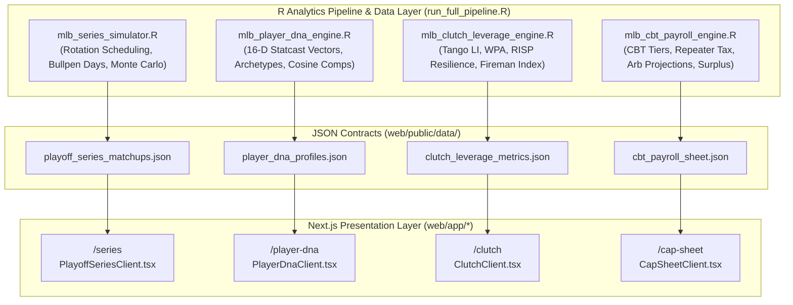
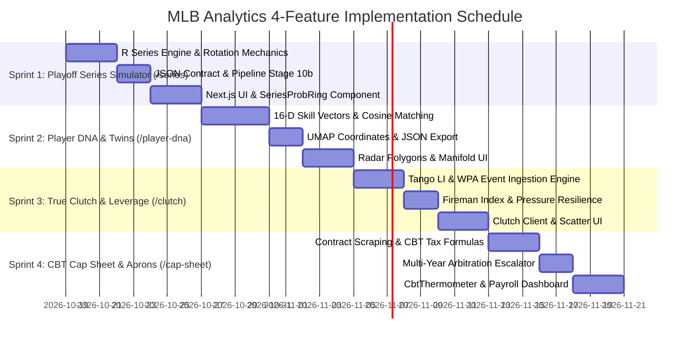

# Master Implementation Blueprint: Features 1 through 4 (MLB Analytics)

**Document ID:** `PLAN-MLB-PARITY-001`  
**Target Platform:** MLB Analytics Platform (R Engine + Next.js Web Application)  
**Target Horizon:** 2026–2027 MLB Season  
**Status:** ARCHITECTURAL SPECIFICATION & STAGED IMPLEMENTATION PLANS  

---

## Executive Summary & Parity Architecture

This blueprint specifies the phased implementation architectures for **Features 1 through 4**, bringing the **MLB Analytics** platform to analytical and interactive parity with the **NBA Analytics** analog.

---

## Feature 1: Interactive Playoff Series Simulator (`/series`)

### 1.1 Strategic Objective
Expand the static 12-team bracket in `/postseason` into an interactive head-to-head series simulator. Enable users to pair any two MLB clubs, choose series format (Best-of-3 Wild Card, Best-of-5 Division Series, or Best-of-7 LCS/World Series), designate starting pitcher rotations, and simulate 10,000 series iterations with tactical mismatch modeling.

### 1.2 Mathematical & Sabermetric Formulation

1. **Game Win Probability with Pitcher & Tactical Adjustments:**
   For Game $k$ between Team A (home) and Team B (away) with designated starting pitchers $\text{SP}_A$ and $\text{SP}_B$:
   $$P(\text{Team A wins Game } k) = \Phi\left( \frac{\Delta \text{Elo}_{\text{base}} + \text{HFA} + 4.7 \times (\text{rGS}_{A, k} - \text{rGS}_{B, k}) + \sum_m \Delta_{\text{mismatch}, m}}{\sigma_{\text{playoff}}} \right)$$
   * $\Delta \text{Elo}_{\text{base}} = \text{Elo}_A - \text{Elo}_B$.
   * $\text{HFA} = +14.9\text{ Elo}$ for home team.
   * $\text{rGS}$: Tangotiger rolling Starter Game Score for the scheduled starting pitcher.
   * $\sigma_{\text{playoff}} = 9.2$ (tightened variance for shortened playoff rotations and high-leverage bullpen usage).

2. **Rotation & Rest Mechanics:**
   * **Best-of-3 (Wild Card):** 3-man rotation, no rest days (Games 1-2-3 consecutive at high seed).
   * **Best-of-5 (Division Series):** 2-2-1 format; Games 1 & 2 $\to$ Travel $\to$ Games 3 & 4 $\to$ Travel $\to$ Game 5. Ace can start Games 1 and 5 on regular rest; short rest penalty ($-5.0\text{ rGS}$) if starting on 3 days rest.
   * **Best-of-7 (LCS & World Series):** 2-3-2 format; standard 4-man rotation with bullpen day fallback.

3. **Tactical Mismatch Levers ($\Delta_{\text{mismatch}}$):**
   * **High Whiff vs. High-K Lineup:** If pitcher arsenal Whiff% $\ge 32\%$ and opponent lineup K% $\ge 24\%$, $\Delta_{\text{mismatch}} = +12.5\text{ Elo}$.
   * **Platoon Exploitation:** Lineup OPS against LHP/RHP vs. starter handedness ($\Delta_{\text{wOBA}} \times 280\text{ Elo}$).
   * **Bullpen Rest Index:** Difference in bullpen fatigue score (from Stage 9 `mlb_bullpen_fatigue.R`).
   * **Ballpark Synergy:** Ballpark factor for HR and handedness (e.g., flyball pull-hitters in Yankee Stadium).

### 1.3 Phased Implementation Steps
* **Phase 1.1 (Engine - R):** Create `mlb_series_simulator.R` implementing `simulate_custom_series(team_a, team_b, series_length, hfa_team, rotation_a, rotation_b, n_sims = 10000)`.
* **Phase 1.2 (Pipeline & JSON):** Add Stage 10b to `run_full_pipeline.R` generating `playoff_series_matchups.json` with pre-computed contender matchups.
* **Phase 1.3 (Client UI):**
  * `web/app/series/page.tsx` & `web/components/PlayoffSeriesClient.tsx`.
  * `SeriesProbRing.tsx`: SVG donut ring showing series win % and probability distribution of exact outcomes (sweep, in 5, in 6, in 7).
  * `TacticalMismatchRadar.tsx`: 5-axis tactical comparison (Rotation Quality, Bullpen Leverage, Contact/K-Avoidance, Power/ISO, Defensive Efficiency).
  * `RotationMatchupSelector.tsx`: Interactive pitcher slotting for Games 1 through 7.

---

## Feature 2: High-Dimensional Batter & Pitcher DNA (`/player-dna`)

### 2.1 Strategic Objective
Construct 16-dimensional skill vectors for all MLB players using Statcast tracking and plate discipline data. Cluster players into modern tactical archetypes, identify nearest historical comparables via cosine similarity, and project 2D stylistic manifolds.

### 2.2 Mathematical Formulation

1. **16-Dimensional Skill Vector $\mathbf{v}_p$ (Standardized Percentiles $[0, 100]$):**
   * **Batters (16-D):**
     $$\mathbf{v}_{\text{bat}} = \big[\text{EV}_{90}, \text{Barrel\%}, \text{HardHit\%}, \text{ZoneContact\%}, \text{Whiff\%}^{-1}, \text{Chase\%}^{-1}, \text{BB\%}, \text{K\%}^{-1}, \overline{\text{LA}}, \text{SweetSpot\%}, \text{PullAir\%}, \text{Oppo\%}, \text{SprintSpd}, \text{BsR}, \text{OAA}, \text{ISO}\big]$$
   * **Pitchers (16-D):**
     $$\mathbf{v}_{\text{pit}} = \big[\text{Velo}_{\text{FB}}, \text{IVB}_{\text{FB}}, |\text{HB}_{\text{primary}}|, \text{Stuff+}, \text{Location+}, \text{Pitching+}, \text{Whiff\%}, \text{Chase\%}, \text{Zone\%}, \text{K\%}, \text{BB\%}^{-1}, \text{HardHit\%}^{-1}, \text{Barrel\%}^{-1}, \text{GB\%}, \text{Extension}, H_{\text{arsenal}}\big]$$
     *where $H_{\text{arsenal}} = -\sum p_i \ln(p_i)$ is pitch mix Shannon entropy.*

2. **Cosine Similarity Comps:**
   $$\text{Sim}(p_1, p_2) = \frac{\mathbf{v}_{p_1} \cdot \mathbf{v}_{p_2}}{\|\mathbf{v}_{p_1}\|_2 \|\mathbf{v}_{p_2}\|_2} \times 100\%$$
   Matched against historical player seasons (2015–2026 Statcast database + normalized historical baselines).

3. **Archetype Clustering:**
   Fit Gaussian Mixture Models ($K=8$ clusters) to label players:
   * *Batters:* "Three-True-Outcomes Slugger", "Contact & Speed Table-Setter", "All-Fields Gap Hitter", "Patient OBP Machine", "High-Whiff Power Threat", etc.
   * *Pitchers:* "High-IVB Flamethrower", "Sink/Slide Wormburner", "East-West Sweeper Craftsman", "Arsenal Shuffler", "High-Leverage Eraser".

### 2.3 Phased Implementation Steps
* **Phase 2.1 (Engine - R):** Create `mlb_player_dna_engine.R` computing 16-D vectors from Statcast and FanGraphs data, fitting UMAP 2D coordinates and cosine distance matrices.
* **Phase 2.2 (Pipeline & JSON):** Add Stage 8b to `run_full_pipeline.R` exporting `player_dna_profiles.json`.
* **Phase 2.3 (Client UI):**
  * `web/app/player-dna/page.tsx` & `web/components/PlayerDnaClient.tsx`.
  * `SkillFingerprintPolygon.tsx`: 16-axis radar polygon comparing player vs. MLB median.
  * `HistoricalTwinCard.tsx`: Top 5 historical twins with similarity %, comparative metric bars, and player bios.
  * `DnaManifoldScatter.tsx`: Interactive 2D UMAP scatter showing player clusters colored by archetype.

---

## Feature 3: True Clutch & Leverage Index Engine (`/clutch`)

### 3.1 Strategic Objective
Isolate high-stakes late-inning performance from blowout garbage time using Tom Tango's Leverage Index (LI) and Win Probability Added (WPA). Evaluate batter pressure resilience and reliever "fireman" effectiveness.

### 3.2 Mathematical Formulation

1. **Tom Tango Leverage Index (LI):**
   $$\text{LI}(b, o, i, \Delta R) = \frac{\Delta \text{WE}(b, o, i, \Delta R)}{\overline{\Delta \text{WE}}}$$
   * High Leverage: $\text{LI} \ge 1.50$; Extreme Leverage: $\text{LI} \ge 2.50$; Low Leverage: $\text{LI} < 0.85$.

2. **True Clutch Index Formulation:**
   $$\text{Clutch} = \frac{\text{WPA}}{\text{pLI}} - \text{WPA}_{\text{base}}$$
   * Measures win probability added beyond what base run creation would predict in neutral contexts.

3. **Batter Pressure Resilience:**
   $$\Delta \text{wOBA}_{\text{clutch}} = \text{wOBA}_{\text{LI} \ge 1.5} - \text{wOBA}_{\text{LI} < 0.85}$$
   * Chase discipline delta ($\Delta \text{O-Swing}_{\text{clutch}}$) and 2-Out RISP conversion rate.

4. **Reliever "Fireman" Rating:**
   $$\text{FiremanIndex} = \text{WPA}_{\text{reliever}} \times \overline{\text{gmLI}} \times \left(1 - \frac{\text{IRS}}{\text{IR}}\right)$$
   * Rewards relievers brought into high-leverage jams ($\text{gmLI} > 1.8$) who strand inherited runners ($\text{IRS} / \text{IR}$).

### 3.3 Phased Implementation Steps
* **Phase 3.1 (Engine - R):** Create `mlb_clutch_leverage_engine.R` parsing Retrosheet / Statcast pitch-by-pitch and play-by-play events, filtering by game state leverage.
* **Phase 3.2 (Pipeline & JSON):** Add Stage 9b to `run_full_pipeline.R` generating `clutch_leverage_metrics.json`.
* **Phase 3.3 (Client UI):**
  * `web/app/clutch/page.tsx` & `web/components/ClutchClient.tsx`.
  * `PressureResiliencePlot.tsx`: Scatter plot comparing base wOBA/xERA vs. $\Delta \text{wOBA}_{\text{clutch}}$.
  * `FiremanLeaderboardCard.tsx`: Dedicated reliever view tracking inherited runner stranding and late-inning high-LI save conversion.
  * `LeverageDistributionBar.tsx`: Visual breakdown of player plate appearances across Low, Medium, High, and Extreme leverage states.

---

## Feature 4: CBT Luxury Tax, Salary Payroll & Contract Architect (`/cap-sheet`)

### 4.1 Strategic Objective
Model the financial, competitive, and regulatory constraints of MLB's Competitive Balance Tax (CBT) and arbitration system. Provide front-office tools for luxury tax forecasting, draft pick penalty modeling, and contract surplus value evaluation.

### 4.2 Mathematical & Regulatory Formulation

1. **CBT Thresholds (2026–2027 Season Baselines):**
   * Base CBT Threshold: $T_0 = \$241\text{M}$
   * First Surcharge Line (Tier 1): $T_1 = \$261\text{M}$ ($+\$20\text{M}$)
   * Second Surcharge Line (Tier 2): $T_2 = \$281\text{M}$ ($+\$40\text{M}$)
   * Third Surcharge Line ("Cohen Tax" Tier 3): $T_3 = \$301\text{M}$ ($+\$60\text{M}$)

2. **Progressive Tax Multipliers & Repeater Penalty:**
   For taxable payroll $P_{\text{tax}} = \max(0, \text{Payroll}_{\text{CBT}} - T_0)$:
   * **1st-Year Payor:**
     $$\text{TaxBill} = 0.20 \times \Delta P_1 + 0.32 \times \Delta P_2 + 0.625 \times \Delta P_3 + 0.80 \times \Delta P_4$$
   * **Repeater Payor (3+ Consecutive Years):**
     $$\text{TaxBill}_{\text{rep}} = 0.50 \times \Delta P_1 + 0.65 \times \Delta P_2 + 0.95 \times \Delta P_3 + 1.10 \times \Delta P_4$$

3. **Draft & International Pool Sanctions:**
   * Exceeding $T_3$ ($>\$60\text{M}$ over base) causes the club's highest draft pick to fall 10 spots.
   * Loss of $\$1\text{M}$ from international bonus signing pool for top-tier CBT teams.

4. **Multi-Year Arbitration Escalation & Contract Surplus:**
   * Arbitration modeling: Super Two eligibility, Arb 1 (25% of market value), Arb 2 (40%), Arb 3 (60%).
   * **Surplus Value Equation:**
     $$\text{SurplusValue} = \left(\text{ProjWAR} \times \$8.5\text{M}\right) - \text{ContractAAV}$$

### 4.3 Phased Implementation Steps
* **Phase 4.1 (Engine - R):** Create `mlb_cbt_payroll_engine.R` compiling 30-team contracts, arbitration projections, CBT surcharge brackets, and multi-year obligations.
* **Phase 4.2 (Pipeline & JSON):** Add Stage 14b to `run_full_pipeline.R` generating `cbt_payroll_sheet.json`.
* **Phase 4.3 (Client UI):**
  * `web/app/cap-sheet/page.tsx` & `web/components/CapSheetClient.tsx`.
  * `CbtThermometer.tsx`: Visual horizontal progress bar showing 4 CBT threshold lines and tax surcharge tiers.
  * `FranchisePayrollTable.tsx`: Multi-year breakdown of guaranteed money, player/club options, arb projections, and dead money.
  * `SurplusValueCalculator.tsx`: Interactive widget evaluating contract efficiency (WAR per \$1M spent).

---

## File Inventory & Implementation Mapping

| Feature | Target Route | Core React Component | Backend R Engine Script | JSON Contract Artifact |
|:---|:---|:---|:---|:---|
| **1. Playoff Series** | `/series` | `PlayoffSeriesClient.tsx` | `mlb_series_simulator.R` | `playoff_series_matchups.json` |
| **2. Player DNA** | `/player-dna` | `PlayerDnaClient.tsx` | `mlb_player_dna_engine.R` | `player_dna_profiles.json` |
| **3. True Clutch** | `/clutch` | `ClutchClient.tsx` | `mlb_clutch_leverage_engine.R` | `clutch_leverage_metrics.json` |
| **4. CBT Cap Sheet** | `/cap-sheet` | `CapSheetClient.tsx` | `mlb_cbt_payroll_engine.R` | `cbt_payroll_sheet.json` |

---

## Phased Sprint Delivery Schedule

1. **Sprint 1 (Playoff Series Matchup Simulator - `/series`):** Fastest ROI. Leverages existing `mlb_postseason_simulator.R` logic to build interactive head-to-head series simulations with rotation matchups.
2. **Sprint 2 (Player DNA & Historical Twins - `/player-dna`):** Delivers rich visual engagement (16-D radar polygons, UMAP clusters, and player similarity comps).
3. **Sprint 3 (True Clutch & Leverage Index - `/clutch`):** Implements foundational sabermetric leverage theory (Tango LI, WPA, RISP pressure resilience, reliever fireman ratings).
4. **Sprint 4 (CBT Luxury Tax & Contract Architect - `/cap-sheet`):** Establishes the front-office business and payroll layer (Cohen tax thresholds, draft penalties, and surplus value curves).
