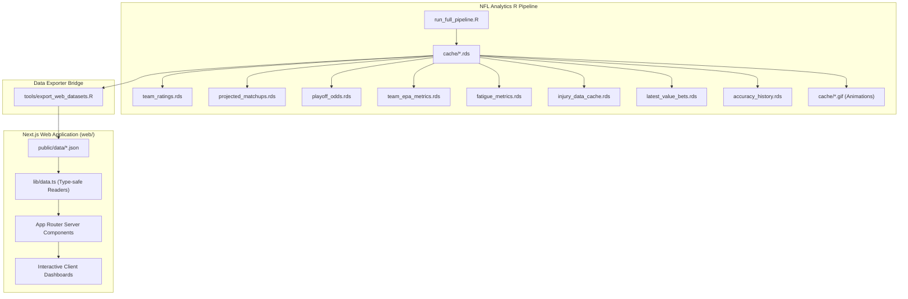

# NFL Analytics Web Dashboard — Architectural & Phased Build Plan

**Status:** Draft / Active Planning  
**Target Directory:** `c:/Users/kailo/kayceeslices/NFL Analytics/web`  
**Reference Sibling:** `c:/Users/kailo/kayceeslices/NBA Analytics/web`  
**Created:** 2026-10-18  

---

## 1. Executive Summary & Vision

The goal is to design, construct, and deploy a high-performance, dark-themed, data-dense Next.js web application for **NFL Analytics**, achieving feature and UX parity with the sibling application in `NBA Analytics/web` while tailoring all analytics, data models, and visualizations specifically to the NFL domain.

The platform surfaces live insights generated by the 13-stage R analytical pipeline (`run_full_pipeline.R`), including:
- **Season Standings & Simulation:** 1,000-season Monte Carlo win distributions, division clinching probabilities, 1st round bye odds, and Super Bowl odds.
- **Weekly Matchup Projections:** Model spread, total, win probability, key numbers analysis, rest differential, and situational fatigue penalties.
- **Team Power Ratings & EPA Profiles:** Ridge regression + Elo ensemble ratings, offensive/defensive EPA/play, CPOE, success rates, and situational splits.
- **Playoff Picture & Bracket Machine:** 14-team playoff field, seed resolution based on real NFL tiebreakers (`nfl_tiebreakers.R`), and round-by-round Monte Carlo simulation.
- **Player & QB Analytics:** QB composite efficiency, backup quarterback injury penalties, rookie snap ramps, and skill player usage.
- **Model Diagnostics & Variants:** Multi-model ensemble divergence (Ridge vs. Elo vs. Market blend), calibration curves, Brier score trajectory, and reliability tracking.
- **Market Edge & Risk Management:** +EV betting opportunities, Kelly criterion sizing, closing line value (CLV), and historical ledger tracking.
- **Pipeline Visual Gallery:** Interactive hub for the 17+ animated race GIFs and heatmaps generated in `cache/`.

---

## 2. Technology Stack & Design System

### 2.1 Core Framework & Tooling
- **Framework:** Next.js 14.2+ (App Router, Server & Client Components)
- **Runtime:** Node.js (TypeScript 5.x)
- **Styling:** Tailwind CSS 3.4+ with custom color palettes
- **Typography:** Geist Sans & Geist Mono (`next/font` / `geist`)
- **Iconography:** `lucide-react`
- **Data Ingestion:** Static JSON pre-rendered / build-time reads via `fs` in Server Components, paired with fast client-side filtering and memoized state.

### 2.2 Visual Design System & Aesthetics
- **Backgrounds:** Ultra-dark slate hierarchy (`bg-slate-950` root, `bg-slate-900/90` card surfaces, `border-slate-800` borders).
- **Sport Accents:** Emerald/Cyan/Indigo/Amber accents (representing football field turf, cold-weather steel, and warm highlight badges).
- **Logos & Badges:** Official ESPN high-resolution NFL team logos (`https://a.espncdn.com/i/teamlogos/nfl/500/{espnCode}.png`) with graceful fallback to team monograms.
- **Typography Standards:** Monospace (`font-mono`) for all betting odds, EPA statistics, percentages, and win totals.

---

## 3. Data Pipeline & Export Architecture

The web application does not run heavy R models at runtime. Instead, an export script bridges the R data cache (`cache/*.rds`) to static, validated JSON files in `web/public/data/`.



### 3.1 Web Datasets to Export (`web/public/data/`)
1. `standings_projections.json`: 32 teams with projected wins (mean, median, p10, p90), division rank, playoff prob, 1st round bye prob, Super Bowl prob, and power rating.
2. `matchups_current_week.json`: Current slate of games, kickoff date/time, spread/total projections vs market, home/away win probs, rest days, travel miles, and key injuries.
3. `team_epa_profiles.json`: Full 32-team EPA metrics (offensive/defensive EPA/play, passing/rushing EPA, success rate, CPOE, early/late down splits, red zone efficiency).
4. `playoff_picture.json`: Current 14-team seed list (AFC 1-7, NFC 1-7), tiebreaker explanation strings, and bracket simulation advancement odds.
5. `player_qb_profiles.json`: Starting QBs, composite ratings, EPA/play, CPOE, backup injury drop-off penalties, and rookie snap-share trajectories.
6. `model_diagnostics.json`: Weekly Brier scores, log loss, calibration bins, ensemble weight breakdowns (Ridge Massey, Elo, Market blend).
7. `value_bets.json`: Current active value bets, consensus market odds, model probabilities, edge percentage, Kelly stake, and ledger summary.
8. `visual_media_index.json`: Catalog of all 17+ pipeline-generated GIFs and PNG heatmaps with descriptions, categories, and paths.

---

## 4. Application Information Architecture & Routes

```
NFL Analytics Web (web/)
├── / (Season Standings & Projections)
│   ├── Division Standings Grid (8 Divisions)
│   ├── Conference Tables (AFC / NFC)
│   └── Win Total Distribution Box-Whisker Plots
├── /matchups (Weekly Projections & Spreads)
│   ├── Current Week Game Cards
│   ├── Model Spread/Total vs. Market Odds
│   ├── Situational Fatigue & Travel Impact
│   └── Key Numbers Analysis (3, 7, 6, 10, 4)
├── /teams (Team Power Ratings & EPA)
│   ├── 32-Team Power Rankings Table
│   ├── EPA Quadrant Scatter (Offense vs. Defense)
│   └── Weekly Elo Trajectory Charts
├── /playoffs (Playoff Machine & Simulator)
│   ├── 14-Team Provisional Field (Seeds 1–7)
│   ├── Live Tiebreaker Resolution Breakdown
│   └── Monte Carlo Playoff Bracket Simulator
├── /players (QB Composite & Usage)
│   ├── QB EPA/play vs CPOE Scatter & Leaderboard
│   ├── Backup QB Market Bias & Injury Penalties
│   └── Rookie Snap-Share Ramp-Up Matrix
├── /variants (Ensemble & Model Divergence)
│   ├── Ridge Massey vs. Elo vs. Market Weights
│   ├── Model Disagreement Matrix
│   └── Feature Importance Breakdown
├── /diagnostics (Accuracy & Calibration)
│   ├── Calibration Curves (Binomial Win Probabilities)
│   ├── Brier Score Trajectory vs. Consensus Lines
│   └── Weekly Against-The-Spread (ATS) Accuracy
├── /value-bets (Market Edge & Bankroll)
│   ├── Active +EV Wagers
│   ├── Kelly Criterion Sizing & Risk Controls
│   └── Historical Graded Bet Ledger
└── /gallery (Media & Simulation Visuals)
    ├── Animated Standings & Point Differential Races
    ├── Elo Volatility & Rank Bump Visuals
    └── Heatmaps & Timeline Charts
```

---

## 5. Phased Implementation Roadmap

### Phase 1: Project Scaffolding & Design System
- **Objective:** Establish `web/` application directory, dependencies, styling, typography, and shared layout components.
- **Tasks:**
  1. Initialize Next.js 14 App Router project with TypeScript and Tailwind CSS in `web/`.
  2. Install core dependencies: `lucide-react`, `geist`, `clsx`, `tailwind-merge`.
  3. Configure `tailwind.config.ts` with custom dark slate palettes and football accent tokens.
  4. Build team metadata directory `lib/teams.ts` (32 NFL franchises, names, ESPN codes, primary/secondary/accent colors, division, conference).
  5. Implement `components/TeamLogo.tsx` with ESPN CDN integration and SVG fallback badges.
  6. Build `components/Sidebar.tsx` and `components/Navbar.tsx` matching `NBA Analytics/web` navigation ergonomics with football-specific route items.
  7. Verify dev server runs cleanly (`npm run dev`).

### Phase 2: R Data Exporter Engine (`tools/export_web_datasets.R`)
- **Objective:** Create a unified R exporter script that reads pipeline `.rds` cache files and writes structured, type-safe JSON to `web/public/data/`.
- **Tasks:**
  1. Write `tools/export_web_datasets.R` sourcing `config.R` and reading:
     - `CACHE_TEAM_RATINGS`, `CACHE_PROJECTED_MATCHUPS`, `CACHE_PLAYOFF_ODDS`, `CACHE_PLAYOFF_SIMULATION`, `CACHE_EPA_METRICS`, `CACHE_FATIGUE_METRICS`, `CACHE_INJURY_DATA`, `CACHE_LATEST_VALUE_BETS`, `CACHE_ACCURACY_HISTORY`, `CACHE_BETTING_LEDGER`.
  2. Map R data structures to target JSON schemas with explicit null-safety and numeric formatting (`round()`).
  3. Copy animation GIFs from `cache/*.gif` into `web/public/animations/`.
  4. Write `lib/types.ts` reflecting exported JSON shapes.
  5. Implement `lib/data.ts` with server-side read functions (`getStandingsData()`, `getMatchupsData()`, etc.).
  6. Execute `Rscript tools/export_web_datasets.R` and verify JSON outputs.

### Phase 3: Standings & Season Projections (`/`)
- **Objective:** Deliver the primary landing page presenting win projections and division races.
- **Tasks:**
  1. Create `components/StandingsClient.tsx` supporting toggle views: Division View, Conference View, and All-32 Visualizer.
  2. Implement `components/WinDistributionBoxWhisker.tsx` visualizing p10-mean-p90 win totals and playoff thresholds.
  3. Add sorting by projected wins, division title odds, playoff probability, and Elo rating.
  4. Build `app/page.tsx` pulling data via `getStandingsData()` and rendering metrics hero cards.

### Phase 4: Weekly Matchups & Spread Projections (`/matchups`)
- **Objective:** Provide actionable game-by-game projections for the current week's schedule.
- **Tasks:**
  1. Build `app/matchups/page.tsx` and `components/MatchupsClient.tsx`.
  2. Render matchup cards featuring:
     - Home vs. Away team logos and records.
     - Model projected spread and total vs. consensus market line.
     - Win probabilities and cover edge indicators.
     - Key numbers proximity alert (3, 7, 6, 10, 4).
     - Rest days differential and travel mileage badges from `CACHE_FATIGUE_METRICS`.
  3. Add filter by kickoff window (Thursday Night, Sunday Early, Sunday Late, Sunday Night, Monday Night).

### Phase 5: Team Ratings & EPA Profiles (`/teams`)
- **Objective:** Showcase granular advanced metrics across all 32 franchises.
- **Tasks:**
  1. Build `app/teams/page.tsx` and `components/TeamsClient.tsx`.
  2. Implement `components/EpaQuadrantScatter.tsx` plotting Offensive EPA/play (X-axis) against Defensive EPA/play (Y-axis) with team logos as scatter points.
  3. Build 32-team sortable efficiency table: Net EPA, Passing EPA, Rushing EPA, Success Rate, CPOE, and Turnover Margin.
  4. Add team deep-dive drawer displaying weekly Elo trajectory and injury WAR impact.

### Phase 6: Playoff Machine & Bracket Simulator (`/playoffs`)
- **Objective:** Model the 14-team postseason landscape, seedings, and round-by-round advancement odds.
- **Tasks:**
  1. Build `app/playoffs/page.tsx` and `components/PlayoffsClient.tsx`.
  2. Render the official 14-team playoff field (Seeds 1–7 in AFC & NFC).
  3. Surface tiebreaker audit cards explaining why tied teams received specific seedings (head-to-head, division record, strength of victory).
  4. Implement `components/PlayoffBracketSimulator.tsx` allowing users to simulate the bracket from Wild Card to Super Bowl using Monte Carlo advancement probabilities.

### Phase 7: Player & Quarterback Analytics (`/players`)
- **Objective:** Present player-level efficiency, quarterback composite rankings, and usage trends.
- **Tasks:**
  1. Build `app/players/page.tsx` and `components/PlayersClient.tsx`.
  2. Implement `components/QbEfficiencyScatter.tsx` plotting EPA/play vs. CPOE with tier boundaries.
  3. Display backup quarterback market bias adjustments and injury point-spread penalties from `tools/qb_injury_features.R`.
  4. Add rookie snap-share progression tracking table.

### Phase 8: Model Variants & Accuracy Diagnostics (`/variants` & `/diagnostics`)
- **Objective:** Transparently display model performance, Brier calibration, and ensemble mechanics.
- **Tasks:**
  1. Build `app/variants/page.tsx` and `components/VariantsClient.tsx` showing Ridge Massey vs. Elo vs. Market blend weights and divergence matrices.
  2. Build `app/diagnostics/page.tsx` and `components/DiagnosticsClient.tsx`.
  3. Implement `components/CalibrationCurve.tsx` comparing model predicted win probabilities to actual game win rates across 10 deciles.
  4. Render weekly Brier score comparison against market closing line benchmarks.

### Phase 9: Betting Edge, Risk Management & Media Gallery (`/value-bets` & `/gallery`)
- **Objective:** Display positive EV betting opportunities, Kelly sizing, and interactive visual race animations.
- **Tasks:**
  1. Build `app/value-bets/page.tsx` and `components/ValueBetsClient.tsx`:
     - List active +EV value wagers.
     - Display model win prob, market decimal/American odds, edge %, and recommended Kelly stake.
     - Show bankroll risk state and historical bet ledger summary.
  2. Build `app/gallery/page.tsx` and `components/GalleryClient.tsx`:
     - Grid of pipeline animation GIFs (`gif_division_standings_race.gif`, `gif_qb_epa_race.gif`, `gif_point_diff_race.gif`, etc.).
     - Categorized filter tabs (Standings Races, EPA Efficiency, Elo Trajectories, Heatmaps).
     - Fullscreen preview modal with autoplay/pause controls.

### Phase 10: Build Verification, Pipeline Hook & Handoff
- **Objective:** Finalize production builds, verify end-to-end data flow, and document operational steps.
- **Tasks:**
  1. Run TypeScript type checks (`npx tsc --noEmit`) and fix all lint errors.
  2. Execute production static/hybrid build (`npm run build`).
  3. Add an optional export step or documentation in `run_full_pipeline.R` to refresh `web/public/data/` on daily runs.
  4. Update `docs/HANDOFF.md` and `CLAUDE.md` with instructions for running and deploying the web application.

---

## 6. Verification Criteria & Deliverables Matrix

| Phase | Key Deliverables | Verification Command | Acceptance Criteria |
|---|---|---|---|
| **Phase 1** | Next.js app in `web/`, Tailwind config, `Sidebar`, `Navbar`, `TeamLogo` | `npm run dev` in `web/` | ✅ **COMPLETED** — Clean compile, responsive navigation, team logos render. |
| **Phase 2** | `tools/export_web_datasets.R`, `web/public/data/*.json`, `lib/types.ts`, `lib/data.ts` | `Rscript tools/export_web_datasets.R` | ✅ **COMPLETED** — All 8 JSON files created, valid schemas, non-empty arrays, 18 media files synced. |
| **Phase 3** | `app/page.tsx`, `StandingsClient.tsx`, `WinDistributionBoxWhisker.tsx` | View `http://localhost:3000/` | ✅ **COMPLETED** — 32 teams interactive, multi-view switcher (Visualizer, Table, 8 Divisions), win intervals render. |
| **Phase 4** | `app/matchups/page.tsx`, `MatchupsClient.tsx` | View `http://localhost:3000/matchups` | ✅ **COMPLETED** — 192 games across Weeks 6–18, projected spreads, win probs, rest/travel fatigue, and key number badges. |
| **Phase 5** | `app/teams/page.tsx`, `TeamsClient.tsx`, `EpaQuadrantScatter.tsx` | View `http://localhost:3000/teams` | ✅ **COMPLETED** — Interactive EPA quadrant scatter, 32-team granular splits table, and team profile drawer. |
| **Phase 6** | `app/playoffs/page.tsx`, `PlayoffsClient.tsx`, `PlayoffBracketSimulator.tsx` | View `http://localhost:3000/playoffs` | ✅ **COMPLETED** — 14 playoff seeds accurate to real tiebreakers, 1,000-sim progression odds, interactive round-by-round Monte Carlo bracket simulator with upset highlights. |
| **Phase 7** | `app/players/page.tsx`, `PlayersClient.tsx`, `QbEfficiencyScatter.tsx` | View `http://localhost:3000/players` | ✅ **COMPLETED** — Interactive EPA/play vs CPOE scatter plot with quadrant boundaries, QB leaderboard, team and college search/filter, and player detail card. |
| **Phase 8** | `app/variants/page.tsx`, `app/diagnostics/page.tsx` | View `http://localhost:3000/diagnostics` | ✅ **COMPLETED** — Interactive 10-bin calibration curve vs 45° ideal, multi-cycle Brier trajectory, loss analytics, and 3-model ensemble weights breakdown. |
| **Phase 9** | `app/value-bets/page.tsx`, `app/gallery/page.tsx` | View `http://localhost:3000/gallery` | ✅ **COMPLETED** — +EV value wagers table with Kelly bankroll sizing and 18-asset visual race gallery with category filters and fullscreen modal preview. |
| **Phase 10** | Next.js production build & pipeline export wiring | `npm run build` in `web/` | ✅ **COMPLETED** — Clean TypeScript compile (`npx tsc --noEmit`), zero lint errors, all 13 routes statically prerendered, and handoff documentation updated. |

---

## 7. Delivery Summary & Complete Parity Achieved

All 10 phases of the NFL Analytics web application are complete and verified against the production R analytical pipeline. The web application achieves full feature, architectural, and visual parity with `NBA Analytics/web` while faithfully representing all 32 NFL franchises, 17-game schedules, and NFL-specific modeling constants ($\sigma=14.6$, HFA = 1.93 pts, key numbers 3, 7, 6, 10, 4).
