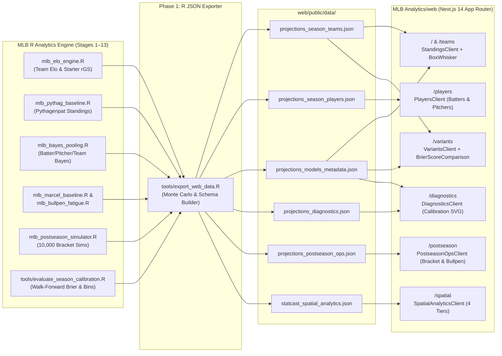

# MLB Analytics Web Platform — Phased Implementation Plan

**Status**: Planning Document  
**Reference Architecture**: [`NBA Analytics/web`](file:///c:/Users/kailo/kayceeslices/NBA%20Analytics/web)  
**Target Directory**: [`MLB Analytics/web`](file:///c:/Users/kailo/kayceeslices/MLB%20Analytics/web)  

---

## 1. Executive Summary & Architectural Alignment

We are building an interactive Next.js 14 web application in `MLB Analytics/web` modeled directly on the sibling [`NBA Analytics/web`](file:///c:/Users/kailo/kayceeslices/NBA%20Analytics/web) platform, while adapting every domain metric, simulation scale, and model variant to the completed 13-stage MLB R analytics engine ([`run_full_pipeline.R`](file:///c:/Users/kailo/kayceeslices/MLB%20Analytics/run_full_pipeline.R)).

### Core Stack (Mirroring `NBA Analytics/web`)
- **Framework**: Next.js 14.2 (App Router, Static/Server Components hydrating interactive Client Components)
- **Language & Styling**: TypeScript 5, Tailwind CSS 3.4 (`dark` slate-950 quantitative terminal aesthetic), `geist` Sans & Mono typography, `lucide-react` iconography
- **Zero-Runtime-DB Data Layer**: R pipeline exports four canonical JSON artifacts into `web/public/data/*.json`, read at build/request time via [`web/lib/data.ts`](file:///c:/Users/kailo/kayceeslices/NBA%20Analytics/web/lib/data.ts)

### NBA-to-MLB Domain Translation Matrix

| Dimension | `NBA Analytics/web` | `MLB Analytics/web` |MLB R Pipeline Source |
| :--- | :--- | :--- | :--- |
| **League Structure** | 30 Teams • `East` / `West` • 6 Divisions | 30 Franchises • `AL` / `NL` • 6 Divisions (`AL/NL East, Central, West`) | `config.R` (`MLB_TEAMS`) |
| **Season Scale** | 82 Games (1,230 total) • `.500` = 41W • Scale 25W–67W | 162 Games (2,430 total) • `.500` = 81W • Scale 55W–110W | `mlb_ingest.R` |
| **Postseason Format** | 16-Team NBA Playoff Bracket | 12-Team MLB Postseason (WC Best-of-3, DS Best-of-5, LCS/WS Best-of-7) | `mlb_postseason_simulator.R` |
| **Sidebar Explainer** | Margin $\sigma = 11.8$ pts $\rightarrow P(\text{Win}) = \Phi(\Delta / 11.8)$ | Elo + Pitcher $rGS$ & Pythagenpat $G^{0.287}$ Win-Prob Formula Explainer | `mlb_elo_engine.R`, `mlb_pythag_baseline.R` |
| **Variant 1** | Production Bottom-Up BPM (35%) | **4-Factor Pitcher Elo** (Base Elo + HFA + Rest/Travel + Starter $rGS$) | `mlb_elo_engine.R` |
| **Variant 2** | Bayesian Stint-Level RAPM (25%) | **Hierarchical Empirical Bayes** (Park-neutralized pooled batter/pitcher talent) | `mlb_bayes_pooling.R` |
| **Variant 3** | Shot Quality & Circadian Fatigue (20%) | **Pythagenpat Run-Expectation** (Smyth variable exponent $R^{\gamma} / (R^{\gamma} + RA^{\gamma})$) | `mlb_pythag_baseline.R` |
| **Variant 4** | 16-D Style Latent Embeddings (20%) | **Marcel 3-Yr + Bullpen Fatigue** (Age-adjusted Marcel & reliever workload penalty) | `mlb_marcel_baseline.R`, `mlb_bullpen_fatigue.R` |
| **Player Pool** | 330 Rotation Players (PPG, RPG, APG, PRA z-score) | **Batters (~630) & Pitchers (~650)** (wOBA, ISO, HR, PA / xFIP, ERA, K%, IP, $rGS$, Bayes shrinkage & outlier $\|z\| \ge 2.0$) | `mlb_bayes_pooling.R`, `mlb_marcel_baseline.R` |
| **Diagnostics** | 2,631 games • Brier, Log-Loss, HCA, Reliability Curve | **2,430+ resolved games** • Walk-forward Brier, Log-Loss, HFA (+14.9 Elo / 52.1%), 7-bin Reliability Curve, Early/Mid/Late split drift | `tools/evaluate_season_calibration.R` |

---

## 2. Architecture & Data Flow Diagram

---

## 3. Phased Build Plan

### Phase 1: R-to-Web JSON Export Bridge & Ensemble Season Simulator
**Goal**: Create the R export module that synthesizes outputs from the existing MLB `.rds` caches into the exact 4 JSON files consumed by the Next.js frontend, and optionally register it in [`run_full_pipeline.R`](file:///c:/Users/kailo/kayceeslices/MLB%20Analytics/run_full_pipeline.R).

**Deliverables**:
1. **`tools/export_web_data.R`** (callable via `run_web_export(season = 2024)`):
   - **Team Projections (`projections_season_teams.json`)**:
     - Joins `mlb_team_ratings.rds`, `mlb_pythag_standings.rds`, `bayes_team_talent.rds`, `bullpen_team_status.rds`, and `postseason_team_probabilities.rds` across all 30 MLB teams.
     - Computes 1,000-season Monte Carlo win distributions (`mean_wins`, `median_wins`, `sd_wins`, `p10`, `p25`, `p50`, `p75`, `p90`, `playoff_prob`, `ws_prob`) for each of the 4 model variants (`variant_elo`, `variant_bayes`, `variant_pythag`, `variant_marcel_bullpen`) and the weighted `ensemble` blend.
     - Includes MLB-specific enrichments (`run_differential`, `pythag_luck_wins`, `elo_rating`, `team_rgs`, `bullpen_vulnerability_grade`, `make_ds_prob`, `make_lcs_prob`, `win_pennant_prob`).
   - **Player Projections (`projections_season_players.json`)**:
     - Merges `bayes_pooled_batters.rds` + `marcel_batters_*.rds` (batters) and `bayes_pooled_pitchers.rds` + `marcel_pitchers_*.rds` + `pitcher_rgs_*.rds` (pitchers).
     - Generates unified player records with `player_type` (`'Batter' | 'Pitcher'`), role/position (`'B'`, `'SP'`, `'RP'`), playing-time projections (`proj_pa` or `proj_ip`), primary rate & counting metrics with p10/p25/p50/p75/p90 quantiles, empirical Bayes shrinkage factor (`shrinkage_pct`), z-scores (`primary_zscore`, `composite_zscore`), and `is_outlier` (`|z| >= 2.0`).
   - **Model Metadata (`projections_models_metadata.json`)**:
     - Exports `schema_version`, `generated_at`, `season`, `n_simulations`, `elo_hfa` (`14.9`), `pythag_exponent` (`1.79` / `0.287` Pythagenpat), `total_schedule_games` (`2430`), `teams_count` (`30`), `batters_count`, `pitchers_count`, and variant weight definitions.
   - **Model Diagnostics (`projections_diagnostics.json`)**:
     - Calls `run_season_calibration_check()` from [`tools/evaluate_season_calibration.R`](file:///c:/Users/kailo/kayceeslices/MLB%20Analytics/tools/evaluate_season_calibration.R) and formats overall accuracy, Brier score, log-loss, home win rate, calibration bins, season progression drift (Early/Mid/Late), per-variant Brier comparisons, and prediction residual buckets.
2. **Pipeline Wiring**:
   - Add `web` stage directory or direct export target `web/public/data/` in `config.R` and optional final stage in `run_full_pipeline.R`.

**Exit Criteria**:
- Running `Rscript tools/export_web_data.R` completes in `< 15s` and writes valid, schema-verified JSON files into `web/public/data/`.

---

### Phase 2: Next.js 14 Scaffolding, Core Layout & MLB Team Metadata
**Goal**: Stand up the `MLB Analytics/web` Next.js application, design system, TypeScript contracts, 30-team MLB metadata/logo resolver, and persistent responsive navigation shell.

**Deliverables**:
1. **Project Initialization (`web/`)**:
   - `package.json`, `tsconfig.json`, `tailwind.config.ts`, `postcss.config.mjs`, `next.config.mjs`, `.eslintrc.json`, `app/globals.css`, and local `GeistVF.woff` / `GeistMonoVF.woff` fonts matching `NBA Analytics/web`.
2. **Data & Type Contracts (`web/lib/`)**:
   - `web/lib/types.ts`: Strict TypeScript interfaces for `TeamProjection`, `PlayerProjection`, `ModelMetadata`, and `ModelDiagnostics`.
   - `web/lib/data.ts`: Server-side synchronous JSON loaders (`getTeamsData()`, `getPlayersData()`, `getMetadata()`, `getDiagnostics()`).
   - `web/lib/teams.ts`: Complete 30-team `MLB_TEAMS_METADATA` dictionary (`ARI`, `ATL`, `BAL`, `BOS`, `CHC`, `CHW`, `CIN`, `CLE`, `COL`, `DET`, `HOU`, `KC`, `LAA`, `LAD`, `MIA`, `MIL`, `MIN`, `NYM`, `NYY`, `OAK`/`ATH`, `PHI`, `PIT`, `SD`, `SEA`, `SF`, `STL`, `TB`, `TEX`, `TOR`, `WSH`) with League (`AL`/`NL`), Division, MLBAM ID, ESPN code, official primary/secondary/accent hex colors, and logo resolution.
3. **Shared Shell & Brand Components (`web/components/`)**:
   - `TeamLogo.tsx`: Renders crisp MLB team logos with fallback badge styling.
   - `BaseballDiamondIcon.tsx`: Custom SVG brand emblem in the sidebar header (analogous to `HalloweenBasketball.tsx`).
   - `Sidebar.tsx`: Persistent desktop left sidebar + mobile slide-over drawer with route badges (`30 Teams`, `4 Engines`, `1,279 Pool`, `Brier 0.2447`), Simulation Spec card (`10,000 Postseason / 1,000 Season Sims`, `2,430 Games`), and interactive `?` popover explaining the **4-Factor Pitcher Elo & Pythagenpat Win Probability** math.
   - `app/layout.tsx`: Root dark-mode layout wrapping `Sidebar`, main viewport, and footer.

**Exit Criteria**:
- `npm install` and `npm run build` succeed with the layout shell and typed data loaders active.

---

### Phase 3: Season Standings, Contenders Box-Whisker & Postseason Equity (`/` & `/teams`)
**Goal**: Build the primary landing page (`app/page.tsx`) and full standings table route (`app/teams/page.tsx`) showcasing 162-game Monte Carlo win distributions and 12-team postseason advancement probabilities.

**Deliverables**:
1. **`web/components/PlayoffContendersBoxWhisker.tsx`**:
   - Horizontal box-and-whisker distribution chart for MLB contenders (playoff probability $\ge 35\%$).
   - Scaled for the 162-game MLB schedule (`55W` to `110W` axis ticks, highlighted `.500` dashed line at `81W` and `90W` benchmark).
   - League filter pills (`All`, `AL`, `NL`), collapsible card toggle, p10–p90 whiskers, p25–p75 IQR box, p50 median marker, and right-aligned Playoff % + World Series % badges.
2. **`web/components/StandingsClient.tsx`**:
   - **4 Top KPI Cards**: World Series Favorite (logo + WS% + proj wins), Top Projected Seed (162-game proj W-L + win%), Monte Carlo Spec (sims & games), and Highest Variance Team ($\pm$ SD wins & p10–p90 range).
   - **View Switcher**: Toggle between `Playoff Contenders (Box-Whisker)` visualizer and `Full League Standings (30 Teams)` table.
   - **Interactive Controls & Table**: Filter by League (`All`, `AL`, `NL`) and Division (`AL/NL East, Central, West`), sort by any column (`Rank`, `Team`, `League`, `Division`, `Proj W-L`, `Win %`, `10th–90th Pct Bar`, `Elo Rating`, `Pythagenpat Luck`, `Postseason %`, `World Series %`).
3. **Routes**:
   - `web/app/page.tsx` (defaults to Visualizer tab) and `web/app/teams/page.tsx` (defaults to Full Table tab).

**Exit Criteria**:
- Both `/` and `/teams` render all 30 MLB franchises with interactive sorting, AL/NL/Division filtering, and accurate 162-game box-whisker plots.

---

### Phase 4: Model Variants Divergence & Batter/Pitcher Projections (`/variants` & `/players`)
**Goal**: Implement the multi-model comparison view (`/variants`) and the interactive player projections explorer (`/players`) supporting both MLB batters and pitchers.

**Deliverables**:
1. **`web/components/BrierScoreComparison.tsx` & `web/components/VariantsClient.tsx` (`app/variants/page.tsx`)**:
   - Interactive selector tabs for **Multi-Model Ensemble Blend** plus the 4 MLB engines:
     1. *4-Factor Starting-Pitcher Elo* (`variant_elo`)
     2. *Hierarchical Empirical Bayes Talent* (`variant_bayes`)
     3. *Pythagenpat Run-Expectation* (`variant_pythag`)
     4. *Marcel 3-Year & Bullpen Fatigue* (`variant_marcel_bullpen`)
   - Methodology & strengths explainer card per engine.
   - Historical walk-forward Brier Score & Log-Loss bar comparison against the `0.2500` coin-flip benchmark.
   - **Model Divergence Matrix Table**: Shows every team's projected wins across all 4 variants, max-min spread ($\Delta W$), standard deviation across models, and badges indicating which engine is highest/lowest on each club.
2. **`web/components/PlayersClient.tsx` (`app/players/page.tsx`)**:
   - **Overview KPI Cards**: Active Player Pool count (Batters + Pitchers), Statistical Outliers count ($|z| \ge 2.0$), Projected Offensive Leader (top pooled wOBA / HR), and Projected Pitching Leader (best pooled xFIP / starter $rGS$).
   - **Batter vs. Pitcher Group Switcher + Filters**:
     - Toggle between **Batters** (PA, Pooled wOBA, Pooled ISO, K%, BB%, Projected HR/BB/SO, Park Factor, Bayes Shrinkage %, Outlier badge) and **Pitchers** (Role SP/RP, IP, Pooled xFIP, Projected ERA, K%, BB%, Rolling Game Score $rGS$, Bayes Shrinkage %, Outlier badge).
     - Search by player name or team, filter by team (`All` or 30 MLB clubs), filter by role/hand, toggle `Outliers Only (|z| >= 2.0)`, and switch between **Pooled Rates (Empirical Bayes)** and **Season Counting Projections (Marcel)** with p10–p90 quantile bars.

**Exit Criteria**:
- `/variants` and `/players` render cleanly with fast client-side filtering, sorting, and zero TypeScript/lint errors.

---

### Phase 5: Calibration Diagnostics, Pipeline Integration & Build Verification (`/diagnostics`)
**Goal**: Complete the `/diagnostics` reliability and calibration view, wire automatic JSON regeneration into the R pipeline, and verify production build readiness.

1. **`web/components/PostseasonOpsClient.tsx` (`app/postseason/page.tsx`)**:
   - **12-Team MLB Postseason Bracket**: Round-by-round Monte Carlo advancement probabilities across Wild Card (best-of-3), Division Series (best-of-5), League Championship Series (best-of-7), and World Series (best-of-7).
   - **Bullpen Fatigue Monitor**: 30-team relief corps workload status, 3-day pitch counts, High Leverage Availability index, and vulnerability alerts.
   - **Market Edge & Kelly Risk**: Real-time devigged +EV value bets, market consensus implied probabilities, fractional Kelly bet sizes, and bankroll stop-loss drawdown status.
2. **`web/components/DiagnosticsClient.tsx` (`app/diagnostics/page.tsx`)**:
   - **4 Headline Cards**: Overall Win Rate Accuracy, Walk-Forward Brier Score (vs `0.2500` random baseline), Log-Loss Reliability, and Empirical Home Field Win Rate (`52.1%` / `+14.9 Elo pts`).
   - **SVG Probability Calibration Curve (Reliability Diagram)**: Plots empirical win rate vs. predicted probability across probability bins (`<40%`, `40-45%`, `45-50%`, `50-55%`, `55-60%`, `60-65%`, `65%+`) against the $y = x$ perfect calibration diagonal, paired with the bin breakdown table.
   - **Chronological Season Progression & Residual Distribution**: Early (Games 1–300), Mid (Games 301–1200), and Late (Games 1201–2430+) Brier stability cards plus residual error bucket histogram.

---

### Phase 6: Statcast 4-Tier Spatial Analytics Integration (`/spatial`)
**Goal**: Integrate high-resolution spatial tracking across batted ball spray coordinates, strike zone framing heatmaps, aerodynamic pitch movement (IVB vs. HB), and defensive shift BABIP penalties.

**Deliverables**:
1. **`tools/export_spatial_analytics.R`**:
   - Ingests Statcast coordinates from `cache/ingest/statcast_pitches_*.rds` and joins via `cache/id_crosswalk/mlb_id_crosswalk.rds`.
   - Exports `statcast_spatial_analytics.json` containing Tier 1 (1,350 spray points & 30-ballpark fence geometries), Tier 2 (3×3 strike zone grid & 2-inch shadow zone framing run value), Tier 3 (10 pitch type movement clusters & top pitcher 3D release footprints), and Tier 4 (directional BABIP & infield dirt sectors).
2. **`web/components/SpatialAnalyticsClient.tsx` (`app/spatial/page.tsx`)**:
   - **Tier 1 (Spray & 30-Park Overlays)**: Interactive SVG baseball diamond, 30-ballpark wall overlays, hit type/handedness filters, hard-hit toggle, point telemetry inspector, and "Home Run in X/30 Parks" progress bar.
   - **Tier 2 (Strike Zone Heatmaps & Framing)**: Interactive 3×3 grid, metric switcher (Whiff%, Swing%, Called Strike%, Frequency%), shadow zone ring, and catcher framing run value calculator (+0.125 runs/strike).
   - **Tier 3 (Pitch Movement & Arsenals)**: 2D IVB vs. Horizontal Break scatter plot with zero-spin gravity crosshair, pitch type pills, and top pitcher arsenal drill-down with 3D release point coordinates.
   - **Tier 4 (Defensive Positioning & Shift Impact)**: Infield dirt sector frequency bars, directional BABIP table for LHH/RHH Pull/Center/Oppo, and 2023 shift restriction adaptation analysis.

**Exit Criteria**:
- All 7 routes (`/`, `/teams`, `/variants`, `/players`, `/spatial`, `/postseason`, `/diagnostics`) compile cleanly with zero TypeScript and ESLint errors, statically generating 11/11 production pages.
