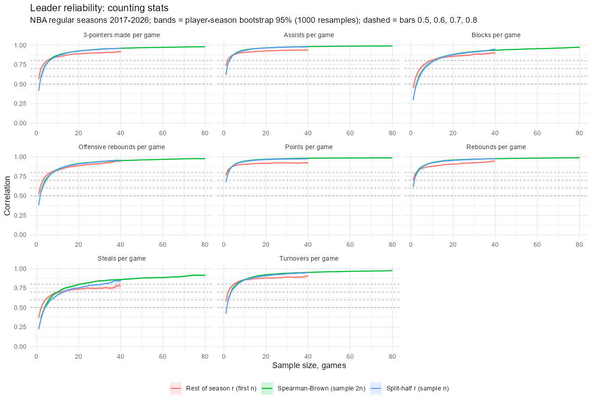
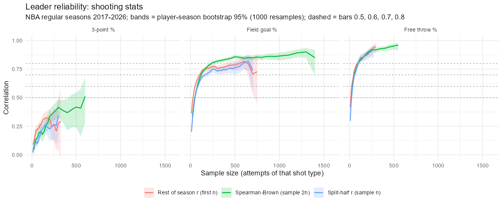
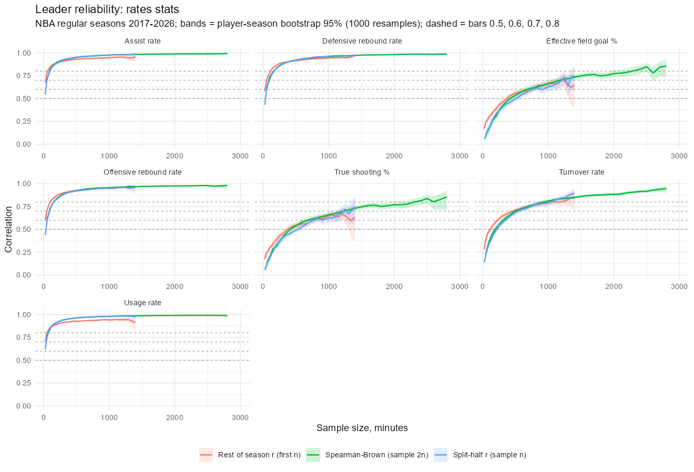
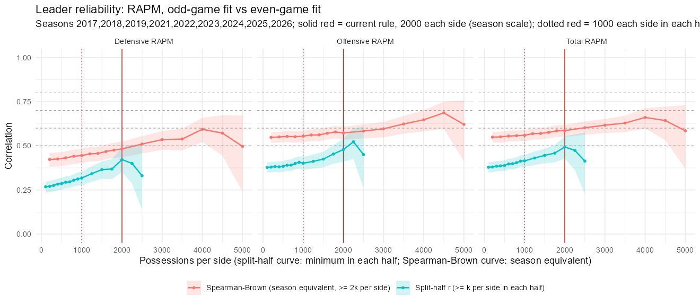

# Leader reliability study (issue #253)

Research only. This study measures how quickly each league-leader stat settles as a player's sample grows. It does not choose any qualifying minimum and changes no production code; the owner reviews these curves and sets the minimums (used by the leaders panel, #254).

Generated by `tools/leader_reliability_study.R` (seed 253, 1000 bootstrap resamples). Runtime of this run: 2.2 minutes.

## Data

- NBA regular seasons 2017, 2018, 2019, 2021, 2022, 2023, 2024, 2025, 2026 (hoopR end-year numbering, so 2026 is 2025-26). 2020 is left out because that regular season was halted and never completed; 2026-27 is in progress and is not used. 4,974 player-seasons.
- Player box scores: ESPN via hoopR (`load_nba_player_box`; 2024-2026 from the project's player box cache, which holds the same hoopR table). Team box scores: `hoopR::load_nba_team_box`.
- Regular season only (`season_type == 2`). Rows flagged `did_not_play` are excluded. Rows not flagged but with no minutes recorded are excluded and counted below. Nothing is imputed: a missing value makes any sample that contains it missing at that point, and the number of such player-seasons is reported at every point (`n_missing` in the JSON).
- A player-season covers every team the player played for that season. Team context (team minutes, team and opponent totals) is taken game by game for the team he played for in that game.

| Season | Player box source | Regular-season rows | Did not play | Played, minutes missing | Player-games used | Games | Rows missing a box stat | Rows missing team context |
|---|---|---|---|---|---|---|---|---|
| 2017 | hoopR::load_nba_player_box(2017) | 31,584 | 5,421 | 23 | 26,140 | 1230 | 0 | 0 |
| 2018 | hoopR::load_nba_player_box(2018) | 31,009 | 4,875 | 14 | 26,120 | 1231 | 0 | 0 |
| 2019 | hoopR::load_nba_player_box(2019) | 30,865 | 4,701 | 17 | 26,147 | 1231 | 0 | 0 |
| 2021 | hoopR::load_nba_player_box(2021) | 28,906 | 5,830 | 1 | 23,075 | 1081 | 0 | 0 |
| 2022 | hoopR::load_nba_player_box(2022) | 31,353 | 5,289 | 0 | 26,064 | 1231 | 0 | 0 |
| 2023 | hoopR::load_nba_player_box(2023) | 31,575 | 5,653 | 0 | 25,922 | 1231 | 0 | 0 |
| 2024 | player_box_scores_cache.rds | 32,552 | 6,004 | 0 | 26,548 | 1232 | 0 | 0 |
| 2025 | player_box_scores_cache.rds | 32,662 | 6,218 | 68 | 26,376 | 1234 | 0 | 0 |
| 2026 | player_box_scores_cache.rds | 32,294 | 5,551 | 35 | 26,708 | 1235 | 0 | 0 |

## Methods

- **Split-half reliability.** Each player-season's games are numbered in date order; odd-numbered games form half A and even-numbered games half B. At each sample size n the stat is computed on each half from the first n units of that half, for every player-season whose two halves each reach n units, and the two halves are correlated across player-seasons (Pearson). The raw correlation is the reliability of an n-unit sample. The Spearman-Brown value 2r / (1 + r) is the projected reliability of a 2n-unit sample and is plotted at 2n.
- **Rest-of-season check.** The stat over a player's first n units of the season against the same stat over all of his remaining games that season. Rule: only player-seasons whose remaining games hold at least n units are used, so the remainder is never smaller than the early sample.
- **Units.** Counting stats: games played. Shooting: attempts of that shot type. Rates: minutes. Games are indivisible, so for attempts and minutes a sample of n is the shortest run of whole games whose cumulative units reach n; the mean realised size is reported in the JSON (`mean_realised_units`).
- **Intervals.** Player-season block bootstrap: player-seasons are resampled with replacement (1000 resamples, seed 253), every curve point is recomputed on each resample with the same draw, and the 2.5th and 97.5th percentiles are reported. Points with fewer than 30 player-seasons are not reported.
- **Reading the curves at large n.** Only high-volume players reach large samples, so the player pool narrows as n grows; a narrower spread of true talent lowers correlations. A curve that flattens or dips at the right-hand end reflects that selection as well as noise, and the player count at each point should be read with it.
- **Who is in the pool.** As issue #253 specifies, every player-season that reaches n is correlated, from deep bench to stars. The spread of true levels across that pool is wide (a starter's points per game differ from a reserve's mostly through role and minutes), and a wide spread makes correlations high at small n. Separating players near the top of a leader list from each other is a harder task than this pool-wide correlation measures, so the crossings below describe the whole league, not the top of a list.

## Rate formulas

Basketball Reference definitions, computed from player and team box scores. For a sample of games each rate is the sum of its per-game numerators over the sum of its per-game denominators. MP is the player's minutes; TmMP is the sum of his team's player minutes in that game; Tm and Opp are the team box totals of his team and its opponent in that game. Team turnovers are the team box `turnovers` (player-credited turnovers, matching the sum of player turnovers).

| Rate | Formula |
|---|---|
| Effective field goal % | (FG + 0.5 x 3P) / FGA |
| True shooting % | PTS / (2 x (FGA + 0.44 x FTA)) |
| Turnover rate | 100 x TOV / (FGA + 0.44 x FTA + TOV) |
| Offensive rebound rate | 100 x ORB x (TmMP / 5) / (MP x (TmORB + OppDRB)) |
| Defensive rebound rate | 100 x DRB x (TmMP / 5) / (MP x (TmDRB + OppORB)) |
| Assist rate | 100 x AST / (((MP / (TmMP / 5)) x TmFG) - FG) |
| Usage rate | 100 x ((FGA + 0.44 x FTA + TOV) x (TmMP / 5)) / (MP x (TmFGA + 0.44 x TmFTA + TmTOV)) |

## Curves

### Counting stats (per game, by games played)

### Shooting percentages (by attempts)

### Rates (by minutes)

### Snapshot at one sample size per unit

Correlation [bootstrap 95%] and player-season count. The full curves are in the results JSON.

| Stat | Unit | n | Split-half r at n | Spearman-Brown (2n) | Rest-of-season r at n |
|---|---|---|---|---|---|
| Points per game | games | 20 | 0.96 [0.96, 0.97] (N=3144) | 0.98 [0.98, 0.98] | 0.92 [0.91, 0.92] (N=3144) |
| Rebounds per game | games | 20 | 0.95 [0.95, 0.96] (N=3144) | 0.98 [0.97, 0.98] | 0.91 [0.90, 0.91] (N=3144) |
| Offensive rebounds per game | games | 20 | 0.91 [0.90, 0.92] (N=3144) | 0.95 [0.95, 0.96] | 0.89 [0.87, 0.90] (N=3144) |
| Assists per game | games | 20 | 0.96 [0.96, 0.97] (N=3144) | 0.98 [0.98, 0.98] | 0.93 [0.92, 0.93] (N=3144) |
| Steals per game | games | 20 | 0.75 [0.74, 0.77] (N=3144) | 0.86 [0.85, 0.87] | 0.74 [0.72, 0.76] (N=3144) |
| Blocks per game | games | 20 | 0.88 [0.86, 0.89] (N=3144) | 0.93 [0.93, 0.94] | 0.86 [0.84, 0.87] (N=3144) |
| Turnovers per game | games | 20 | 0.91 [0.90, 0.91] (N=3144) | 0.95 [0.95, 0.96] | 0.88 [0.87, 0.89] (N=3144) |
| 3-pointers made per game | games | 20 | 0.92 [0.92, 0.93] (N=3144) | 0.96 [0.96, 0.96] | 0.89 [0.88, 0.90] (N=3144) |
| Field goal % | field goal attempts | 200 | 0.72 [0.69, 0.74] (N=1916) | 0.84 [0.82, 0.85] | 0.76 [0.73, 0.78] (N=1975) |
| 3-point % | 3-point attempts | 100 | 0.20 [0.15, 0.25] (N=1443) | 0.34 [0.27, 0.40] | 0.26 [0.22, 0.31] (N=1515) |
| Free throw % | free throw attempts | 100 | 0.81 [0.77, 0.84] (N=624) | 0.89 [0.87, 0.91] | 0.81 [0.78, 0.84] (N=711) |
| Effective field goal % | minutes | 500 | 0.50 [0.46, 0.53] (N=2386) | 0.66 [0.63, 0.69] | 0.56 [0.53, 0.59] (N=2414) |
| True shooting % | minutes | 500 | 0.49 [0.46, 0.52] (N=2386) | 0.66 [0.63, 0.69] | 0.54 [0.51, 0.57] (N=2414) |
| Turnover rate | minutes | 500 | 0.68 [0.65, 0.71] (N=2386) | 0.81 [0.79, 0.83] | 0.71 [0.69, 0.73] (N=2414) |
| Offensive rebound rate | minutes | 500 | 0.92 [0.91, 0.93] (N=2386) | 0.96 [0.95, 0.96] | 0.93 [0.92, 0.93] (N=2414) |
| Defensive rebound rate | minutes | 500 | 0.92 [0.91, 0.93] (N=2386) | 0.96 [0.95, 0.96] | 0.91 [0.91, 0.92] (N=2414) |
| Assist rate | minutes | 500 | 0.95 [0.95, 0.96] (N=2386) | 0.98 [0.97, 0.98] | 0.93 [0.92, 0.94] (N=2414) |
| Usage rate | minutes | 500 | 0.96 [0.96, 0.97] (N=2386) | 0.98 [0.98, 0.98] | 0.93 [0.92, 0.93] (N=2414) |

## RAPM

Seasons fit: 2017, 2018, 2019, 2021, 2022, 2023, 2024, 2025, 2026. For each season the regular-season games (NBA Stats game ids with prefix `002`) are sorted by game id, which follows the schedule, and alternately assigned to an odd half and an even half. `estimate_rapm_from_possessions()` from `rapm_engine.R` (sourced unchanged, lambda = 3000) is fit on each half separately and players rated in both halves are paired. A player-season's exposure is the smallest of his offensive and defensive possessions across the two halves ("possessions per side in each half").
All requested seasons were fit.

Rest-of-season check for RAPM: not run. RAPM is a joint ridge fit over all players, so a player-specific "first n possessions vs the rest" split would need a separate refit for every player and cutoff; the split-half fits above are the RAPM reliability measure delivered here.

No synthetic RAPM path is used: the script calls only `load_or_build_possession_cache()` and `estimate_rapm_from_possessions()`, which fit published possession data, and never calls `estimate_rapm_ratings()` or any fallback.

### Comparison with the current rule (2,000 possessions each side)

Each half holds about half a season, so the current season-scale rule corresponds to about 1,000 per side in each half; the Spearman-Brown value projects the half-season correlation to a full-season sample.

- orapm: split-half r 0.40 [0.36, 0.44] among the 2234 player-seasons with at least 1,000 per side in each half; Spearman-Brown (season scale, about 2,000 per side) 0.57 [0.53, 0.61].
- drapm: split-half r 0.32 [0.28, 0.35] among the 2234 player-seasons with at least 1,000 per side in each half; Spearman-Brown (season scale, about 2,000 per side) 0.48 [0.43, 0.52].
- total_rapm: split-half r 0.41 [0.38, 0.45] among the 2234 player-seasons with at least 1,000 per side in each half; Spearman-Brown (season scale, about 2,000 per side) 0.59 [0.55, 0.62].

Caveats specific to RAPM: ridge shrinkage pulls low-exposure players toward 0 in both halves, and half-season fits carry the same penalty as full-season fits on half the data, so these correlations describe the engine as configured, not an unshrunk rating. The bootstrap resamples player-seasons from the fitted pairs; it does not refit the ridge, so its intervals omit fitting uncertainty. Players in the same lineups share possessions, so ratings are not independent across players.

### By possessions-per-side bins

| Measure | Possessions per side in each half | Player-seasons | Split-half r [95%] | Spearman-Brown [95%] |
|---|---|---|---|---|
| orapm | 0-249 | 1134 | 0.15 [0.08, 0.22] | 0.26 [0.15, 0.36] |
| orapm | 250-499 | 527 | 0.15 [0.08, 0.22] | 0.26 [0.14, 0.37] |
| orapm | 500-749 | 453 | 0.16 [0.07, 0.24] | 0.27 [0.13, 0.38] |
| orapm | 750-999 | 452 | 0.20 [0.11, 0.29] | 0.33 [0.19, 0.45] |
| orapm | 1,000-1,499 | 856 | 0.24 [0.18, 0.30] | 0.39 [0.30, 0.47] |
| orapm | 1,500-1,999 | 781 | 0.35 [0.28, 0.41] | 0.52 [0.44, 0.58] |
| orapm | 2,000-2,499 | 494 | 0.48 [0.40, 0.54] | 0.65 [0.57, 0.70] |
| orapm | 2,500-up | 103 | 0.45 [0.26, 0.61] | 0.62 [0.41, 0.76] |
| drapm | 0-249 | 1134 | 0.09 [0.02, 0.16] | 0.16 [0.03, 0.28] |
| drapm | 250-499 | 527 | 0.09 [-0.00, 0.18] | 0.16 [-0.00, 0.30] |
| drapm | 500-749 | 453 | 0.19 [0.10, 0.28] | 0.31 [0.18, 0.44] |
| drapm | 750-999 | 452 | 0.17 [0.09, 0.25] | 0.29 [0.16, 0.40] |
| drapm | 1,000-1,499 | 856 | 0.23 [0.17, 0.29] | 0.37 [0.29, 0.45] |
| drapm | 1,500-1,999 | 781 | 0.32 [0.25, 0.38] | 0.48 [0.39, 0.55] |
| drapm | 2,000-2,499 | 494 | 0.44 [0.37, 0.51] | 0.61 [0.54, 0.68] |
| drapm | 2,500-up | 103 | 0.33 [0.14, 0.51] | 0.50 [0.24, 0.67] |
| total_rapm | 0-249 | 1134 | 0.14 [0.07, 0.20] | 0.24 [0.13, 0.33] |
| total_rapm | 250-499 | 527 | 0.15 [0.07, 0.24] | 0.26 [0.13, 0.38] |
| total_rapm | 500-749 | 453 | 0.19 [0.10, 0.28] | 0.32 [0.19, 0.44] |
| total_rapm | 750-999 | 452 | 0.23 [0.14, 0.31] | 0.37 [0.24, 0.47] |
| total_rapm | 1,000-1,499 | 856 | 0.28 [0.22, 0.34] | 0.44 [0.36, 0.50] |
| total_rapm | 1,500-1,999 | 781 | 0.39 [0.32, 0.44] | 0.56 [0.49, 0.61] |
| total_rapm | 2,000-2,499 | 494 | 0.50 [0.44, 0.57] | 0.67 [0.61, 0.72] |
| total_rapm | 2,500-up | 103 | 0.41 [0.23, 0.58] | 0.59 [0.37, 0.73] |

### At least k possessions per side in each half

| Measure | At least k per side in each half | Season equivalent (2k) | Player-seasons | Split-half r [95%] | Spearman-Brown [95%] |
|---|---|---|---|---|---|
| orapm | 100 | 200 | 4113 | 0.38 [0.35, 0.41] | 0.55 [0.52, 0.58] |
| orapm | 200 | 400 | 3799 | 0.38 [0.35, 0.41] | 0.55 [0.52, 0.58] |
| orapm | 300 | 600 | 3562 | 0.38 [0.35, 0.41] | 0.55 [0.52, 0.58] |
| orapm | 400 | 800 | 3322 | 0.38 [0.35, 0.41] | 0.55 [0.52, 0.58] |
| orapm | 500 | 1,000 | 3139 | 0.38 [0.35, 0.41] | 0.55 [0.52, 0.59] |
| orapm | 600 | 1,200 | 2970 | 0.39 [0.36, 0.42] | 0.56 [0.53, 0.59] |
| orapm | 700 | 1,400 | 2789 | 0.39 [0.36, 0.42] | 0.56 [0.53, 0.59] |
| orapm | 800 | 1,600 | 2590 | 0.40 [0.37, 0.43] | 0.57 [0.54, 0.60] |
| orapm | 900 | 1,800 | 2410 | 0.41 [0.37, 0.44] | 0.58 [0.54, 0.61] |
| orapm | 1,000 | 2,000 | 2234 | 0.40 [0.36, 0.44] | 0.57 [0.53, 0.61] |
| orapm | 1,250 | 2,500 | 1795 | 0.41 [0.37, 0.45] | 0.58 [0.54, 0.62] |
| orapm | 1,500 | 3,000 | 1378 | 0.42 [0.38, 0.47] | 0.60 [0.55, 0.64] |
| orapm | 1,750 | 3,500 | 964 | 0.45 [0.40, 0.50] | 0.62 [0.57, 0.67] |
| orapm | 2,000 | 4,000 | 597 | 0.48 [0.41, 0.54] | 0.65 [0.58, 0.70] |
| orapm | 2,250 | 4,500 | 302 | 0.52 [0.43, 0.60] | 0.69 [0.60, 0.75] |
| orapm | 2,500 | 5,000 | 103 | 0.45 [0.26, 0.61] | 0.62 [0.41, 0.76] |
| drapm | 100 | 200 | 4113 | 0.27 [0.24, 0.30] | 0.42 [0.38, 0.46] |
| drapm | 200 | 400 | 3799 | 0.27 [0.24, 0.30] | 0.43 [0.38, 0.46] |
| drapm | 300 | 600 | 3562 | 0.28 [0.24, 0.31] | 0.43 [0.39, 0.47] |
| drapm | 400 | 800 | 3322 | 0.28 [0.25, 0.31] | 0.44 [0.40, 0.48] |
| drapm | 500 | 1,000 | 3139 | 0.29 [0.25, 0.32] | 0.45 [0.40, 0.48] |
| drapm | 600 | 1,200 | 2970 | 0.29 [0.26, 0.33] | 0.45 [0.41, 0.49] |
| drapm | 700 | 1,400 | 2789 | 0.30 [0.26, 0.33] | 0.46 [0.41, 0.49] |
| drapm | 800 | 1,600 | 2590 | 0.31 [0.27, 0.34] | 0.47 [0.42, 0.51] |
| drapm | 900 | 1,800 | 2410 | 0.31 [0.27, 0.35] | 0.48 [0.43, 0.52] |
| drapm | 1,000 | 2,000 | 2234 | 0.32 [0.28, 0.35] | 0.48 [0.43, 0.52] |
| drapm | 1,250 | 2,500 | 1795 | 0.34 [0.30, 0.38] | 0.51 [0.46, 0.55] |
| drapm | 1,500 | 3,000 | 1378 | 0.37 [0.31, 0.41] | 0.54 [0.48, 0.58] |
| drapm | 1,750 | 3,500 | 964 | 0.37 [0.31, 0.43] | 0.54 [0.47, 0.60] |
| drapm | 2,000 | 4,000 | 597 | 0.42 [0.35, 0.49] | 0.59 [0.52, 0.66] |
| drapm | 2,250 | 4,500 | 302 | 0.40 [0.29, 0.51] | 0.57 [0.45, 0.67] |
| drapm | 2,500 | 5,000 | 103 | 0.33 [0.14, 0.51] | 0.50 [0.24, 0.67] |
| total_rapm | 100 | 200 | 4113 | 0.38 [0.35, 0.41] | 0.55 [0.52, 0.58] |
| total_rapm | 200 | 400 | 3799 | 0.38 [0.35, 0.41] | 0.55 [0.52, 0.58] |
| total_rapm | 300 | 600 | 3562 | 0.38 [0.35, 0.41] | 0.56 [0.52, 0.59] |
| total_rapm | 400 | 800 | 3322 | 0.39 [0.36, 0.41] | 0.56 [0.53, 0.59] |
| total_rapm | 500 | 1,000 | 3139 | 0.39 [0.36, 0.42] | 0.56 [0.53, 0.59] |
| total_rapm | 600 | 1,200 | 2970 | 0.40 [0.37, 0.43] | 0.57 [0.54, 0.60] |
| total_rapm | 700 | 1,400 | 2789 | 0.40 [0.37, 0.43] | 0.57 [0.54, 0.60] |
| total_rapm | 800 | 1,600 | 2590 | 0.40 [0.37, 0.44] | 0.58 [0.54, 0.61] |
| total_rapm | 900 | 1,800 | 2410 | 0.41 [0.38, 0.45] | 0.58 [0.55, 0.62] |
| total_rapm | 1,000 | 2,000 | 2234 | 0.41 [0.38, 0.45] | 0.59 [0.55, 0.62] |
| total_rapm | 1,250 | 2,500 | 1795 | 0.43 [0.39, 0.47] | 0.60 [0.56, 0.64] |
| total_rapm | 1,500 | 3,000 | 1378 | 0.45 [0.40, 0.48] | 0.62 [0.57, 0.65] |
| total_rapm | 1,750 | 3,500 | 964 | 0.46 [0.41, 0.50] | 0.63 [0.58, 0.67] |
| total_rapm | 2,000 | 4,000 | 597 | 0.49 [0.43, 0.55] | 0.66 [0.60, 0.71] |
| total_rapm | 2,250 | 4,500 | 302 | 0.47 [0.36, 0.56] | 0.64 [0.53, 0.72] |
| total_rapm | 2,500 | 5,000 | 103 | 0.41 [0.23, 0.58] | 0.59 [0.37, 0.73] |

## Reference points for the owner's review

For each stat, the first grid sample size at which each curve reaches the bar, with a bootstrap 95% interval for that crossing. "Beyond grid" means some resamples did not reach the bar inside the grid. These are reference points for review, not chosen values. Split-half and rest-of-season values are in the stat's own unit for an n-unit sample; Spearman-Brown values are the projected sample (2n) at which reliability reaches the bar.

### Counting, shooting and rates

| Stat | Unit | Curve | bar 0.5 | bar 0.6 | bar 0.7 | bar 0.8 |
|---|---|---|---|---|---|---|
| Points per game | games | split-half r, sample n | 1 [1, 1] | 1 [1, 1] | 2 [2, 2] | 3 [2, 3] |
| Points per game | games | Spearman-Brown, sample 2n | 2 [2, 2] | 2 [2, 2] | 2 [2, 2] | 2 [2, 4] |
| Points per game | games | rest-of-season r, first n | 1 [1, 1] | 1 [1, 1] | 1 [1, 1] | 2 [2, 2] |
| Rebounds per game | games | split-half r, sample n | 1 [1, 1] | 1 [1, 2] | 2 [2, 2] | 4 [3, 4] |
| Rebounds per game | games | Spearman-Brown, sample 2n | 2 [2, 2] | 2 [2, 2] | 2 [2, 2] | 4 [4, 4] |
| Rebounds per game | games | rest-of-season r, first n | 1 [1, 1] | 1 [1, 1] | 1 [1, 2] | 3 [3, 3] |
| Offensive rebounds per game | games | split-half r, sample n | 2 [2, 2] | 3 [3, 4] | 5 [5, 6] | 8 [7, 9] |
| Offensive rebounds per game | games | Spearman-Brown, sample 2n | 2 [2, 2] | 4 [4, 4] | 6 [4, 6] | 8 [8, 10] |
| Offensive rebounds per game | games | rest-of-season r, first n | 1 [1, 2] | 2 [2, 2] | 4 [3, 4] | 7 [6, 8] |
| Assists per game | games | split-half r, sample n | 1 [1, 1] | 1 [1, 2] | 2 [2, 2] | 3 [3, 3] |
| Assists per game | games | Spearman-Brown, sample 2n | 2 [2, 2] | 2 [2, 2] | 2 [2, 2] | 4 [4, 4] |
| Assists per game | games | rest-of-season r, first n | 1 [1, 1] | 1 [1, 1] | 1 [1, 1] | 2 [2, 2] |
| Steals per game | games | split-half r, sample n | 4 [4, 5] | 7 [7, 8] | 13 [12, 15] | 32 [26, 36] |
| Steals per game | games | Spearman-Brown, sample 2n | 4 [4, 6] | 6 [6, 8] | 12 [10, 12] | 22 [20, 24] |
| Steals per game | games | rest-of-season r, first n | 3 [2, 3] | 5 [4, 5] | 12 [9, 15] | not reached (67% of resamples) |
| Blocks per game | games | split-half r, sample n | 3 [3, 3] | 5 [4, 5] | 7 [6, 7] | 11 [10, 13] |
| Blocks per game | games | Spearman-Brown, sample 2n | 4 [2, 4] | 4 [4, 6] | 8 [6, 8] | 12 [10, 14] |
| Blocks per game | games | rest-of-season r, first n | 2 [2, 2] | 3 [2, 3] | 5 [4, 6] | 10 [8, 12] |
| Turnovers per game | games | split-half r, sample n | 2 [2, 2] | 3 [2, 3] | 4 [4, 4] | 7 [7, 8] |
| Turnovers per game | games | Spearman-Brown, sample 2n | 2 [2, 2] | 4 [2, 4] | 4 [4, 4] | 8 [6, 8] |
| Turnovers per game | games | rest-of-season r, first n | 1 [1, 1] | 2 [2, 2] | 3 [2, 3] | 5 [5, 6] |
| 3-pointers made per game | games | split-half r, sample n | 2 [2, 2] | 3 [3, 3] | 4 [4, 4] | 7 [6, 7] |
| 3-pointers made per game | games | Spearman-Brown, sample 2n | 2 [2, 2] | 4 [2, 4] | 4 [4, 4] | 6 [6, 8] |
| 3-pointers made per game | games | rest-of-season r, first n | 1 [1, 1] | 2 [2, 2] | 3 [2, 3] | 5 [5, 6] |
| Field goal % | field goal attempts | split-half r, sample n | 60 [50, 60] | 90 [70, 100] | 175 [125, 225] | 600 [450, beyond grid] |
| Field goal % | field goal attempts | Spearman-Brown, sample 2n | 60 [40, 60] | 80 [80, 100] | 120 [120, 140] | 250 [250, 300] |
| Field goal % | field goal attempts | rest-of-season r, first n | 30 [30, 40] | 50 [50, 60] | 125 [90, 125] | 550 [375, beyond grid] |
| 3-point % | 3-point attempts | split-half r, sample n | not reached (96% of resamples) | not reached (100% of resamples) | not reached (100% of resamples) | not reached (100% of resamples) |
| 3-point % | 3-point attempts | Spearman-Brown, sample 2n | 600 [400, beyond grid] | not reached (82% of resamples) | not reached (99% of resamples) | not reached (100% of resamples) |
| 3-point % | 3-point attempts | rest-of-season r, first n | not reached (87% of resamples) | not reached (98% of resamples) | not reached (100% of resamples) | not reached (100% of resamples) |
| Free throw % | free throw attempts | split-half r, sample n | 30 [20, 30] | 40 [40, 50] | 60 [50, 80] | 100 [90, 125] |
| Free throw % | free throw attempts | Spearman-Brown, sample 2n | 40 [20, 40] | 40 [40, 40] | 60 [60, 80] | 100 [100, 120] |
| Free throw % | free throw attempts | rest-of-season r, first n | 20 [20, 20] | 30 [30, 40] | 50 [50, 60] | 90 [80, 125] |
| Effective field goal % | minutes | split-half r, sample n | 550 [450, 600] | 800 [700, 1,100] | 1,250 [1,100, beyond grid] | not reached (73% of resamples) |
| Effective field goal % | minutes | Spearman-Brown, sample 2n | 500 [400, 600] | 700 [600, 900] | 1,200 [1,100, 1,400] | 2,300 [2,000, 2,700] |
| Effective field goal % | minutes | rest-of-season r, first n | 400 [350, 450] | 750 [600, 850] | 1,200 [1,000, beyond grid] | not reached (90% of resamples) |
| True shooting % | minutes | split-half r, sample n | 550 [450, 650] | 800 [700, 1,150] | 1,250 [1,150, beyond grid] | not reached (72% of resamples) |
| True shooting % | minutes | Spearman-Brown, sample 2n | 500 [400, 500] | 700 [600, 900] | 1,300 [1,100, 1,400] | 2,400 [2,000, 2,800] |
| True shooting % | minutes | rest-of-season r, first n | 400 [350, 450] | 800 [700, 1,000] | not reached (54% of resamples) | not reached (92% of resamples) |
| Turnover rate | minutes | split-half r, sample n | 250 [200, 250] | 350 [350, 400] | 550 [500, 700] | 1,100 [850, 1,150] |
| Turnover rate | minutes | Spearman-Brown, sample 2n | 200 [200, 250] | 350 [300, 400] | 500 [500, 600] | 1,000 [900, 1,100] |
| Turnover rate | minutes | rest-of-season r, first n | 125 [100, 150] | 250 [200, 300] | 500 [400, 600] | 1,050 [900, beyond grid] |
| Offensive rebound rate | minutes | split-half r, sample n | 50 [50, 50] | 75 [50, 75] | 100 [100, 100] | 175 [150, 175] |
| Offensive rebound rate | minutes | Spearman-Brown, sample 2n | 50 [50, 50] | 50 [50, 100] | 100 [100, 100] | 200 [150, 200] |
| Offensive rebound rate | minutes | rest-of-season r, first n | 25 [25, 25] | 50 [25, 50] | 50 [50, 75] | 125 [100, 125] |
| Defensive rebound rate | minutes | split-half r, sample n | 50 [50, 50] | 75 [75, 75] | 100 [100, 125] | 175 [175, 200] |
| Defensive rebound rate | minutes | Spearman-Brown, sample 2n | 50 [50, 50] | 50 [50, 100] | 100 [100, 100] | 200 [150, 200] |
| Defensive rebound rate | minutes | rest-of-season r, first n | 25 [25, 25] | 50 [25, 50] | 75 [50, 75] | 125 [125, 125] |
| Assist rate | minutes | split-half r, sample n | 25 [25, 25] | 50 [50, 50] | 75 [50, 75] | 100 [100, 125] |
| Assist rate | minutes | Spearman-Brown, sample 2n | 50 [50, 50] | 50 [50, 50] | 50 [50, 100] | 100 [100, 100] |
| Assist rate | minutes | rest-of-season r, first n | 25 [25, 25] | 25 [25, 25] | 50 [50, 50] | 75 [75, 75] |
| Usage rate | minutes | split-half r, sample n | 25 [25, 25] | 25 [25, 25] | 50 [50, 50] | 75 [75, 100] |
| Usage rate | minutes | Spearman-Brown, sample 2n | 50 [50, 50] | 50 [50, 50] | 50 [50, 50] | 100 [100, 100] |
| Usage rate | minutes | rest-of-season r, first n | 25 [25, 25] | 25 [25, 25] | 25 [25, 50] | 75 [50, 75] |

### RAPM (possessions per side)

| RAPM measure | Curve | bar 0.5 | bar 0.6 | bar 0.7 | bar 0.8 |
|---|---|---|---|---|---|
| orapm | split-half r, at least k per side in each half | 2,250 [1,750, beyond grid] | not reached (95% of resamples) | not reached (100% of resamples) | not reached (100% of resamples) |
| orapm | Spearman-Brown, season scale (2k per side) | 200 [200, 200] | 3,500 [1,600, 4,500] | not reached (62% of resamples) | not reached (100% of resamples) |
| drapm | split-half r, at least k per side in each half | not reached (94% of resamples) | not reached (100% of resamples) | not reached (100% of resamples) | not reached (100% of resamples) |
| drapm | Spearman-Brown, season scale (2k per side) | 2,500 [1,600, 4,000] | not reached (47% of resamples) | not reached (98% of resamples) | not reached (100% of resamples) |
| total_rapm | split-half r, at least k per side in each half | not reached (50% of resamples) | not reached (98% of resamples) | not reached (100% of resamples) | not reached (100% of resamples) |
| total_rapm | Spearman-Brown, season scale (2k per side) | 200 [200, 200] | 2,500 [1,400, 4,000] | not reached (84% of resamples) | not reached (100% of resamples) |

RAPM crossings use the "at least k per side in each half" curves, which pool every player-season at or above k. Because that pool always includes the high-exposure players, the curve can sit above a bar at the smallest k; a crossing at the first grid point means exactly that, and the bin table in the RAPM section shows how low the correlation is within low-exposure bins on their own.

