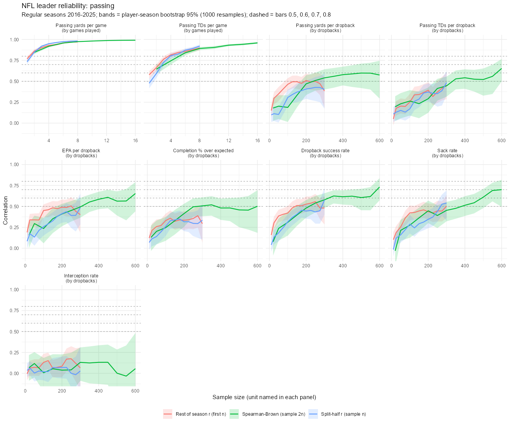
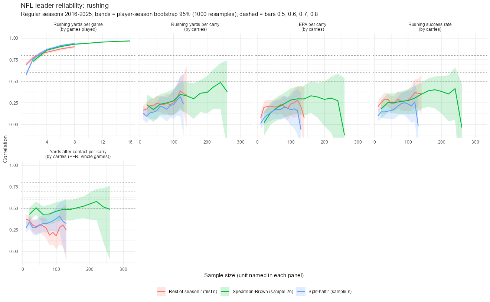
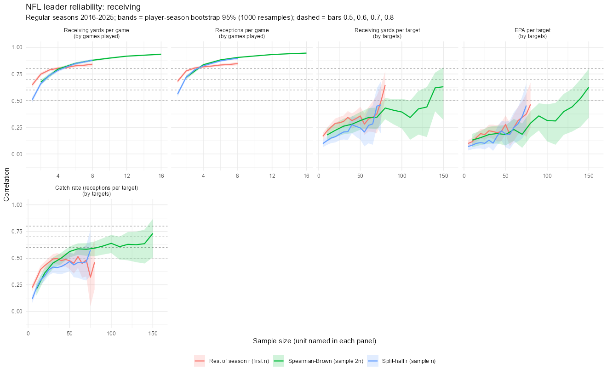
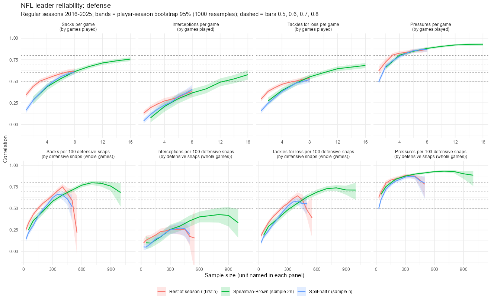

# NFL leader reliability study (issue #229)

Research only. This study measures how quickly each NFL leader stat settles as a player's sample grows, repeating the NBA study (NBA_analytics#253) for football. It does not choose any qualifying minimum and changes no production code; the owner reviews these curves and sets the minimums (used by the NFL leaders panel).

Generated by `tools/leader_reliability_study.R` (seed 229, 1000 bootstrap resamples). Runtime of this run: 1.7 minutes.

## Data

- NFL regular seasons 2016-2025 (10) (season = the year it starts). 2016 is the first season of the participation and snap-count era the pipeline uses; 2026 is in progress and is not used. Regular season only (`season_type == "REG"` / `game_type == "REG"`).
- Play-by-play: `nflreadr::load_pbp()` (nflfastR fields `qb_epa`, `epa`, `success`, `cpoe`, `passer_id`, `rusher_player_id`, `receiver_player_id`). Per-game box-score counts: `nflreadr::load_player_stats(summary_level = "week")`. Games played and defensive snaps: `nflreadr::load_snap_counts()`, linked to gsis ids through `nflreadr::load_players()`. Yards after contact and pressures: `nflreadr::load_pfr_advstats(summary_level = "week")`, which the source serves from 2018.
- Participation data (`nflreadr::load_participation()`) was examined for routes and pressures. Its `route` field is one value per play (the targeted receiver's route, from 2023) and `was_pressure` is a play-level flag not credited to a defender, so neither gives a per-player count; pressures come from Pro Football Reference instead and routes run are not measured (see below).
- Pro Football Reference weekly advanced stats are not served for: rush 2016, rush 2017, def 2016, def 2017 (source message: "seasons >= 2018 is not TRUE"). Yards after contact and pressures use the seasons it does serve.
- **Seasons each stat uses** (a season is used only if the stat's field is measurable in it):

| Group | Stat | Unit | Source | Seasons used | Player-seasons |
|---|---|---|---|---|---|
| passing | Passing yards per game | games played | nflreadr::load_player_stats() + load_snap_counts() | 2016-2025 (10) | 1,002 |
| passing | Passing TDs per game | games played | nflreadr::load_player_stats() + load_snap_counts() | 2016-2025 (10) | 1,002 |
| passing | Passing yards per dropback | dropbacks | nflreadr::load_pbp() | 2016-2025 (10) | 1,073 |
| passing | Passing TDs per dropback | dropbacks | nflreadr::load_pbp() | 2016-2025 (10) | 1,073 |
| passing | EPA per dropback | dropbacks | nflreadr::load_pbp() | 2016-2025 (10) | 1,073 |
| passing | Completion % over expected | dropbacks | nflreadr::load_pbp() | 2016-2025 (10) | 1,073 |
| passing | Dropback success rate | dropbacks | nflreadr::load_pbp() | 2016-2025 (10) | 1,073 |
| passing | Sack rate | dropbacks | nflreadr::load_pbp() | 2016-2025 (10) | 1,073 |
| passing | Interception rate | dropbacks | nflreadr::load_pbp() | 2016-2025 (10) | 1,073 |
| rushing | Rushing yards per game | games played | nflreadr::load_player_stats() + load_snap_counts() | 2016-2025 (10) | 3,214 |
| rushing | Rushing yards per carry | carries | nflreadr::load_pbp() | 2016-2025 (10) | 3,311 |
| rushing | EPA per carry | carries | nflreadr::load_pbp() | 2016-2025 (10) | 3,311 |
| rushing | Rushing success rate | carries | nflreadr::load_pbp() | 2016-2025 (10) | 3,311 |
| rushing | Yards after contact per carry | carries (PFR, whole games) | nflreadr::load_pfr_advstats(stat_type = "rush") | 2018-2025 (8) | 2,798 |
| receiving | Receiving yards per game | games played | nflreadr::load_player_stats() + load_snap_counts() | 2016-2025 (10) | 5,005 |
| receiving | Receptions per game | games played | nflreadr::load_player_stats() + load_snap_counts() | 2016-2025 (10) | 5,005 |
| receiving | Receiving yards per target | targets | nflreadr::load_pbp() | 2016-2025 (10) | 5,047 |
| receiving | EPA per target | targets | nflreadr::load_pbp() | 2016-2025 (10) | 5,047 |
| receiving | Catch rate (receptions per target) | targets | nflreadr::load_pbp() | 2016-2025 (10) | 5,047 |
| defense | Sacks per game | games played | nflreadr::load_player_stats() + load_snap_counts() | 2016-2025 (10) | 9,797 |
| defense | Interceptions per game | games played | nflreadr::load_player_stats() + load_snap_counts() | 2016-2025 (10) | 9,797 |
| defense | Tackles for loss per game | games played | nflreadr::load_player_stats() + load_snap_counts() | 2016-2025 (10) | 9,797 |
| defense | Pressures per game | games played | nflreadr::load_pfr_advstats(stat_type = "def") + load_snap_counts() | 2018-2025 (8) | 7,934 |
| defense | Sacks per 100 defensive snaps | defensive snaps (whole games) | nflreadr::load_player_stats() + load_snap_counts() | 2016-2025 (10) | 9,797 |
| defense | Interceptions per 100 defensive snaps | defensive snaps (whole games) | nflreadr::load_player_stats() + load_snap_counts() | 2016-2025 (10) | 9,797 |
| defense | Tackles for loss per 100 defensive snaps | defensive snaps (whole games) | nflreadr::load_player_stats() + load_snap_counts() | 2016-2025 (10) | 9,797 |
| defense | Pressures per 100 defensive snaps | defensive snaps (whole games) | nflreadr::load_pfr_advstats(stat_type = "def") + load_snap_counts() | 2018-2025 (8) | 7,934 |

- **Missing values.** Nothing is imputed. A missing value (for example a play with no EPA, a defensive game with no Pro Football Reference row, or a player who cannot be linked to a gsis id) makes any sample that contains it missing at that point, and the number of such player-seasons is reported at every point (`n_missing` in the JSON).
- **Games with no stats row.** `load_player_stats()` is built from play-by-play and lists a player in a game only when he recorded an event. A game in which the snap counts show the player on the field and the stats table has no row for him is a game with none of the counted events (zero), not a missing value; these games are counted in the audit below. Pro Football Reference rows are not built this way, so a played defensive game without one has missing pressures.
- Pool player-seasons that could not be linked to snap counts (no per-game rows for them): passing 71, rushing 97, receiving 42.
- A player-season covers every team the player played for that season.

| Season | REG plays | Dropbacks | Designed carries | Targets | EPA missing (db/car/tgt) | PFR rushing player-games | Defensive player-games | Def. games, no stats row | Def. games unlinked | Def. games, pressures missing |
|---|---|---|---|---|---|---|---|---|---|---|
| 2016 | 45,707 | 19,993 | 12,296 | 17,999 | 0/0/0 | 0 | 9,748 | 1,167 | 0 | 9,748 |
| 2017 | 45,268 | 19,355 | 12,629 | 17,175 | 0/0/0 | 0 | 9,741 | 1,153 | 0 | 9,741 |
| 2018 | 45,120 | 19,669 | 12,082 | 17,172 | 0/0/0 | 2,097 | 9,618 | 1,092 | 0 | 2,624 |
| 2019 | 45,339 | 19,837 | 12,207 | 17,143 | 1/0/1 | 2,058 | 9,649 | 1,162 | 15 | 2,676 |
| 2020 | 45,406 | 19,930 | 12,512 | 17,309 | 0/0/0 | 2,162 | 9,830 | 1,193 | 6 | 2,568 |
| 2021 | 47,651 | 20,796 | 13,187 | 18,058 | 0/0/0 | 2,273 | 10,561 | 1,170 | 3 | 2,569 |
| 2022 | 47,157 | 20,208 | 13,439 | 17,306 | 0/0/0 | 2,287 | 10,367 | 1,178 | 4 | 2,922 |
| 2023 | 47,399 | 20,692 | 13,143 | 17,483 | 0/0/0 | 2,276 | 10,550 | 1,336 | 0 | 3,024 |
| 2024 | 47,274 | 20,115 | 13,219 | 17,013 | 0/0/0 | 2,254 | 10,586 | 1,275 | 0 | 3,015 |
| 2025 | 46,452 | 19,732 | 13,079 | 16,609 | 0/0/0 | 2,253 | 10,539 | 1,117 | 15 | 3,027 |

## Methods

- **Position groups and pools.** Curves are per stat group. Passing: every player-season with at least one dropback. Rushing: every player-season with at least one designed carry. Receiving: every player-season with at least one target. Defense: every player-season with at least one defensive snap. A player can appear in more than one group. Per-game stats in a group use the same pool, with games played (offensive or defensive snaps above zero) as the unit.
- **Split-half reliability.** Each player-season's games are numbered in week order; odd-numbered games form half A and even-numbered games half B. For play units the games numbered are those in which the player had at least one play of that unit; for per-game and snap units they are the games he played. At each sample size n the stat is computed on each half from the first n units of that half, for every player-season whose two halves each reach n units, and the two halves are correlated across player-seasons (Pearson). The raw correlation is the reliability of an n-unit sample. The Spearman-Brown value 2r / (1 + r) is the projected reliability of a 2n-unit sample and is plotted at 2n.
- **Rest-of-season check.** The stat over a player's first n units of the season against the same stat over all of his remaining units that season. Rule: only player-seasons whose remainder holds at least n units are used, so the remainder is never smaller than the early sample.
- **Units.** Dropbacks, designed carries and targets come from play-by-play, so a sample of n is exactly the first n plays. Yards after contact (Pro Football Reference carries) and the defensive per-snap stats are only available per game, so a sample of n there is the shortest run of whole games whose cumulative units reach n; the mean realised size is reported in the JSON (`mean_realised_units`).
- **Intervals.** Player-season block bootstrap: player-seasons are resampled with replacement (1000 resamples, seed 229 and one stream per sample table), every curve point is recomputed on each resample with the same draw, and the 2.5th and 97.5th percentiles are reported. Points with fewer than 30 player-seasons are not reported.
- **Reading the curves at large n.** Only high-volume players reach large samples, so the player pool narrows as n grows; a narrower range of true talent lowers correlations. A curve that flattens or dips at the right-hand end reflects that selection as well as noise, and the player count at each point should be read with it.
- **Who is in the pool.** As issue #229 specifies (following the NBA study), every player-season that reaches n is correlated, from backups and depth players to stars. The range of true levels across that pool is wide (a starter's yards per game differ from a backup's mostly through role and snaps), and a wide range makes correlations high at small n. Separating players near the top of a leader list from each other is a harder task than this pool-wide correlation measures, so the crossings below describe the whole league, not the top of a list.

## Units and per-game stats

A regular season has only 16 games (2016-2020) or 17 games (2021 on), so a half holds at most 8 or 9 games and the per-game curves stop at n = 8 games per half (Spearman-Brown projects to 16). The issue lists yards per game, touchdowns, receptions, sacks, interceptions, tackles for loss and pressures as per-game or counting stats, so each is reported twice: per game, by games played, and in a per-play form by the group's play unit. Catch rate is the per-play form of receptions (receptions per target).

| Per-game stat (unit: games played) | Per-play form | Per-play unit |
|---|---|---|
| Passing yards per game | Passing yards per dropback | dropbacks |
| Passing TDs per game | Passing TDs per dropback | dropbacks |
| Rushing yards per game | Rushing yards per carry | carries |
| Receiving yards per game | Receiving yards per target | targets |
| Receptions per game | Catch rate (receptions per target) | targets |
| Sacks per game | Sacks per 100 defensive snaps | defensive snaps (whole games) |
| Interceptions per game | Interceptions per 100 defensive snaps | defensive snaps (whole games) |
| Tackles for loss per game | Tackles for loss per 100 defensive snaps | defensive snaps (whole games) |
| Pressures per game | Pressures per 100 defensive snaps | defensive snaps (whole games) |

## Formulas

For a sample, each stat is the sum of its numerators over the sum of its denominators. Dropbacks are plays with `qb_dropback == 1` (pass attempts, sacks and scrambles) of type pass or run, credited to `passer_id`. Designed carries are run plays with `rush_attempt == 1`, excluding QB scrambles (counted as dropbacks) and kneels, credited to `rusher_player_id`. Targets are pass attempts (not sacks) with a `receiver_player_id`. Two-point tries are excluded throughout. Success is nflfastR's `success` (EPA > 0). CPOE is nflfastR's `cpoe` (percentage points); dropbacks without a `cpoe` value (sacks, scrambles, attempts without a completion probability) carry no weight. Yards on incomplete passes are 0.

| Stat | Unit | Formula (over a sample of plays or games) |
|---|---|---|
| Passing yards per game | games played | sum(passing yards) / games played |
| Passing TDs per game | games played | sum(passing TDs) / games played |
| Passing yards per dropback | dropbacks | sum(passing yards on completions) / dropbacks |
| Passing TDs per dropback | dropbacks | sum(pass_touchdown) / dropbacks |
| EPA per dropback | dropbacks | sum(qb_epa) / dropbacks |
| Completion % over expected | dropbacks | mean(cpoe) over dropbacks that are pass attempts with a cpoe value |
| Dropback success rate | dropbacks | sum(success) / dropbacks (success = EPA > 0) |
| Sack rate | dropbacks | sacks / dropbacks |
| Interception rate | dropbacks | interceptions / pass attempts (sacks and scrambles excluded) |
| Rushing yards per game | games played | sum(rushing yards) / games played |
| Rushing yards per carry | carries | sum(rushing_yards) / designed carries |
| EPA per carry | carries | sum(epa) / designed carries |
| Rushing success rate | carries | sum(success) / designed carries |
| Yards after contact per carry | carries (PFR, whole games) | sum(PFR rushing_yards_after_contact) / sum(PFR carries) |
| Receiving yards per game | games played | sum(receiving yards) / games played |
| Receptions per game | games played | sum(receptions) / games played |
| Receiving yards per target | targets | sum(receiving yards on completions) / targets |
| EPA per target | targets | sum(epa) / targets |
| Catch rate (receptions per target) | targets | receptions / targets |
| Sacks per game | games played | sum(def_sacks) / games played |
| Interceptions per game | games played | sum(def_interceptions) / games played |
| Tackles for loss per game | games played | sum(def_tackles_for_loss) / games played |
| Pressures per game | games played | sum(PFR def_pressures) / games played |
| Sacks per 100 defensive snaps | defensive snaps (whole games) | 100 x sum(def_sacks) / sum(defensive snaps) |
| Interceptions per 100 defensive snaps | defensive snaps (whole games) | 100 x sum(def_interceptions) / sum(defensive snaps) |
| Tackles for loss per 100 defensive snaps | defensive snaps (whole games) | 100 x sum(def_tackles_for_loss) / sum(defensive snaps) |
| Pressures per 100 defensive snaps | defensive snaps (whole games) | 100 x sum(PFR def_pressures) / sum(defensive snaps) |

## Curves

### Passing (dropbacks; per-game stats by games played)

### Rushing (designed carries; per-game stats by games played)

### Receiving (targets; per-game stats by games played)

### Defense (games played and defensive snaps)

### Snapshot at one sample size per unit

Correlation [bootstrap 95%] and player-season count. The full curves, with player counts at every point, are in the results JSON.

| Stat | Unit | n | Split-half r at n | Spearman-Brown (2n) | Rest-of-season r at n |
|---|---|---|---|---|---|
| Passing yards per game | games played | 4 | 0.95 [0.94, 0.96] (N=593) | 0.97 [0.97, 0.98] | 0.93 [0.91, 0.94] (N=593) |
| Passing TDs per game | games played | 4 | 0.81 [0.77, 0.83] (N=593) | 0.89 [0.87, 0.91] | 0.82 [0.78, 0.85] (N=593) |
| Passing yards per dropback | dropbacks | 150 | 0.37 [0.25, 0.48] (N=292) | 0.54 [0.40, 0.64] | 0.50 [0.41, 0.57] (N=304) |
| Passing TDs per dropback | dropbacks | 150 | 0.29 [0.19, 0.39] (N=292) | 0.45 [0.32, 0.56] | 0.34 [0.25, 0.44] (N=304) |
| EPA per dropback | dropbacks | 150 | 0.33 [0.22, 0.43] (N=292) | 0.49 [0.36, 0.60] | 0.48 [0.39, 0.56] (N=304) |
| Completion % over expected | dropbacks | 150 | 0.34 [0.24, 0.44] (N=292) | 0.51 [0.38, 0.61] | 0.32 [0.22, 0.42] (N=304) |
| Dropback success rate | dropbacks | 150 | 0.41 [0.32, 0.49] (N=292) | 0.58 [0.48, 0.66] | 0.51 [0.42, 0.59] (N=304) |
| Sack rate | dropbacks | 150 | 0.29 [0.19, 0.38] (N=292) | 0.45 [0.32, 0.55] | 0.45 [0.35, 0.53] (N=304) |
| Interception rate | dropbacks | 150 | 0.07 [-0.04, 0.18] (N=292) | 0.13 [-0.09, 0.31] | 0.06 [-0.05, 0.16] (N=304) |
| Rushing yards per game | games played | 4 | 0.87 [0.86, 0.88] (N=2348) | 0.93 [0.92, 0.94] | 0.84 [0.82, 0.86] (N=2348) |
| Rushing yards per carry | carries | 60 | 0.21 [0.09, 0.32] (N=347) | 0.35 [0.17, 0.49] | 0.24 [0.14, 0.33] (N=387) |
| EPA per carry | carries | 60 | 0.17 [0.07, 0.28] (N=347) | 0.30 [0.12, 0.44] | 0.20 [0.11, 0.29] (N=387) |
| Rushing success rate | carries | 60 | 0.18 [0.06, 0.28] (N=347) | 0.31 [0.12, 0.44] | 0.25 [0.15, 0.33] (N=387) |
| Yards after contact per carry | carries (PFR, whole games) | 60 | 0.32 [0.23, 0.42] (N=291) | 0.49 [0.37, 0.60] | 0.30 [0.19, 0.39] (N=315) |
| Receiving yards per game | games played | 4 | 0.78 [0.77, 0.80] (N=3847) | 0.88 [0.87, 0.89] | 0.80 [0.79, 0.82] (N=3847) |
| Receptions per game | games played | 4 | 0.83 [0.82, 0.84] (N=3847) | 0.91 [0.90, 0.91] | 0.82 [0.80, 0.83] (N=3847) |
| Receiving yards per target | targets | 30 | 0.21 [0.14, 0.27] (N=905) | 0.34 [0.24, 0.43] | 0.31 [0.25, 0.36] (N=1063) |
| EPA per target | targets | 30 | 0.13 [0.07, 0.20] (N=905) | 0.23 [0.12, 0.33] | 0.22 [0.16, 0.27] (N=1063) |
| Catch rate (receptions per target) | targets | 30 | 0.42 [0.36, 0.47] (N=905) | 0.59 [0.53, 0.64] | 0.49 [0.45, 0.54] (N=1063) |
| Sacks per game | games played | 4 | 0.44 [0.41, 0.47] (N=6464) | 0.61 [0.59, 0.64] | 0.53 [0.51, 0.56] (N=6464) |
| Interceptions per game | games played | 4 | 0.22 [0.19, 0.26] (N=6464) | 0.37 [0.31, 0.41] | 0.27 [0.24, 0.31] (N=6464) |
| Tackles for loss per game | games played | 4 | 0.38 [0.35, 0.41] (N=6464) | 0.55 [0.52, 0.58] | 0.47 [0.44, 0.49] (N=6464) |
| Pressures per game | games played | 4 | 0.79 [0.77, 0.81] (N=1907) | 0.88 [0.87, 0.90] | 0.83 [0.80, 0.85] (N=1352) |
| Sacks per 100 defensive snaps | defensive snaps (whole games) | 250 | 0.55 [0.52, 0.58] (N=3241) | 0.71 [0.69, 0.74] | 0.60 [0.58, 0.63] (N=3353) |
| Interceptions per 100 defensive snaps | defensive snaps (whole games) | 250 | 0.22 [0.17, 0.26] (N=3241) | 0.36 [0.29, 0.42] | 0.24 [0.20, 0.28] (N=3353) |
| Tackles for loss per 100 defensive snaps | defensive snaps (whole games) | 250 | 0.46 [0.43, 0.50] (N=3241) | 0.63 [0.60, 0.66] | 0.52 [0.49, 0.55] (N=3353) |
| Pressures per 100 defensive snaps | defensive snaps (whole games) | 250 | 0.84 [0.82, 0.86] (N=1474) | 0.91 [0.90, 0.93] | 0.86 [0.83, 0.88] (N=1203) |

## Not measured

- **Yards per route run (receiving).** Routes run per player are not in the nflverse data. load_participation() has a single `route` value per play (the targeted receiver's route, recorded from 2023 only), not the routes of every receiver on the play, so routes run cannot be counted. Receiving is therefore measured by targets.

## Reference points for the owner's review

For each stat, the first grid sample size at which each curve reaches the bar, with a bootstrap 95% interval for that crossing. "Beyond grid" means some resamples did not reach the bar inside the grid; "not reached" means the curve stays below the bar over the whole grid. These are reference points for review, not chosen values. Split-half and rest-of-season values are in the stat's own unit for an n-unit sample; Spearman-Brown values are the projected sample (2n) at which reliability reaches the bar. The pool covers every player-season, from backups to stars, so separating players near the top of a list is harder than these curves suggest.

### Passing

| Stat | Unit | Curve | bar 0.5 | bar 0.6 | bar 0.7 | bar 0.8 |
|---|---|---|---|---|---|---|
| Passing yards per game | games played | split-half r, sample n | 1 [1, 1] | 1 [1, 1] | 1 [1, 1] | 2 [2, 2] |
| Passing yards per game | games played | Spearman-Brown, sample 2n | 2 [2, 2] | 2 [2, 2] | 2 [2, 2] | 2 [2, 2] |
| Passing yards per game | games played | rest-of-season r, first n | 1 [1, 1] | 1 [1, 1] | 1 [1, 1] | 2 [2, 2] |
| Passing TDs per game | games played | split-half r, sample n | 2 [1, 2] | 3 [2, 3] | 3 [3, 4] | 4 [4, 6] |
| Passing TDs per game | games played | Spearman-Brown, sample 2n | 2 [2, 2] | 2 [2, 4] | 4 [4, 4] | 6 [6, 6] |
| Passing TDs per game | games played | rest-of-season r, first n | 1 [1, 1] | 2 [1, 2] | 3 [2, 3] | 4 [3, 5] |
| Passing yards per dropback | dropbacks | split-half r, sample n | not reached (71% of resamples) | not reached (98% of resamples) | not reached (100% of resamples) | not reached (100% of resamples) |
| Passing yards per dropback | dropbacks | Spearman-Brown, sample 2n | 250 [200, beyond grid] | not reached (30% of resamples) | not reached (86% of resamples) | not reached (100% of resamples) |
| Passing yards per dropback | dropbacks | rest-of-season r, first n | 200 [100, beyond grid] | not reached (95% of resamples) | not reached (100% of resamples) | not reached (100% of resamples) |
| Passing TDs per dropback | dropbacks | split-half r, sample n | not reached (53% of resamples) | not reached (94% of resamples) | not reached (100% of resamples) | not reached (100% of resamples) |
| Passing TDs per dropback | dropbacks | Spearman-Brown, sample 2n | 350 [250, 600] | 600 [350, beyond grid] | not reached (75% of resamples) | not reached (99% of resamples) |
| Passing TDs per dropback | dropbacks | rest-of-season r, first n | not reached (66% of resamples) | not reached (97% of resamples) | not reached (100% of resamples) | not reached (100% of resamples) |
| EPA per dropback | dropbacks | split-half r, sample n | not reached (50% of resamples) | not reached (90% of resamples) | not reached (100% of resamples) | not reached (100% of resamples) |
| EPA per dropback | dropbacks | Spearman-Brown, sample 2n | 350 [200, 450] | 450 [300, beyond grid] | not reached (71% of resamples) | not reached (98% of resamples) |
| EPA per dropback | dropbacks | rest-of-season r, first n | 250 [100, beyond grid] | not reached (95% of resamples) | not reached (100% of resamples) | not reached (100% of resamples) |
| Completion % over expected | dropbacks | split-half r, sample n | not reached (94% of resamples) | not reached (100% of resamples) | not reached (100% of resamples) | not reached (100% of resamples) |
| Completion % over expected | dropbacks | Spearman-Brown, sample 2n | 300 [200, beyond grid] | not reached (72% of resamples) | not reached (98% of resamples) | not reached (100% of resamples) |
| Completion % over expected | dropbacks | rest-of-season r, first n | not reached (96% of resamples) | not reached (100% of resamples) | not reached (100% of resamples) | not reached (100% of resamples) |
| Dropback success rate | dropbacks | split-half r, sample n | 300 [175, beyond grid] | not reached (60% of resamples) | not reached (96% of resamples) | not reached (100% of resamples) |
| Dropback success rate | dropbacks | Spearman-Brown, sample 2n | 250 [150, 350] | 350 [250, 600] | 600 [450, beyond grid] | not reached (89% of resamples) |
| Dropback success rate | dropbacks | rest-of-season r, first n | 150 [100, beyond grid] | not reached (77% of resamples) | not reached (100% of resamples) | not reached (100% of resamples) |
| Sack rate | dropbacks | split-half r, sample n | 275 [250, beyond grid] | not reached (70% of resamples) | not reached (98% of resamples) | not reached (100% of resamples) |
| Sack rate | dropbacks | Spearman-Brown, sample 2n | 400 [200, 550] | 500 [400, beyond grid] | 600 [500, beyond grid] | not reached (94% of resamples) |
| Sack rate | dropbacks | rest-of-season r, first n | 300 [100, beyond grid] | not reached (90% of resamples) | not reached (100% of resamples) | not reached (100% of resamples) |
| Interception rate | dropbacks | split-half r, sample n | not reached (100% of resamples) | not reached (100% of resamples) | not reached (100% of resamples) | not reached (100% of resamples) |
| Interception rate | dropbacks | Spearman-Brown, sample 2n | not reached (98% of resamples) | not reached (100% of resamples) | not reached (100% of resamples) | not reached (100% of resamples) |
| Interception rate | dropbacks | rest-of-season r, first n | not reached (100% of resamples) | not reached (100% of resamples) | not reached (100% of resamples) | not reached (100% of resamples) |

### Rushing

| Stat | Unit | Curve | bar 0.5 | bar 0.6 | bar 0.7 | bar 0.8 |
|---|---|---|---|---|---|---|
| Rushing yards per game | games played | split-half r, sample n | 1 [1, 1] | 2 [1, 2] | 2 [2, 2] | 3 [3, 3] |
| Rushing yards per game | games played | Spearman-Brown, sample 2n | 2 [2, 2] | 2 [2, 2] | 2 [2, 2] | 4 [4, 4] |
| Rushing yards per game | games played | rest-of-season r, first n | 1 [1, 1] | 1 [1, 1] | 2 [1, 2] | 3 [3, 4] |
| Rushing yards per carry | carries | split-half r, sample n | not reached (89% of resamples) | not reached (98% of resamples) | not reached (100% of resamples) | not reached (100% of resamples) |
| Rushing yards per carry | carries | Spearman-Brown, sample 2n | not reached (48% of resamples) | not reached (75% of resamples) | not reached (94% of resamples) | not reached (99% of resamples) |
| Rushing yards per carry | carries | rest-of-season r, first n | not reached (71% of resamples) | not reached (91% of resamples) | not reached (98% of resamples) | not reached (100% of resamples) |
| EPA per carry | carries | split-half r, sample n | not reached (100% of resamples) | not reached (100% of resamples) | not reached (100% of resamples) | not reached (100% of resamples) |
| EPA per carry | carries | Spearman-Brown, sample 2n | not reached (84% of resamples) | not reached (98% of resamples) | not reached (100% of resamples) | not reached (100% of resamples) |
| EPA per carry | carries | rest-of-season r, first n | not reached (98% of resamples) | not reached (100% of resamples) | not reached (100% of resamples) | not reached (100% of resamples) |
| Rushing success rate | carries | split-half r, sample n | not reached (98% of resamples) | not reached (100% of resamples) | not reached (100% of resamples) | not reached (100% of resamples) |
| Rushing success rate | carries | Spearman-Brown, sample 2n | not reached (68% of resamples) | not reached (92% of resamples) | not reached (99% of resamples) | not reached (100% of resamples) |
| Rushing success rate | carries | rest-of-season r, first n | not reached (85% of resamples) | not reached (98% of resamples) | not reached (100% of resamples) | not reached (100% of resamples) |
| Yards after contact per carry | carries (PFR, whole games) | split-half r, sample n | not reached (76% of resamples) | not reached (96% of resamples) | not reached (100% of resamples) | not reached (100% of resamples) |
| Yards after contact per carry | carries (PFR, whole games) | Spearman-Brown, sample 2n | 40 [20, beyond grid] | not reached (46% of resamples) | not reached (85% of resamples) | not reached (99% of resamples) |
| Yards after contact per carry | carries (PFR, whole games) | rest-of-season r, first n | not reached (92% of resamples) | not reached (99% of resamples) | not reached (100% of resamples) | not reached (100% of resamples) |

### Receiving

| Stat | Unit | Curve | bar 0.5 | bar 0.6 | bar 0.7 | bar 0.8 |
|---|---|---|---|---|---|---|
| Receiving yards per game | games played | split-half r, sample n | 1 [1, 2] | 2 [2, 2] | 3 [3, 3] | 5 [5, 5] |
| Receiving yards per game | games played | Spearman-Brown, sample 2n | 2 [2, 2] | 2 [2, 2] | 4 [4, 4] | 6 [4, 6] |
| Receiving yards per game | games played | rest-of-season r, first n | 1 [1, 1] | 1 [1, 1] | 2 [2, 2] | 4 [3, 6] |
| Receptions per game | games played | split-half r, sample n | 1 [1, 1] | 2 [2, 2] | 2 [2, 2] | 4 [3, 4] |
| Receptions per game | games played | Spearman-Brown, sample 2n | 2 [2, 2] | 2 [2, 2] | 2 [2, 4] | 4 [4, 4] |
| Receptions per game | games played | rest-of-season r, first n | 1 [1, 1] | 1 [1, 1] | 2 [2, 2] | 3 [3, 4] |
| Receiving yards per target | targets | split-half r, sample n | not reached (56% of resamples) | not reached (87% of resamples) | not reached (98% of resamples) | not reached (100% of resamples) |
| Receiving yards per target | targets | Spearman-Brown, sample 2n | 140 [80, beyond grid] | 140 [130, beyond grid] | not reached (69% of resamples) | not reached (96% of resamples) |
| Receiving yards per target | targets | rest-of-season r, first n | 80 [70, 80] | 80 [75, beyond grid] | not reached (76% of resamples) | not reached (99% of resamples) |
| EPA per target | targets | split-half r, sample n | not reached (62% of resamples) | not reached (89% of resamples) | not reached (99% of resamples) | not reached (100% of resamples) |
| EPA per target | targets | Spearman-Brown, sample 2n | 140 [120, beyond grid] | 150 [130, beyond grid] | not reached (74% of resamples) | not reached (98% of resamples) |
| EPA per target | targets | rest-of-season r, first n | not reached (59% of resamples) | not reached (89% of resamples) | not reached (99% of resamples) | not reached (100% of resamples) |
| Catch rate (receptions per target) | targets | split-half r, sample n | 75 [45, beyond grid] | not reached (57% of resamples) | not reached (89% of resamples) | not reached (100% of resamples) |
| Catch rate (receptions per target) | targets | Spearman-Brown, sample 2n | 40 [30, 50] | 90 [50, 150] | 150 [100, beyond grid] | not reached (80% of resamples) |
| Catch rate (receptions per target) | targets | rest-of-season r, first n | 60 [25, beyond grid] | not reached (82% of resamples) | not reached (98% of resamples) | not reached (100% of resamples) |

### Defense

| Stat | Unit | Curve | bar 0.5 | bar 0.6 | bar 0.7 | bar 0.8 |
|---|---|---|---|---|---|---|
| Sacks per game | games played | split-half r, sample n | 5 [5, 6] | 8 [7, beyond grid] | not reached (100% of resamples) | not reached (100% of resamples) |
| Sacks per game | games played | Spearman-Brown, sample 2n | 6 [6, 8] | 8 [8, 10] | 12 [12, 14] | not reached (100% of resamples) |
| Sacks per game | games played | rest-of-season r, first n | 3 [3, 4] | 7 [6, beyond grid] | not reached (100% of resamples) | not reached (100% of resamples) |
| Interceptions per game | games played | split-half r, sample n | not reached (100% of resamples) | not reached (100% of resamples) | not reached (100% of resamples) | not reached (100% of resamples) |
| Interceptions per game | games played | Spearman-Brown, sample 2n | 14 [12, 16] | not reached (81% of resamples) | not reached (100% of resamples) | not reached (100% of resamples) |
| Interceptions per game | games played | rest-of-season r, first n | not reached (100% of resamples) | not reached (100% of resamples) | not reached (100% of resamples) | not reached (100% of resamples) |
| Tackles for loss per game | games played | split-half r, sample n | 8 [6, beyond grid] | not reached (100% of resamples) | not reached (100% of resamples) | not reached (100% of resamples) |
| Tackles for loss per game | games played | Spearman-Brown, sample 2n | 8 [6, 8] | 10 [10, 12] | not reached (85% of resamples) | not reached (100% of resamples) |
| Tackles for loss per game | games played | rest-of-season r, first n | 6 [5, 8] | not reached (100% of resamples) | not reached (100% of resamples) | not reached (100% of resamples) |
| Pressures per game | games played | split-half r, sample n | 2 [1, 2] | 2 [2, 2] | 3 [3, 3] | 5 [4, 5] |
| Pressures per game | games played | Spearman-Brown, sample 2n | 2 [2, 2] | 2 [2, 2] | 4 [4, 4] | 4 [4, 6] |
| Pressures per game | games played | rest-of-season r, first n | 1 [1, 1] | 1 [1, 2] | 2 [2, 3] | 3 [3, 5] |
| Sacks per 100 defensive snaps | defensive snaps (whole games) | split-half r, sample n | 250 [200, 250] | 300 [300, 350] | not reached (96% of resamples) | not reached (100% of resamples) |
| Sacks per 100 defensive snaps | defensive snaps (whole games) | Spearman-Brown, sample 2n | 300 [200, 300] | 400 [300, 400] | 500 [500, 600] | not reached (48% of resamples) |
| Sacks per 100 defensive snaps | defensive snaps (whole games) | rest-of-season r, first n | 150 [150, 200] | 250 [250, 300] | 350 [350, 400] | not reached (100% of resamples) |
| Interceptions per 100 defensive snaps | defensive snaps (whole games) | split-half r, sample n | not reached (100% of resamples) | not reached (100% of resamples) | not reached (100% of resamples) | not reached (100% of resamples) |
| Interceptions per 100 defensive snaps | defensive snaps (whole games) | Spearman-Brown, sample 2n | not reached (91% of resamples) | not reached (100% of resamples) | not reached (100% of resamples) | not reached (100% of resamples) |
| Interceptions per 100 defensive snaps | defensive snaps (whole games) | rest-of-season r, first n | not reached (98% of resamples) | not reached (100% of resamples) | not reached (100% of resamples) | not reached (100% of resamples) |
| Tackles for loss per 100 defensive snaps | defensive snaps (whole games) | split-half r, sample n | 300 [300, 350] | not reached (61% of resamples) | not reached (100% of resamples) | not reached (100% of resamples) |
| Tackles for loss per 100 defensive snaps | defensive snaps (whole games) | Spearman-Brown, sample 2n | 400 [300, 400] | 500 [500, 500] | 700 [600, 700] | not reached (98% of resamples) |
| Tackles for loss per 100 defensive snaps | defensive snaps (whole games) | rest-of-season r, first n | 250 [250, 300] | 350 [350, 400] | not reached (99% of resamples) | not reached (100% of resamples) |
| Pressures per 100 defensive snaps | defensive snaps (whole games) | split-half r, sample n | 50 [25, 50] | 50 [50, 100] | 100 [100, 150] | 200 [150, 250] |
| Pressures per 100 defensive snaps | defensive snaps (whole games) | Spearman-Brown, sample 2n | 50 [50, 50] | 50 [50, 50] | 100 [100, 100] | 200 [200, 200] |
| Pressures per 100 defensive snaps | defensive snaps (whole games) | rest-of-season r, first n | 25 [25, 25] | 25 [25, 50] | 100 [50, 100] | 150 [100, 150] |

