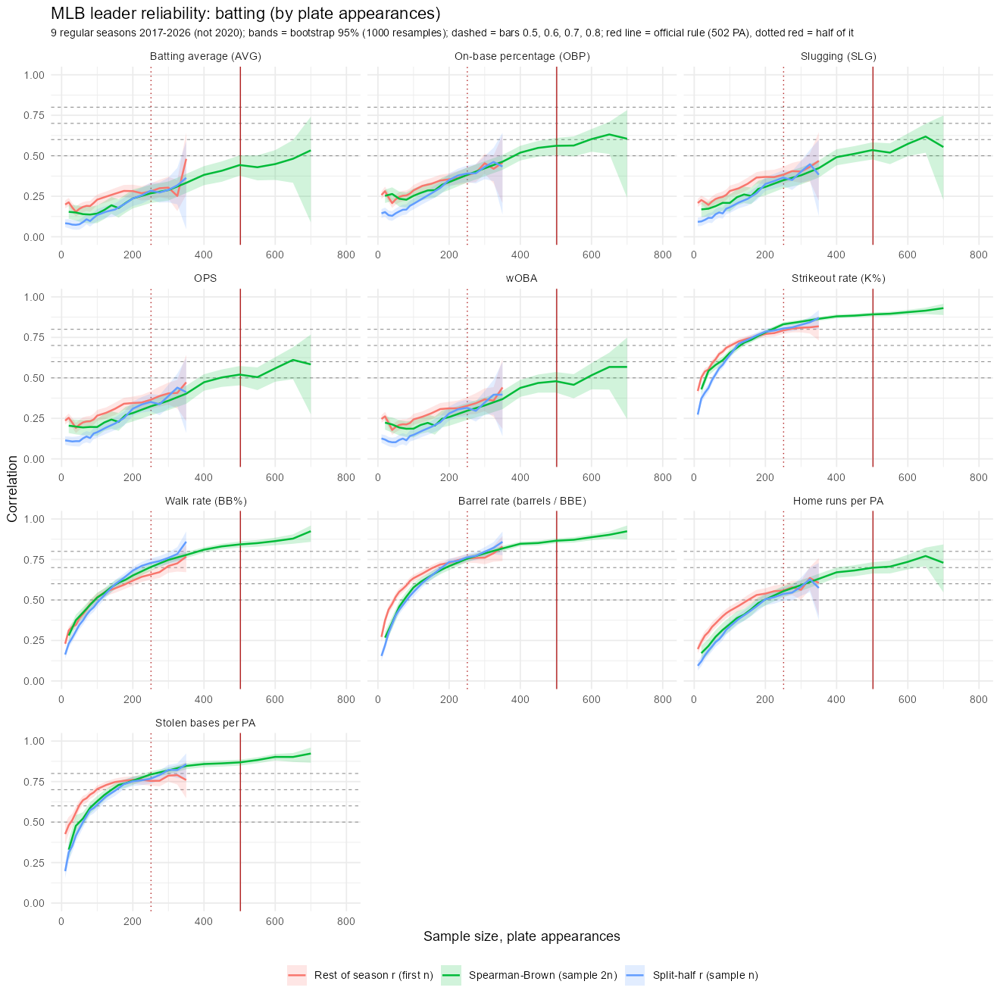
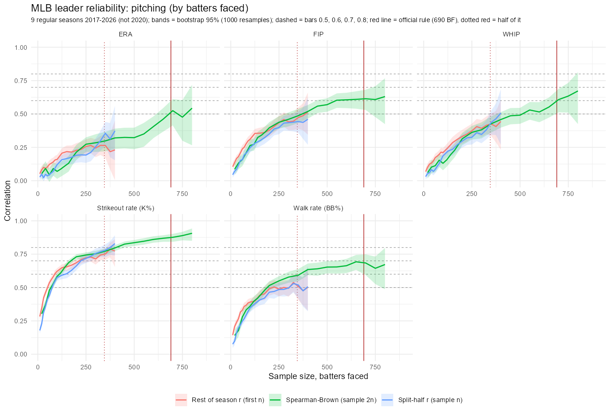
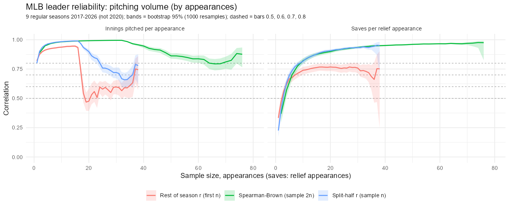

# MLB leader reliability study (issue #162)

Research only. This study measures how quickly each MLB league-leader stat settles as a player's sample grows. It repeats the NBA study (NBA_analytics#253) with the same methods. It does not choose any qualifying minimum and changes no production code; the owner reviews these curves and sets the minimums, which the leaders panel then uses.

Generated by `tools/leader_reliability_study.R` (seed 162, 1000 bootstrap resamples). Runtime of this run: 1.8 minutes.

## Data

- MLB regular seasons 2017, 2018, 2019, 2021, 2022, 2023, 2024, 2025, 2026. 2020 is left out because it was a 60-game season. Only complete seasons are used. Player-seasons: 8,981 batting, 7,624 pitching (6,272 of them with relief appearances).
- Player game logs: MLB Stats API (`statsapi.mlb.com`, the API that baseballr's `mlb_*` functions read), one batting and one pitching row per player per game, `gameType == R`. The player list for each season is `baseballr::mlb_sports_players()`. baseballr has no bulk game-log function, so the logs are read with the API's people endpoint and its game-log hydration, 40 players per request. Completeness is checked against the API's team season totals (table below).
- Barrel rate: Statcast batted-ball events from the Baseball Savant search CSV (the endpoint `baseballr::statcast_search()` reads), regular season, filtered to balls in play, joined to the game logs by game and batter. A player-game in a game that is absent from the Statcast pull has missing barrel fields, never zero. Batted balls without a tracked launch angle and exit velocity are left out of the denominator and counted in the table.
- wOBA weights and the FIP constant: FanGraphs season constants (`baseballr::fg_guts()`).
- Nothing is imputed. A missing value makes any sample that contains it missing at that point, and a sample whose stat is undefined (for example no outs recorded for ERA) is treated the same way; the number of such player-seasons is reported at every point (`n_missing` in the JSON).
- A player-season covers every team the player played for that season. Doubleheaders are ordered by game id within the date.
- Rule changes inside the window (2023: pitch clock, larger bases, limits on pickoffs and on the infield shift) shifted league levels of some stats, especially stolen bases. Correlations are computed within player-seasons, so a league-wide shift does not by itself create agreement between halves, but the pooled range of stolen-base rates is wider after 2023.

| Season | Batting player-games | Pitching player-games | Games | PA in game logs / team totals | BF in game logs / team totals | Outs in game logs / team totals | Rows missing a field (bat / pit) | Statcast BBE tracked / untracked | Box balls in play | Batting player-games in games missing from Statcast |
|---|---|---|---|---|---|---|---|---|---|---|
| 2017 | 60,659 | 20,519 | 2,430 | 185,295 / 185,295 | 185,295 / 185,295 | 129,771 / 129,771 | 0 / 0 | 125,472 / 2,083 | 127,556 | 0 |
| 2018 | 61,179 | 21,201 | 2,431 | 185,139 / 185,139 | 185,139 / 185,139 | 130,467 / 130,467 | 0 / 0 | 124,425 / 1,858 | 126,283 | 0 |
| 2019 | 61,095 | 21,432 | 2,429 | 186,517 / 186,517 | 186,517 / 186,517 | 130,270 / 130,270 | 0 / 0 | 123,857 / 1,894 | 125,754 | 0 |
| 2021 | 61,317 | 21,545 | 2,429 | 181,818 / 181,818 | 181,818 / 181,818 | 127,845 / 127,845 | 0 / 0 | 121,319 / 384 | 121,705 | 0 |
| 2022 | 50,290 | 20,883 | 2,430 | 182,052 / 182,052 | 182,052 / 182,052 | 129,226 / 129,226 | 0 / 0 | 123,723 / 543 | 124,267 | 0 |
| 2023 | 50,754 | 20,634 | 2,430 | 184,104 / 184,104 | 184,104 / 184,104 | 129,262 / 129,262 | 0 / 0 | 123,874 / 359 | 124,234 | 0 |
| 2024 | 50,746 | 20,695 | 2,429 | 182,444 / 182,449 | 182,449 / 182,449 | 129,349 / 129,349 | 0 / 0 | 123,825 / 375 | 124,199 | 0 |
| 2025 | 50,887 | 20,870 | 2,430 | 182,926 / 182,926 | 182,926 / 182,926 | 129,225 / 129,225 | 0 / 0 | 124,439 / 448 | 124,886 | 0 |
| 2026 | 51,708 | 20,802 | 2,429 | 183,849 / 183,849 | 183,849 / 183,849 | 129,239 / 129,239 | 0 / 0 | 124,100 / 511 | 124,609 | 0 |

Game-log totals equal the API's team season totals for PA, BF and outs in every season except: 2024 batting: game logs hold 182,444 PA of 182,449 in the team totals. Those rows are absent from the people endpoint and are left out, not filled.

Statcast batted-ball events (tracked plus untracked) differ from the box-score balls in play (AB - SO + SF + SH) by at most 3 per season, and 0 batting player-games fall in games absent from the Statcast pull. The runtime above covers the analysis from cached data; the one-time download of game logs and Statcast data into `cache/` took about 53 minutes.

### Seasons each stat uses

| Stat | Source | Seasons used | Seasons left out |
|---|---|---|---|
| Batting average (AVG) | MLB Stats API game logs | 2017, 2018, 2019, 2021, 2022, 2023, 2024, 2025, 2026 | none |
| On-base percentage (OBP) | MLB Stats API game logs | 2017, 2018, 2019, 2021, 2022, 2023, 2024, 2025, 2026 | none |
| Slugging (SLG) | MLB Stats API game logs | 2017, 2018, 2019, 2021, 2022, 2023, 2024, 2025, 2026 | none |
| OPS | MLB Stats API game logs | 2017, 2018, 2019, 2021, 2022, 2023, 2024, 2025, 2026 | none |
| wOBA | MLB Stats API game logs | 2017, 2018, 2019, 2021, 2022, 2023, 2024, 2025, 2026 | none |
| Strikeout rate (K%) | MLB Stats API game logs | 2017, 2018, 2019, 2021, 2022, 2023, 2024, 2025, 2026 | none |
| Walk rate (BB%) | MLB Stats API game logs | 2017, 2018, 2019, 2021, 2022, 2023, 2024, 2025, 2026 | none |
| Barrel rate (barrels / BBE) | Statcast (Baseball Savant) | 2017, 2018, 2019, 2021, 2022, 2023, 2024, 2025, 2026 | none |
| Home runs per PA | MLB Stats API game logs | 2017, 2018, 2019, 2021, 2022, 2023, 2024, 2025, 2026 | none |
| Stolen bases per PA | MLB Stats API game logs | 2017, 2018, 2019, 2021, 2022, 2023, 2024, 2025, 2026 | none |
| ERA | MLB Stats API game logs | 2017, 2018, 2019, 2021, 2022, 2023, 2024, 2025, 2026 | none |
| FIP | MLB Stats API game logs | 2017, 2018, 2019, 2021, 2022, 2023, 2024, 2025, 2026 | none |
| WHIP | MLB Stats API game logs | 2017, 2018, 2019, 2021, 2022, 2023, 2024, 2025, 2026 | none |
| Strikeout rate (K%) | MLB Stats API game logs | 2017, 2018, 2019, 2021, 2022, 2023, 2024, 2025, 2026 | none |
| Walk rate (BB%) | MLB Stats API game logs | 2017, 2018, 2019, 2021, 2022, 2023, 2024, 2025, 2026 | none |
| Innings pitched per appearance | MLB Stats API game logs | 2017, 2018, 2019, 2021, 2022, 2023, 2024, 2025, 2026 | none |
| Saves per relief appearance | MLB Stats API game logs | 2017, 2018, 2019, 2021, 2022, 2023, 2024, 2025, 2026 | none |

### Stats not measured

Every stat listed in issue #162 is measured. No stat had to be reported as not measured.

## Methods

- **Split-half reliability.** Each player-season's games are numbered in date order; odd-numbered games form half A and even-numbered games half B. At each sample size n the stat is computed on each half from the first n units of that half, for every player-season whose two halves each reach n units, and the two halves are correlated across player-seasons (Pearson). The raw correlation is the reliability of an n-unit sample. The Spearman-Brown value 2r / (1 + r) is the projected reliability of a 2n-unit sample and is plotted at 2n.
- **Rest-of-season check.** The stat over a player's first n units of the season against the same stat over all of his remaining games that season. Rule: only player-seasons whose remaining games hold at least n units are used, so the remainder is never smaller than the early sample.
- **Units.** Batting: plate appearances. Pitching rate stats: batters faced. Innings pitched: per appearance, counted in appearances (starts and relief). Saves: per relief appearance, counted in relief appearances; for saves the odd/even numbering runs over relief appearances only. Games are indivisible, so a sample of n is the shortest run of whole games whose cumulative units reach n; the mean realised size is in the JSON (`mean_realised_units`).
- **Intervals.** Player-season block bootstrap: player-seasons are resampled with replacement (1000 resamples, seed 162 for batters and 163 for pitchers), every curve point is recomputed on each resample with the same draw, and the 2.5th and 97.5th percentiles are reported. Points with fewer than 30 player-seasons are not reported.
- **Reading the curves at large n.** Only regulars reach large samples, so the player pool narrows as n grows; a narrower range of true talent lowers correlations. A curve that flattens or dips at the right-hand end reflects that selection as well as noise, and the player count at each point should be read with it.
- **Who is in the pool.** As issue #162 specifies, every player-season that reaches n is correlated, from bench players and September call-ups to stars. The range of true levels across that pool is wide (a slugger's home-run rate differs from a utility infielder's, a closer's save rate from a long reliever's, a starter's innings per appearance from a reliever's), and a wide range makes correlations high at small n. Separating players near the top of a leader list from each other is a harder task than this pool-wide correlation measures, so the crossings below describe the whole league, not the top of a list. This applies most to innings per appearance and saves, whose curves mostly separate roles (starter or reliever, closer or not). The innings-per-appearance curves fall sharply after about 16 appearances per half because starters (about 32 starts a season) leave the pool there, leaving relievers, whose innings per appearance vary much less; the drop is a change of pool, not a loss of reliability.

## Formulas

Each stat over a sample is computed from the summed per-game components (for example AVG over 50 PA is the sum of hits over the sum of at-bats in those games), never as an average of per-game values. IP = outs / 3.

| Stat | Unit counted by n | Formula over a sample of games |
|---|---|---|
| Batting average (AVG) | plate appearances | H / AB |
| On-base percentage (OBP) | plate appearances | (H + BB + HBP) / (AB + BB + HBP + SF) |
| Slugging (SLG) | plate appearances | TB / AB |
| OPS | plate appearances | OBP + SLG, each computed over the sample |
| wOBA | plate appearances | (wBB x uBB + wHBP x HBP + w1B x 1B + w2B x 2B + w3B x 3B + wHR x HR) / (AB + BB - IBB + SF + HBP); uBB = BB - IBB; weights are FanGraphs' constants for that season |
| Strikeout rate (K%) | plate appearances | SO / PA |
| Walk rate (BB%) | plate appearances | BB / PA (BB includes intentional walks, as FanGraphs' BB%) |
| Barrel rate (barrels / BBE) | plate appearances | Barrels / batted-ball events with a tracked launch angle and exit velocity; barrel = Statcast launch_speed_angle code 6; sample size counted in PA |
| Home runs per PA | plate appearances | HR / PA |
| Stolen bases per PA | plate appearances | SB / PA (steals in games without a PA, such as pinch-running, count in the numerator) |
| ERA | batters faced | 9 x ER / IP; IP = outs / 3 |
| FIP | batters faced | (13 x HR + 3 x (BB + HBP) - 2 x SO) / IP + cFIP; cFIP is FanGraphs' constant for that season; BB includes intentional walks |
| WHIP | batters faced | (BB + H) / IP |
| Strikeout rate (K%) | batters faced | SO / BF |
| Walk rate (BB%) | batters faced | BB / BF (BB includes intentional walks) |
| Innings pitched per appearance | appearances | IP / appearances, all appearances (starts and relief) |
| Saves per relief appearance | relief appearances | SV / relief appearances (appearances that were not starts); pool: every pitcher-season with relief appearances |

## Curves

### Batting (by plate appearances)

### Pitching (by batters faced)

### Pitching volume (by appearances)

### Snapshot at one sample size per unit

Correlation [bootstrap 95%] and player-season count. The full curves are in the results JSON.

| Stat | Unit | n | Split-half r at n | Spearman-Brown (2n) | Rest-of-season r at n |
|---|---|---|---|---|---|
| Batting average (AVG) | plate appearances | 100 | 0.13 [0.10, 0.17] (N=3159) | 0.24 [0.17, 0.29] | 0.23 [0.19, 0.26] (N=3213) |
| On-base percentage (OBP) | plate appearances | 100 | 0.20 [0.17, 0.24] (N=3159) | 0.34 [0.29, 0.38] | 0.29 [0.25, 0.32] (N=3213) |
| Slugging (SLG) | plate appearances | 100 | 0.18 [0.15, 0.22] (N=3159) | 0.31 [0.26, 0.36] | 0.28 [0.25, 0.32] (N=3213) |
| OPS | plate appearances | 100 | 0.16 [0.13, 0.20] (N=3159) | 0.28 [0.23, 0.34] | 0.27 [0.23, 0.30] (N=3213) |
| wOBA | plate appearances | 100 | 0.15 [0.11, 0.18] (N=3159) | 0.26 [0.20, 0.31] | 0.24 [0.21, 0.28] (N=3213) |
| Strikeout rate (K%) | plate appearances | 100 | 0.64 [0.62, 0.66] (N=3159) | 0.78 [0.77, 0.80] | 0.70 [0.68, 0.71] (N=3213) |
| Walk rate (BB%) | plate appearances | 100 | 0.48 [0.45, 0.51] (N=3159) | 0.65 [0.63, 0.68] | 0.52 [0.49, 0.54] (N=3213) |
| Barrel rate (barrels / BBE) | plate appearances | 100 | 0.55 [0.52, 0.57] (N=3159) | 0.71 [0.68, 0.73] | 0.63 [0.61, 0.66] (N=3213) |
| Home runs per PA | plate appearances | 100 | 0.34 [0.30, 0.37] (N=3159) | 0.50 [0.47, 0.54] | 0.43 [0.40, 0.46] (N=3213) |
| Stolen bases per PA | plate appearances | 100 | 0.61 [0.57, 0.64] (N=3159) | 0.76 [0.73, 0.78] | 0.70 [0.68, 0.73] (N=3213) |
| ERA | batters faced | 100 | 0.12 [0.08, 0.16] (N=3129) | 0.21 [0.16, 0.27] | 0.16 [0.12, 0.19] (N=3221) |
| FIP | batters faced | 100 | 0.25 [0.21, 0.28] (N=3129) | 0.40 [0.35, 0.44] | 0.31 [0.28, 0.34] (N=3221) |
| WHIP | batters faced | 100 | 0.19 [0.15, 0.22] (N=3129) | 0.31 [0.27, 0.36] | 0.21 [0.18, 0.24] (N=3221) |
| Strikeout rate (K%) | batters faced | 100 | 0.58 [0.55, 0.60] (N=3129) | 0.73 [0.71, 0.75] | 0.62 [0.60, 0.64] (N=3221) |
| Walk rate (BB%) | batters faced | 100 | 0.35 [0.32, 0.38] (N=3129) | 0.52 [0.48, 0.55] | 0.39 [0.36, 0.42] (N=3221) |
| Innings pitched per appearance | appearances | 10 | 0.98 [0.98, 0.98] (N=3903) | 0.99 [0.99, 0.99] | 0.94 [0.93, 0.94] (N=3903) |
| Saves per relief appearance | relief appearances | 10 | 0.82 [0.79, 0.84] (N=2598) | 0.90 [0.88, 0.91] | 0.74 [0.71, 0.77] (N=2598) |

## Comparison with MLB's official qualifying rules

MLB ranks rate-stat leaders among players with 3.1 plate appearances or 1 inning pitched per team game: 3.1 PA per team game = 502 PA over 162 games, and 1 IP per team game = 162 IP over 162 games = about 690 BF at 1.420 BF per out. A split-half sample holds half the games, so each rule is read at the grid point nearest half the rule; the Spearman-Brown value there is the projected reliability of a sample the size of the rule. The rest-of-season value at the same point compares the first half-rule sample with the rest of the season.

| Stat | Rule | Half-rule grid point (n per half) | Split-half r at n [95%] (N) | Spearman-Brown at 2n [95%] | Rest-of-season r at n [95%] (N) |
|---|---|---|---|---|---|
| Batting average (AVG) | 502 PA | 250 | 0.28 [0.23, 0.34] (1192) | 0.44 [0.38, 0.50] | 0.28 [0.23, 0.33] (1231) |
| On-base percentage (OBP) | 502 PA | 250 | 0.39 [0.34, 0.44] (1192) | 0.56 [0.50, 0.61] | 0.38 [0.33, 0.43] (1231) |
| Slugging (SLG) | 502 PA | 250 | 0.37 [0.31, 0.41] (1192) | 0.54 [0.48, 0.58] | 0.38 [0.33, 0.43] (1231) |
| OPS | 502 PA | 250 | 0.35 [0.29, 0.40] (1192) | 0.52 [0.45, 0.57] | 0.36 [0.31, 0.42] (1231) |
| wOBA | 502 PA | 250 | 0.32 [0.26, 0.37] (1192) | 0.48 [0.41, 0.54] | 0.33 [0.27, 0.38] (1231) |
| Strikeout rate (K%) | 502 PA | 250 | 0.80 [0.78, 0.82] (1192) | 0.89 [0.88, 0.90] | 0.79 [0.77, 0.81] (1231) |
| Walk rate (BB%) | 502 PA | 250 | 0.73 [0.70, 0.76] (1192) | 0.84 [0.82, 0.86] | 0.66 [0.62, 0.69] (1231) |
| Barrel rate (barrels / BBE) | 502 PA | 250 | 0.76 [0.74, 0.79] (1192) | 0.87 [0.85, 0.88] | 0.76 [0.73, 0.78] (1231) |
| Home runs per PA | 502 PA | 250 | 0.54 [0.50, 0.58] (1192) | 0.70 [0.66, 0.73] | 0.56 [0.52, 0.60] (1231) |
| Stolen bases per PA | 502 PA | 250 | 0.77 [0.74, 0.79] (1192) | 0.87 [0.85, 0.89] | 0.75 [0.72, 0.78] (1231) |
| ERA | 690 BF | 350 | 0.36 [0.26, 0.44] (330) | 0.53 [0.41, 0.61] | 0.26 [0.17, 0.35] (354) |
| FIP | 690 BF | 350 | 0.44 [0.36, 0.52] (330) | 0.61 [0.53, 0.68] | 0.47 [0.39, 0.55] (354) |
| WHIP | 690 BF | 350 | 0.44 [0.34, 0.53] (330) | 0.61 [0.51, 0.69] | 0.43 [0.34, 0.50] (354) |
| Strikeout rate (K%) | 690 BF | 350 | 0.78 [0.73, 0.82] (330) | 0.88 [0.84, 0.90] | 0.75 [0.71, 0.79] (354) |
| Walk rate (BB%) | 690 BF | 350 | 0.52 [0.42, 0.60] (330) | 0.68 [0.59, 0.75] | 0.51 [0.41, 0.59] (354) |
| Innings pitched per appearance | none | n/a | n/a | n/a | n/a |
| Saves per relief appearance | none | n/a | n/a | n/a | n/a |

Innings pitched and saves are counting totals; MLB ranks them without a minimum, so no rule applies to their per-appearance curves.

## Reference points for the owner's review

For each stat, the first grid sample size at which each curve reaches the bar, with a bootstrap 95% interval for that crossing. "Beyond grid" means some resamples did not reach the bar inside the grid; "not reached" means the point curve stays below the bar over the whole grid (often because the pool of players reaching large samples becomes too small). These are reference points for review, not chosen values. Split-half and rest-of-season values are in the stat's own unit for an n-unit sample; Spearman-Brown values are the projected sample (2n) at which reliability reaches the bar. The pool covers every player-season, from bench players to stars, so separating players near the top of a list is harder than these curves suggest.

| Stat | Unit | Curve | bar 0.5 | bar 0.6 | bar 0.7 | bar 0.8 |
|---|---|---|---|---|---|---|
| Batting average (AVG) | plate appearances | split-half r, sample n | not reached (86% of resamples) | not reached (98% of resamples) | not reached (100% of resamples) | not reached (100% of resamples) |
| Batting average (AVG) | plate appearances | Spearman-Brown, sample 2n | 700 [500, beyond grid] | not reached (68% of resamples) | not reached (93% of resamples) | not reached (100% of resamples) |
| Batting average (AVG) | plate appearances | rest-of-season r, first n | not reached (59% of resamples) | not reached (91% of resamples) | not reached (100% of resamples) | not reached (100% of resamples) |
| On-base percentage (OBP) | plate appearances | split-half r, sample n | not reached (62% of resamples) | not reached (94% of resamples) | not reached (100% of resamples) | not reached (100% of resamples) |
| On-base percentage (OBP) | plate appearances | Spearman-Brown, sample 2n | 400 [350, 500] | 600 [500, beyond grid] | not reached (79% of resamples) | not reached (99% of resamples) |
| On-base percentage (OBP) | plate appearances | rest-of-season r, first n | not reached (65% of resamples) | not reached (95% of resamples) | not reached (100% of resamples) | not reached (100% of resamples) |
| Slugging (SLG) | plate appearances | split-half r, sample n | not reached (76% of resamples) | not reached (98% of resamples) | not reached (100% of resamples) | not reached (100% of resamples) |
| Slugging (SLG) | plate appearances | Spearman-Brown, sample 2n | 450 [400, 600] | 650 [600, beyond grid] | not reached (90% of resamples) | not reached (100% of resamples) |
| Slugging (SLG) | plate appearances | rest-of-season r, first n | not reached (61% of resamples) | not reached (92% of resamples) | not reached (100% of resamples) | not reached (100% of resamples) |
| OPS | plate appearances | split-half r, sample n | not reached (74% of resamples) | not reached (96% of resamples) | not reached (100% of resamples) | not reached (100% of resamples) |
| OPS | plate appearances | Spearman-Brown, sample 2n | 450 [400, 650] | 650 [600, beyond grid] | not reached (86% of resamples) | not reached (99% of resamples) |
| OPS | plate appearances | rest-of-season r, first n | not reached (64% of resamples) | not reached (92% of resamples) | not reached (100% of resamples) | not reached (100% of resamples) |
| wOBA | plate appearances | split-half r, sample n | not reached (82% of resamples) | not reached (98% of resamples) | not reached (100% of resamples) | not reached (100% of resamples) |
| wOBA | plate appearances | Spearman-Brown, sample 2n | 600 [450, beyond grid] | not reached (53% of resamples) | not reached (90% of resamples) | not reached (100% of resamples) |
| wOBA | plate appearances | rest-of-season r, first n | not reached (76% of resamples) | not reached (96% of resamples) | not reached (100% of resamples) | not reached (100% of resamples) |
| Strikeout rate (K%) | plate appearances | split-half r, sample n | 60 [50, 70] | 90 [80, 100] | 125 [125, 150] | 250 [200, 300] |
| Strikeout rate (K%) | plate appearances | Spearman-Brown, sample 2n | 40 [40, 40] | 80 [60, 100] | 140 [120, 160] | 250 [250, 250] |
| Strikeout rate (K%) | plate appearances | rest-of-season r, first n | 20 [20, 30] | 60 [50, 70] | 125 [90, 125] | 275 [250, beyond grid] |
| Walk rate (BB%) | plate appearances | split-half r, sample n | 125 [100, 125] | 175 [150, 175] | 225 [200, 250] | 350 [325, beyond grid] |
| Walk rate (BB%) | plate appearances | Spearman-Brown, sample 2n | 100 [80, 120] | 160 [140, 200] | 250 [250, 300] | 400 [400, 450] |
| Walk rate (BB%) | plate appearances | rest-of-season r, first n | 100 [80, 125] | 200 [175, 225] | 300 [275, 350] | not reached (79% of resamples) |
| Barrel rate (barrels / BBE) | plate appearances | split-half r, sample n | 90 [80, 100] | 125 [125, 150] | 200 [175, 200] | 325 [300, beyond grid] |
| Barrel rate (barrels / BBE) | plate appearances | Spearman-Brown, sample 2n | 80 [80, 100] | 120 [100, 140] | 200 [180, 250] | 350 [300, 350] |
| Barrel rate (barrels / BBE) | plate appearances | rest-of-season r, first n | 50 [50, 60] | 90 [80, 100] | 175 [150, 200] | 350 [325, beyond grid] |
| Home runs per PA | plate appearances | split-half r, sample n | 200 [200, 275] | 325 [300, beyond grid] | not reached (92% of resamples) | not reached (100% of resamples) |
| Home runs per PA | plate appearances | Spearman-Brown, sample 2n | 200 [180, 250] | 350 [300, 400] | 550 [400, 650] | not reached (76% of resamples) |
| Home runs per PA | plate appearances | rest-of-season r, first n | 175 [150, 200] | 325 [275, beyond grid] | not reached (87% of resamples) | not reached (100% of resamples) |
| Stolen bases per PA | plate appearances | split-half r, sample n | 60 [60, 70] | 100 [80, 125] | 175 [150, 175] | 300 [275, 350] |
| Stolen bases per PA | plate appearances | Spearman-Brown, sample 2n | 60 [40, 80] | 100 [80, 120] | 160 [140, 160] | 300 [250, 350] |
| Stolen bases per PA | plate appearances | rest-of-season r, first n | 30 [20, 40] | 50 [50, 60] | 100 [90, 125] | not reached (51% of resamples) |
| ERA | batters faced | split-half r, sample n | not reached (89% of resamples) | not reached (99% of resamples) | not reached (100% of resamples) | not reached (100% of resamples) |
| ERA | batters faced | Spearman-Brown, sample 2n | 700 [650, beyond grid] | not reached (67% of resamples) | not reached (96% of resamples) | not reached (100% of resamples) |
| ERA | batters faced | rest-of-season r, first n | not reached (100% of resamples) | not reached (100% of resamples) | not reached (100% of resamples) | not reached (100% of resamples) |
| FIP | batters faced | split-half r, sample n | not reached (59% of resamples) | not reached (94% of resamples) | not reached (100% of resamples) | not reached (100% of resamples) |
| FIP | batters faced | Spearman-Brown, sample 2n | 400 [300, 450] | 550 [450, beyond grid] | not reached (80% of resamples) | not reached (99% of resamples) |
| FIP | batters faced | rest-of-season r, first n | 400 [275, beyond grid] | not reached (85% of resamples) | not reached (99% of resamples) | not reached (100% of resamples) |
| WHIP | batters faced | split-half r, sample n | 400 [350, beyond grid] | not reached (83% of resamples) | not reached (98% of resamples) | not reached (100% of resamples) |
| WHIP | batters faced | Spearman-Brown, sample 2n | 550 [400, 700] | 700 [650, beyond grid] | not reached (60% of resamples) | not reached (95% of resamples) |
| WHIP | batters faced | rest-of-season r, first n | not reached (70% of resamples) | not reached (97% of resamples) | not reached (100% of resamples) | not reached (100% of resamples) |
| Strikeout rate (K%) | batters faced | split-half r, sample n | 80 [70, 90] | 150 [125, 200] | 225 [225, 300] | 375 [325, beyond grid] |
| Strikeout rate (K%) | batters faced | Spearman-Brown, sample 2n | 80 [60, 100] | 120 [100, 140] | 180 [160, 200] | 450 [400, 450] |
| Strikeout rate (K%) | batters faced | rest-of-season r, first n | 60 [50, 60] | 90 [80, 100] | 225 [200, 325] | not reached (55% of resamples) |
| Walk rate (BB%) | batters faced | split-half r, sample n | 325 [200, beyond grid] | not reached (85% of resamples) | not reached (100% of resamples) | not reached (100% of resamples) |
| Walk rate (BB%) | batters faced | Spearman-Brown, sample 2n | 200 [180, 250] | 400 [300, 500] | not reached (36% of resamples) | not reached (98% of resamples) |
| Walk rate (BB%) | batters faced | rest-of-season r, first n | 225 [175, beyond grid] | not reached (87% of resamples) | not reached (100% of resamples) | not reached (100% of resamples) |
| Innings pitched per appearance | appearances | split-half r, sample n | 1 [1, 1] | 1 [1, 1] | 1 [1, 1] | 1 [1, 2] |
| Innings pitched per appearance | appearances | Spearman-Brown, sample 2n | 2 [2, 2] | 2 [2, 2] | 2 [2, 2] | 2 [2, 2] |
| Innings pitched per appearance | appearances | rest-of-season r, first n | 1 [1, 1] | 1 [1, 1] | 1 [1, 1] | 1 [1, 1] |
| Saves per relief appearance | relief appearances | split-half r, sample n | 3 [3, 4] | 4 [4, 5] | 6 [5, 6] | 9 [8, 11] |
| Saves per relief appearance | relief appearances | Spearman-Brown, sample 2n | 4 [4, 4] | 6 [4, 6] | 6 [6, 8] | 10 [8, 12] |
| Saves per relief appearance | relief appearances | rest-of-season r, first n | 3 [2, 3] | 4 [3, 5] | 8 [5, 10] | not reached (49% of resamples) |

